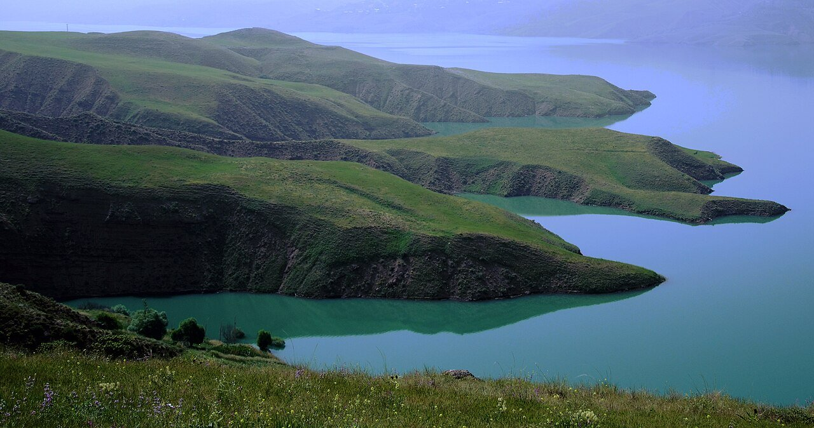

Amidst the wind-whipped, snow-crested ramparts of the Taleqan Valley in Alborz province, weathered limestone crags emerge that uncannily resemble the petrified severed heads of primeval titans. Elders of the ancient village of Hasanjoon in Upper Taleqan preserve the legend of the *Heavy-Headed Div* (*Div-e Sangin-Sar*)—a colossal mountain giant whose cranium was as dense as a granite peak, his shoulders forged from solid basalt.

Tati oral lore relates that due to the unbearable weight of his massive stone skull, the Div could never walk upright, instead traversing the precipitous ridges on all fours like a colossal mountain beast. Dwelling in high caverns overlooking the valley, he commanded the alpine blizzard passes. Shaking his colossal head triggered devastating winter avalanches that sealed off communications between the valleys. He extorted flour and livestock from the mountaineers, threatening to ram his skull against the mountain roots to unleash earthquakes upon the settlements. Ultimately, legendary Tati heroes lured the giant with boiling syrup, tricking him into plunging his brow into a cold subterranean spring, which petrified his skull into the monumental boulder that still gazes down upon the Taleqan reservoir.

> "Lean not against the leaning boulders of Hasanjoon; the Heavy-Headed Div rests his brow against the mountain roots, and whoever shouts into the wind awakens the sleeping avalanches." — Adage of Taleqan shepherds.

Geographer Dr. Manouchehr Sotoudeh in *From Astara to Astarabad* notes that this legend reflects the reality of seismic faults and catastrophic rockfalls in the central Alborz. The anthropomorphic weathering of Taleqan's limestone cliffs fueled local mythology, intertwining natural hazards with heroic folklore. Today, standing upon the high ridgelines of Taleqan, the colossal stone silhouettes emerging from the alpine fog evoke the ageless struggle between highland mortals and the mountain giants.

### Sources & Image Attribution
- **Research Source:** Manouchehr Sotoudeh, *From Astara to Astarabad*, Tehran, Vol. 3, pp. 219-225; Tati Dialect and Mythological Field Notes, Academy of Persian Language and Literature.
- **Image Attribution:** Documented on Wikimedia Commons by Alireza Javaheri; License: [CC BY 3.0](https://commons.wikimedia.org/wiki/File:Iran_-_Alborz_-_Taleghan_Lake_-_panoramio.jpg).
