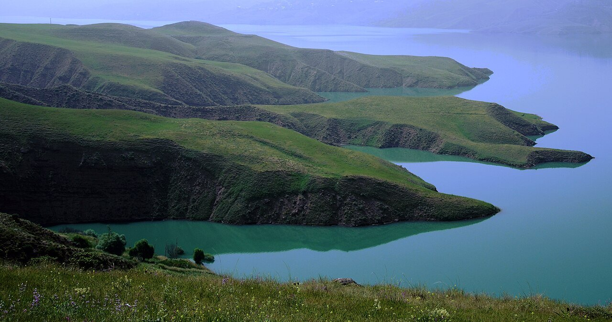

در کوهستان‌های سرکش و برف‌گیر دره طالقان در استان البرز، صخره‌های مرتفعی قرار دارند که به شکلی شگفت‌انگیز به صورت سرهای بریده و غول‌آسای انسانی در سنگ خاره تراشیده شده‌اند. مردم کهنسال روستای حسنجون و بالا‌طالقان از دیوی اسطوره‌ای به نام «دیو سنگین‌سر» یاد می‌کنند؛ موجودی عظیم و خاره‌تراش از نسل دیوان البرز که کله‌اش به سنگینی یک قله کوه و تنش از تخته‌سنگ‌های گرانبار بود.

روایت تاتی طالقان بازگو می‌کند که دیو سنگین‌سر به دلیل سر سنگین و غول‌پیکرش، هرگز توان ایستادن کامل بر دو پای خود را نداشت و به ناچار چهار دست و پا بر یال‌های کوهستان راه می‌رفت. او فرمانروای گردنه‌ها و برف‌کوه‌های طالقان بود و در غاری مشرف به دریاچه طالقان می‌زیست. این دیو با هر تکان دادن سر سنگین خویش، بهمن‌های سهمگین برف را به دره فرومی‌ریخت و راه‌های ارتباطی را می‌بست. او از روستاییان خراج سنگ و آرد می‌طلبید و تهدید می‌کرد که اگر فرمانش برده نشود، سر خود را بر سینه کوه خواهد کوبید تا زلزله‌ای مهیب تمام روستاهای دره را ویران سازد. سرانجام پهلوانان کهن طالقان با ریختن دوشاب داغ و فریب دادن دیو، او را در پای صخره‌ها به خوابی ابدی فرو بردند و سرش به تخته‌سنگی عظیم بدل شد که امروزه نیز تماشاگر دریاچه است.

> «در گذرگاه حسنجون به صخره‌های سنگین تکیه مزن؛ دیو سنگین‌سر سر بر بالین کوه نهاده و هر که فریاد بیهوده برآرد، خواب صخره را بر هم خواهد زد.» — پند چوپانان طالقان در پای قله شاه‌البرز.

دکتر منوچهر ستوده در جلد سوم اثر ماندگار خویش «از آستارا تا استارباد» یادآور می‌شود که این افسانه‌ها ریشه در زمین‌شناسی کوهستانی و زمین‌لغزش‌های تاریخی دره طالقان دارند. شکل خاص فرسایش صخره‌های آهکی طالقان که شبیه چهره‌های غول‌پیکر درآمده است، ذهن خلاق مردمان بومی را برانگیخته تا پیوندی میان پدیده‌های طبیعی و اسطوره‌های دیوان شاهنامه برقرار سازند.

امروزه با ایستادن بر فراز گردنه‌های طالقان و تماشای دریاچه لاجوردی سد، پیکره‌های سنگی غول‌آسا همچنان در مه‌های سپید پنهان و آشکار می‌شوند؛ یادگاری از نبرد دلاوران تات با دیوان کوهستان.

چوپانان حسنجون و دره طالقان باور دارند که در شب‌های چله زمستان، هنگامی که زوزه باد در شکاف کوه‌ها طنین می‌افکند، صدای نفس‌های سنگین دیو در دل صخره‌ها به گوش می‌رسد. مردم تات با نقل این افسانه‌ها در کنار کرسی‌های گرم، شجاعت نیاکان خویش را در مهار دیوان خاره‌تراش به نسل‌های نو یادآوری می‌کردند و پیوند عاطفی عمیقی میان جوانان و کوهستان‌های سرکش البرز برقرار می‌ساختند.

### منابع و اعتبار تصویر
- **منبع پژوهشی افسانه:** منوچهر ستوده، «از آستارا تا استارباد»، تهران، جلد ۳، ص ۲۱۹-۲۲۵؛ یادداشت‌های گویشی و اساطیری طالقان، فرهنگستان زبان و ادب فارسی.
- **اعتبار تصویر:** ثبت‌شده در ویکی‌مدیا کامنز توسط Alireza Javaheri؛ مجوز انتشار: [CC BY 3.0](https://commons.wikimedia.org/wiki/File:Iran_-_Alborz_-_Taleghan_Lake_-_panoramio.jpg).
