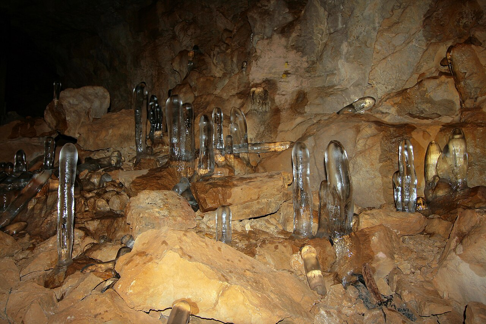

در ارتفاعات مه‌آلود جاده چالوس و در حوالی روستای تاریخی کهنه‌ده گچسر در استان البرز، دهانه غاری اسرارآمیز در سینه صخره باز شده است که به «غار یخ‌مراد» آوازه دارد. این غار کم‌نظیر، برخلاف اکثر غارها که از چکیده‌های آهکی شکل گرفته‌اند، تالارهایی سرشار از قندیل‌ها، ستون‌ها و آبشارهای یخچالی کاملاً شفاف دارد که در دل ماه‌های سرد سال به اوج زیبایی می‌رسند. در باورهای بومی و دیرپای مردم تات‌زبان البرز، این ستون‌های کریستالی پدیده‌ای صرفاً اقلیمی نیستند؛ بلکه قندیل‌هایی معجزه‌آسا و مقدس‌اند که «مراد» دل نیازمندان را برآورده می‌سازند و چشمه‌های جاودانگی را در سینه کوه البرز پاسداری می‌کنند.

کهنسالان کهنه‌ده روایت می‌کنند که در اعماق تاریک غار، پری زیبارویی به نام «پری یخ‌زاد» بر تختی از بلور شفاف جلوس کرده است. این پری نگهبان سرچشمه آبی است که از برفاب‌های کهن توچال و البرز مرکزی تغذیه می‌شود. در باور بومیان، هر قطره آبی که از سقف غار می‌چکد و در هوا منجمد می‌شود، حاصل نیت پاک و استجابت دعای مادری دردمند است. در گذشته، زنان نازا یا بیماران رنجور در اسفندماه و اوایل فروردین با پای پیاده و چراغ‌موشی به دهلیزهای غار می‌آمدند، تکه‌ای یخ شفاف را به نیت تبرک می‌مکیدند یا بر پارچه‌ای می‌بستند تا بیمارشان شفا یابد.

> سالخوردگان تات همواره به جوانان سفارش می‌کردند: «قندیل‌های یخ‌مراد را نشکنید و آبشارهای بلور را آلوده نسازید؛ نیت پاک مراد می‌دهد و شکستن قندیل‌ها قهر سرمای کوهستان را بیدار می‌کند.»

افسانه‌ها می‌گویند چوپانی مهربان در شبی سخت که گله‌اش در برف گم شده بود، به درون غار پناه برد. او در سرمای کشنده در آستانه انجماد بود که پری یخ‌زاد با مشعلی از نور سبز بر او پدیدار گشت، پیاله‌ای از آب چشمه یخ‌بسته به او نوشاند و جانش را گرما بخشید؛ بامدادان چوپان در کمال شگفتی دید که تمام گوسفندانش سالم در پای غار جمع شده‌اند. مردم روستاهای گچسر و آزادبر هنوز هم با فرارسیدن بهار، به یاد پری مهربان یخ‌مراد، بر شاخه‌های درختان کهنسال دهانه غار دخیل‌های سپید می‌بندند. دالان‌های پرپیچ‌وخم غار یخ‌مراد با فسیل‌های باستانی مرجان‌های دریایی بر سقف صخره‌ها، یادآور روزگاری است که البرز در اعماق اقیانوس‌های کهن آرمیده بود و امروز به کوهساری پربرف بدل گشته است. بومیان باور دارند که آب این قندیل‌ها در هنگام تحویل سال نو، نوری زمردین از خود ساطع می‌کند که هر دانه گندم در مجاورت آن صد دانه برکت می‌آورد. غار یخ‌مراد با دخمه‌های چندطبقه و تالارهای بلورینش، گواهی زنده بر باور عمیق انسان کوهستان‌نشین به نیروهای التیام‌بخش و پاک‌کننده طبیعت در پهنه البرز است.

### منبع روایت و تصویر
- **خاستگاه افسانه:** تاریخ شفاهی و باورهای عامیانه مردم تات‌زبان روستای کهنه‌ده و گچسر در استان البرز، پژوهش‌های مردم‌شناسی روستاهای البرز مرکزی.
- **عکاس / پدیدآورنده تصویر:** Mostafameraji
- **منبع تصویر:** [صفحه تصویر در ویکی‌انبار](https://commons.wikimedia.org/wiki/File:Caves_in_Iran,_Yakh_Morad_Cave,_%D8%BA%D8%A7%D8%B1_%DB%8C%D8%AE_%D9%85%D8%B1%D8%A7%D8%AF_%D8%AF%D8%B1_%D8%AD%D9%88%D8%A7%D9%84%DB%8C_%D8%B1%D9%88%D8%B3%D8%AA%D8%A7%DB%8C_%D8%A2%D8%B2%D8%A7%D8%AF%D8%A8%D8%B1_%D9%88_%DA%A9%D9%87%D9%86%D9%87_%D8%AF%D9%87_01.jpg)
- **نوع مجوز:** CC BY-SA 4.0
