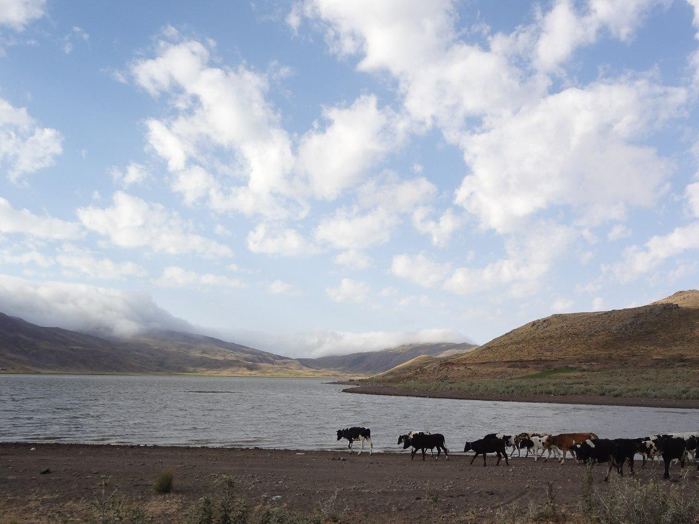

Straddling the mountainous boundary between Ardabil and Gilan, cradled at an elevation of 2,500 meters amidst the cloud-capped crests of the Talesh range, lies the freshwater expanse of *Lake Neor*. Flanked by lush alpine summer pastures, this lake freezes into an impenetrable sheet of solid ice during sub-zero winters. In the ancient folklore of the Shahsevan nomadic confederacy and the highland Taleshi pastoralists, Neor is celebrated as the lair of the *Dragon of the Black Waters*—a colossal aquatic leviathan clad in obsidian scales and leathery wings.

Taleshi and Shahsevan oral lore relates that in ancient times, Lake Neor was an abyssal conduit to the underworld over which the dragon coiled in tyrannical dominion. At twilight, the leviathan surfaced, venting sulfurous exhalations that spawned impenetrable mists across the mountain defiles, disorienting caravaneers traversing the pass between Sabalan and the Caspian Sea. The monster was finally trapped when a heroic Shahsevan chieftain deceived the beast by baiting it with a bull carcass impregnated with molten pitch; upon swallowing the bait, the searing pitch burned the beast from within, binding it in eternal slumber beneath the lake floor. The booming cracks echoing across Neor's frozen surface each winter are believed to be the muffled writhing of the bound dragon.

> "Venture not near the black water on foggy nights at Neor; the cracking of the ice is the groan of the dragon bound beneath the boulders, hungering for lost wanderers." — Warning of Shahsevan elders in Baqerlou pastures.

Eminent ethnographer Gholam-Hossein Sa'edi in *Khiav or Meshgin-Shahr* and Jaber Anassori observe that the Neor dragon myth personifies the lethal cold, sudden disorienting highland blizzards, and acoustic shockwaves of expanding lake ice that once endangered nomadic pastoralists. Today, the crystalline sapphire mirror of Lake Neor remains steeped in this ancient mythological awe.

### Sources & Image Attribution
- **Research Source:** Gholam-Hossein Sa'edi, *Khiav or Meshgin-Shahr*, Tehran: Amir Kabir, pp. 98-104; Jaber Anassori, *Myths and Indigenous Beliefs of Sabalan and Sahand*, p. 73.
- **Image Attribution:** Documented on Wikimedia Commons by Elajan; License: [CC BY-SA 4.0](https://commons.wikimedia.org/wiki/File:Neor.jpg).
