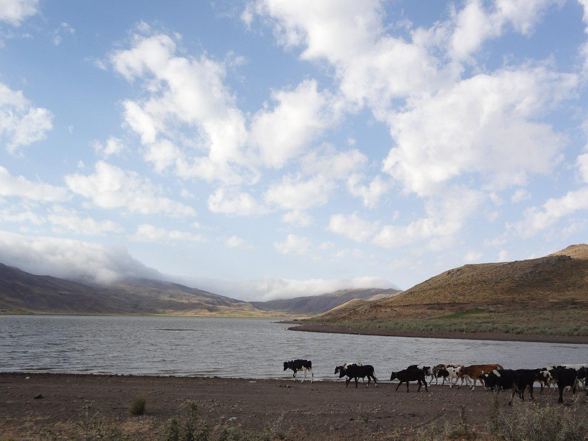

در مرز کوهستانی میان اردبیل و گیلان، بر فراز دامنه‌های مه‌آلود رشته‌کوه طالش در ارتفاع ۲۵۰۰ متری، دریاچه آب شیرین «نئور» در میان مراتع سرسبز ییلاقی چون جام بلورین گسترده شده است. این دریاچه زیبا در زمستان‌ها زیر لایه‌ای نفوذناپذیر از یخ‌های ضخیم به خوابی عمیق فرومی‌رود. در افسانه‌های کهن عشایر شاهسون و تالشان دامدار، نئور خاستگاه یکی از هولناک‌ترین هیولاهای آب شیرین در شمال غرب ایران یعنی «اژدهای سیاه‌آب نئور» شناخته می‌شود.

روایت‌های کهن بازگو می‌کنند که دریاچه نئور در گذشته‌های دور، چشمه‌ای بی‌پایان از جهان زیرزمین بود که اژدهایی عظیم با پوستی از پولک‌های سیاه‌رنگ و بال‌هایی چرمین بر آن چنبره زده بود. این اژدها شبانگاهان از آب‌های یخ‌بندان سر بیرون می‌آورد و با تنفس دودآلود خود، مه‌های سنگینی پدید می‌آورد که چوپانان و کاروانیان گردنه سبلان به تالش را گمراه می‌ساخت. او اسب‌ها و گوسفندان دورافتاده از گله را به کام خویش فرو می‌برد. سرانجام پهلوانی از ایل شاهسون با بستن زنگوله‌های زرین به شاخ‌های گاو نری نیرومند و آغشتن پوست آن به قیر مذاب، اژدها را فریب داد؛ اژدها گاو را بلعید و قیر گداخته دل و روده او را بسوخت، به گونه‌ای که اژدها در اعماق تاریک دریاچه به بند کشیده شد و تنها تنفس او در زمستان‌ها سبب ترک خوردن یخ‌های دریاچه با صدای انفجار مانند می‌گردد.

> «در شب‌های مه‌آلود نئور، کنار سیاه‌آب نروید؛ صدای غرش یخ‌ها، ناله اژدهایی است که در بند سنگ‌های قعر دریاچه می‌پیچد و در آرزوی صید مسافری دیگر بیدار است.» — هشدار عشایر ایل شاهسون در ییلاقات باقرلو.

غلامحسین ساعدی در کتاب ارزشمند «خیاو یا مشکین‌شهر» و جابر عناصری در «اساطیر و باورهای بومی سبلان و سهند» یادآور می‌شوند که اسطوره اژدهای نئور، بازتابی از طبیعت فوق‌العاده سهمگین کوهستان طالش، پدیده رعدآسای شکستن لایه‌های یخ در زمستان و مه‌های ناگهانی کشنده است که در گذشته جان ده‌ها رمه‌دار را می‌گرفته است. این اسطوره‌ها به عنوان زنگ هشداری طبیعی، مسافران را از نزدیک شدن به لبه‌های لغزنده دریاچه در سرما بازمی‌داشته‌اند.

امروزه آرامش فیروزه‌ای دریاچه نئور در فصل بهار با پرواز پرندگان مهاجر، تصویری کارت‌پستالی خلق می‌کند؛ اما در ژرفای باور کهنسالان منطقه، یاد اژدهای باستانی هنوز زنده است.

### منابع و اعتبار تصویر
- **منبع پژوهشی افسانه:** غلامحسین ساعدی، «خیاو یا مشکین‌شهر»، تهران، انتشارات امیرکبیر، ص ۹۸-۱۰۴؛ جابر عناصری، «اساطیر و باورهای بومی سبلان و سهند»، ص ۷۳.
- **اعتبار تصویر:** ثبت‌شده در ویکی‌مدیا کامنز توسط Elajan؛ مجوز انتشار: [CC BY-SA 4.0](https://commons.wikimedia.org/wiki/File:Neor.jpg).
