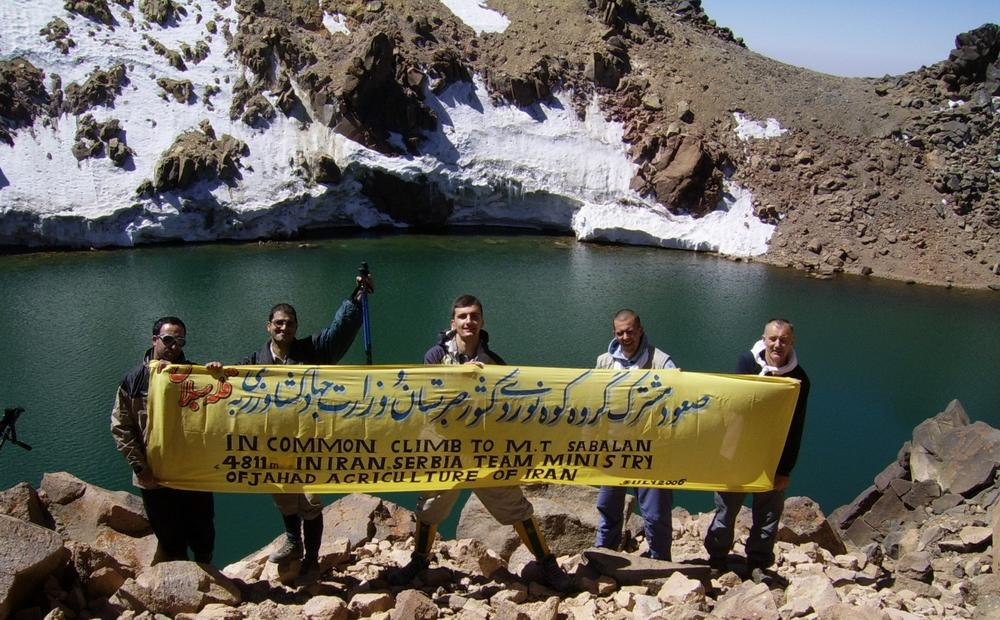

کوهستان شکوهمند سبلان (ساوالان) در خطه اردبیل، از دیرباز در اسطوره‌های آذربایجان مکانی ورجاوند و خاستگاه پاک‌ترین باورهای حماسی و عرفانی بوده است. در قله این آتشفشان خاموش، دریاچه‌ای فیروزه‌ای و یخی همچون نگینی درخشان در آغوش دیواره‌های سنگی آرام گرفته است. اما بر یال‌های منتهی به قله و در نزدیکی پناهگاه شرقی، صخره‌ای شگفت‌آور و سترگ به شکل عقابی تیزچشم ایستاده است که در زبان بومیان «قارتال داشی» (سنگ عقاب) نامیده می‌شود؛ عقابی که سر به سوی مشرق چرخانده و گویی هزاران سال است دیده از افق برنمی‌گیرد تا راز دریاچه دهانه کوه را پاسداری کند. بال‌های سنگی این تندیس طبیعی در گذر هزاره‌ها با سرما و طوفان‌های سهمگین آبدیده شده و هیبتی شگفت‌آور به آن بخشیده است.

در منظومه فولکلور مردم اردبیل، مشگین‌شهر و سرعین، سبلان تنها یک کوه نیست، بلکه پیکر سنگی پهلوانی باستانی و معبد پیامبران کهن است. روایت می‌کنند که در اعماق یخ‌بسته دریاچه قله، اژدهایی مهیب و آتش‌نفس خفته است که روزگاری از تپه‌های سوزان قفقاز به سوی دشت مغان تاخت تا چشمه‌های آب زلال و رمه‌های ایلاتی را بسوزاند. زرتشت یا پهلوانی پاک‌نهاد با نیایش به درگاه پروردگار، اژدها را با تازیانه‌ای از یخ و صاعقه به کام دهانه کوه فرستاد و آب گوگردین آن را منجمد ساخت. برای آنکه این اژدها هرگز سر از خاک برنیاورد، عقاب تیزپرواز کوهستان سوگند خورد که تا پایان جهان بر یال قله بنشیند؛ عقاب با نگاه نافذ خویش به سنگ بدل شد تا طلسم نگاهبانی هرگز با گردش ایام نشکند.

> پیران ایلات شاهسون می‌گویند: «هر پاییز که باد تند ساوالان می‌وزد و دریاچه یخ می‌بندد، صدای غرش خفه‌ای از ژرفای کوه برمی‌خیزد؛ این اژدهاست که جابه‌جا می‌شود و قارتال داشی بال‌های سنگی‌اش را در باد سفت‌تر می‌کند.»

بومیان باور دارند کسانی که پاک‌دل باشند و به نیت زیارت خاک ساوالان از دامنه‌ها بالا روند، نسیم دل‌انگیزی را حس خواهند کرد که خستگی را از تن می‌زداید و آب چشمه‌های گوگردی پایین کوه بیماری‌های ریشه‌دارشان را درمان می‌بخشد؛ اما اگر کسی با نیتی پلید یا با سودای شکستن صخره‌ها پا به حریم قله بگذارد، چشمان قارتال داشی در مه خاکستری رنگ خون به خود می‌گیرد، تگرگی مرگبار آغاز می‌شود و غباری تیره راهپیمایان را به گرداب پرتگاه‌ها می‌کشاند. عشایر ایل شاهسون هنوز هم هنگام کوچ به ییلاقات ساوالان، به قله کوه سلام می‌دهند و تکه‌ای نان نذر سلامتی گله‌ها می‌نمایند. سبلان با عقاب سنگی پاسدارش، مظهر ابدی ایستادگی، تقدس و رازهای سربه‌مهر اساطیر کهن آذربایجان است.

### منبع روایت و تصویر
- **خاستگاه افسانه:** اسطوره‌شناسی شفاهی ایلات شاهسون و مردم آذربایجان پیرامون قارتال داشی و تقدس کوه ساوالان، پژوهش‌های فولکلور اردبیل.
- **عکاس / پدیدآورنده تصویر:** هیئت کوهنوردی ایران و صربستان (Crn)
- **منبع تصویر:** [صفحه تصویر در ویکی‌انبار](https://commons.wikimedia.org/wiki/File:Joint_Serbian_and_Iranian_expedition_celebrates_at_top_of_Mount_Sabalan.jpg)
- **نوع مجوز:** Public Domain
