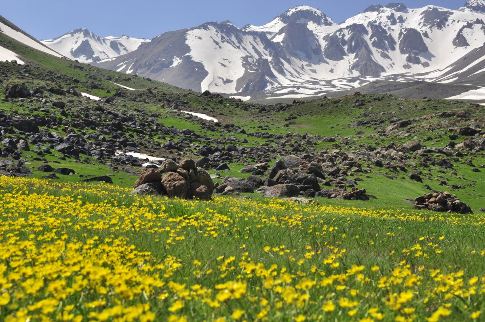

High upon the sacred, snow-crowned volcanic ridge of Mount Sabalan (Savalan) in Ardabil province, where a turquoise crater lake reflects the northern skies, three towering basalt pillars overlook the abyssal chasms. Known locally as *Uch Qardash* (meaning "The Three Brothers" in Azerbaijani Turkish), these natural monoliths hold a consecrated place in regional folklore as the eternal guardians of the mountain's sanctity.

According to regional legends recounted by mountain herders, a massive invading horde once swept across the plains of Azerbaijan, burning nomad camps and driving surviving herds into the highlands. With the tribal warriors fallen in the lowlands, three shepherd brothers—Sohrab, Bahram, and Aslan—vowed atop the sacred peak to halt the advancing vanguard at all costs. Armed only with composite hunting bows and deep knowledge of the volcanic scree, they fortified the narrow rocky defile leading to the high refuges.

> As the elders of Meshgin Shahr sing in their traditional ballads: "The summit of Savalan is wreathed in clouds, salute the honor of the Three Brothers; even the stones of this sacred earth form a fortress against betrayal."

For three continuous days and nights, the brothers rained arrows down onto the treacherous pass, neutralizing wave after wave of attackers. When their quivers ran empty and their bodies were riddled with enemy javelins, they linked arms and bowed toward the mountain summit, beseeching the Creator to transform them into an everlasting barrier so the defilers might never tread upon their ancestral soil. As thunder shook the tectonic fissures of Sabalan, the heavens granted their petition; the flesh and bone of the three heroes hardened into three colossal stone towers. Paralyzed by the supernatural apparition and the unyielding basalt barrier, the enemy forces broke rank and fled in terror. To this day, the three petrified sentinels stand unmovable above the clouds, symbolizing eternal brotherhood and protective sacrifice.

### Anthropological & Folklore Analysis
The narrative embodies classic geomythological motifs, specifically petrification (*lithification*) as an expression of divine intervention and communal self-sacrifice. It illustrates the sacral status of Mount Sabalan across northwestern Iran as an altar of spiritual purity and an active mythological agent safeguarding regional autonomy.

### Archival Sources & Attribution
- **Primary Source:** Folklore and Mythological Studies of Savalan, Elchin Kitab & Savalanport Cultural Research Archive.
- **Source URL:** https://elchinkitab.niloblog.com/p/83/%D8%A7%D9%88%DA%86-%D9%82%D8%A7%D8%B1%D8%AF%D8%A7%D8%B4-%D8%AF%D8%A7%D8%BA%DB%8C%D9%86%DB%8C%D9%86-%D8%A7%D9%81%D8%B3%D8%A7%D9%86%D9%87%D8%B3%DB%8C%D9%86%D9%87-%D8%A8%DB%8C%D8%B1-%D8%A8%D8%A7%D8%AE%DB%8C%D8%B4
- **Original Language:** Azerbaijani Turkish & Persian
- **Image Attribution:** File:Beautiful mountains كوهستان زيبا - panoramio.jpg | Photographer: Farid Atar | License: CC BY 3.0
