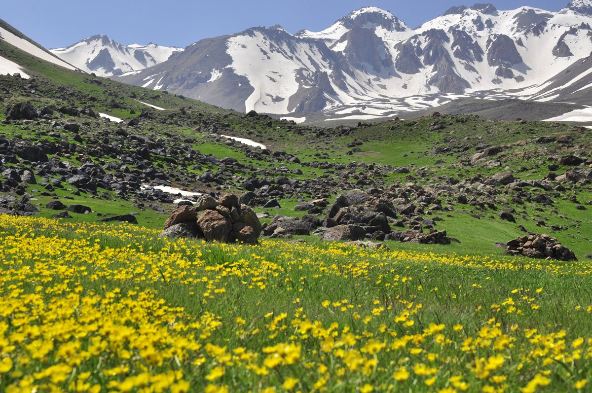

بر فراز قله سپیدپوش و پرهیبت سبلان (ساوالان)، آنجا که دریاچه نیلگون دهانه آتشفشان آینه آسمان آذربایجان می‌شود، سه صخره سنگی عظیم و سر به فلک کشیده بر لبه تیغه‌های یخی استوار ایستاده‌اند که در زبان بومی «اوچ قارداش» (Üç Qardaş به معنای سه برادر) نامیده می‌شوند. در اسطوره‌شناسی اردبیل و مشگین‌شهر، سبلان تنها یک کوه نیست، بلکه جایگاه نزول وحی، سکونتگاه پیامبر باستانی و مامن ارواح پاکی است که سوگند دفاع از سرزمین مادری را یاد کرده‌اند.

افسانه از روزگارانی سخن می‌گوید که لشکری گران از بیگانگان بی‌رحم برای تاراج مراتع و به بند کشیدن ساکنان دامنه‌های سبلان به این منطقه تاختند. پهلوانان نامدار ایل به شهادت رسیده بودند و دشمن با شتاب به سمت آخرین پناهگاه کودکان و دام‌ها پیش می‌رفت. در این میان، سه برادر چوپان به نام‌های «سهراب»، «بهرام» و «اسلان» که از کودکی در شیب‌های سنگی سبلان رمه چرخانده بودند و به پیچ‌وخم دره‌ها آگاهی داشتند، کمان‌های خویش را برگرفتند و در باریک‌ترین گردنه صخره‌ای راه را بر سپاهیان مهاجم بستند.

> کهنسالان مشگین‌شهر در ستایش این کوهستان چنین زمزمه می‌کنند: «ساوالان باشی دوماندیر، اوچ قارداش قاداسین آلیم؛ بو تورپاغین داشلاری دا نامرد قارشیسیندا دیواردیر.» (قله سبلان را مه فرا گرفته است، درود بر غیرت سه برادر؛ سنگ‌های این خاک نیز در برابر نامردان سدی نفوذناپذیرند).

سه برادر به مدت سه شبانه‌روز با تیرهای مرگبار خود مانع از پیشروی سپاه انبوه شدند. هر بار که گروهی از مهاجمان تلاش می‌کردند از دیواره صخره‌ای بالا بیایند، در تیررس دقیق برادران هلاک می‌شدند. اما در شامگاه روز سوم، باران تیر و زوبین تن رنجور برادران را شکافت و تیردان‌هایشان تهی شد. در آن لحظات واپسین، سه برادر دست در دست هم نهادند، رو به قله مقدس سبلان سجده بردند و از خداوند خواستند تا تن آنان را به سدی جاودانه بدل سازد تا هرگز پای متجاوزان به حریم امن قله نرسد. دعای خالصانه آنان در میان آذرخش‌های سهمگین کوهستان مستجاب شد؛ کالبد سه برادر به سه ستون سنگی سترگ و نفوذناپذیر بدل گشت و هیبت سنگین آنان لرزه بر اندام مهاجمان انداخت و آنان را وادار به عقب‌نشینی کرد. از آن دوران تا به امروز، اوچ قارداش نگهبانان ابدی سبلان شناخته می‌شوند.

### بن‌مایه‌ها و ویژگی‌های مردم‌شناختی
افسانه اوچ قارداش نمونه‌ای عالی از «زمین‌اسطوره‌شناسی» (Geomythology) و تقدس کوه‌ها در فرهنگ اقوام آلتاییک و قفقازی است. تجسم فداکاری برادران، دگرگونی انسان به سنگ (Petrification motif) برای نجات قبیله، و پیوند میان قداست معنوی سبلان با مقاومت در برابر هجوم بیگانگان، ساختار اصلی این باور عامیانه را تشکیل می‌دهد.

### منابع و پژوهش
- **منبع اصلی:** افسانه اوچ قارداش داغی، بررسی‌شده در پورتال پژوهشی ادبیات و فولکلور ساوالان و آرشیو ائلچین کیتاب.
- **پیوند مرجع:** https://elchinkitab.niloblog.com/p/83/%D8%A7%D9%88%DA%86-%D9%82%D8%A7%D8%B1%D8%AF%D8%A7%D8%B4-%D8%AF%D8%A7%D8%BA%DB%8C%D9%86%DB%8C%D9%86-%D8%A7%D9%81%D8%B3%D8%A7%D9%86%D9%87%D8%B3%DB%8C%D9%86%D9%87-%D8%A8%DB%8C%D8%B1-%D8%A8%D8%A7%D8%AE%DB%8C%D8%B4
- **زبان اصلی متن:** ترکی آذربایجانی و فارسی
- **تصویر:** File:Beautiful mountains كوهستان زيبا - panoramio.jpg | عکاس: Farid Atar | مجوز: CC BY 3.0
