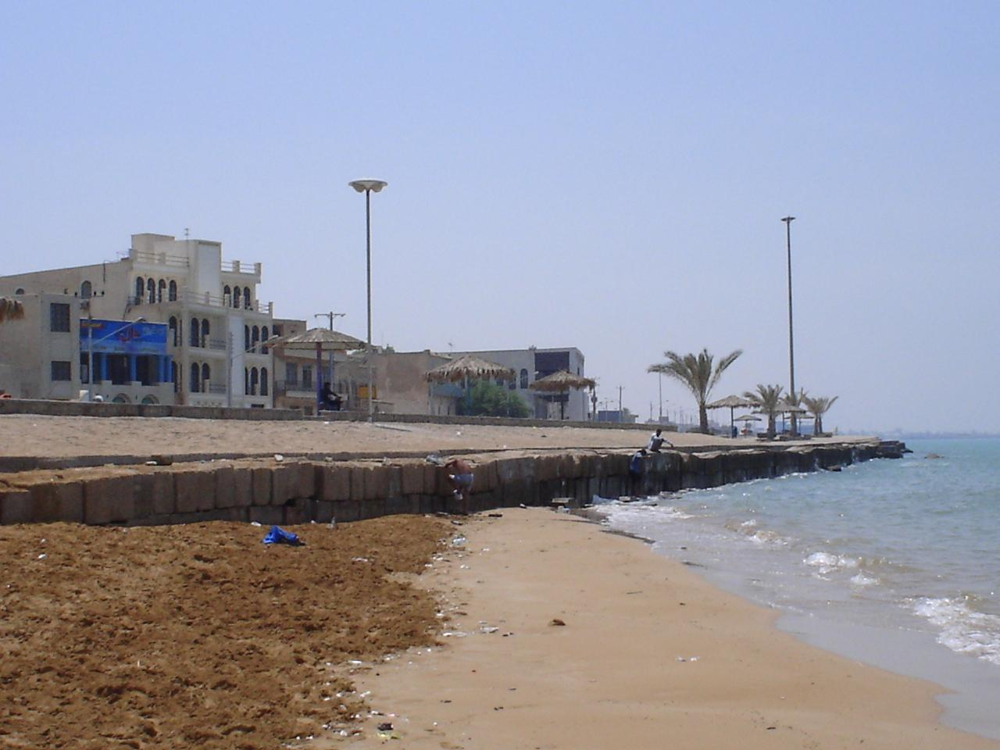

در کرانه‌های گرم و آفتاب‌سوخته بندر بوشهر، آنجا که آب‌های نیلگون خلیج فارس بر صخره‌های باستانی ریشهر سیلی می‌زنند و جهازات چوبی لنج با نوای «شروه» و «یزله» بر موج‌ها می‌رقصند، افسانه‌ای کهن و دلهره‌آور در میان جاشوها و ناخدایان سینه به سینه نقل می‌شود: افسانه «بوسلامه» (یا بوسلامه دریا). در باورهای دریانوردان بوشهر، بوسلامه موجودی هیولایی، دوزیست و بسیار حیله‌گر است که در اعماق تاریک آب‌ها و غارهای زیرآبی صخره‌های ساحلی خانه دارد و مسافران شبانه دریا را به ورطه نابودی می‌کشاند. این موجود نماد هراس پنهان ناخداها از گرداب‌های سهمگین کاروانی و رازهای سربه‌مهر قعر اقیانوس است که با هر جذر و مد خودنمایی می‌کند.

ناخدایان کهنسال روایت می‌کنند که بوسلامه پوستی تیره، لزج و پوشیده از خزه دریایی دارد؛ هیکل او شبیه پیرمردی غول‌پیکر با ریشی از جلبک و چشمانی چون دو چراغ زرد درخشان است. این موجود مرموز در شب‌های طوفانی یا در ساعاتی که مه دریا (شَرجی) دید ساحل را کور می‌کند، بر تنه آب‌نشسته لنج‌ها ظاهر می‌شود. او ابتدا خود را چون طفلی غرق‌شده یا انسانی درمانده نشان می‌دهد که بر روی تخته‌پاره‌ای دست تکان می‌دهد؛ اما همین که ملوانان برای نجات او به لبه عرشه نزدیک می‌شوند یا قایقی کوچک به آب می‌اندازند، بوسلامه با قهقه‌ای کرکننده تغییر شکل می‌دهد، قایق را واژگون می‌سازد و ملوان را با دست‌های پره‌دارش به ژرفای گرداب‌ها فرومی‌برد.

> جاشوهای بوشهری هنگام ترک اسکله در تاریکی می‌خوانند: «از بوسلامه بپرهیزید، به صدای گریه روی آب اعتنا نکنید و تا طلوع آفتاب چشمانتان را به فانوس دکل بدوزید.»

در روایت‌های دیگر مردم ریشهر و هلیله آمده است که بوسلامه گاه در هیبت حیوانی عجیب با اندام نیمه‌آدمی و نیمه‌ماهی در کنار ساحل صخره‌ای پرسه می‌زند و کسانی را که شب‌هنگام به تنهایی در دریا شنا می‌کنند غافلگیر می‌نماید. با این حال، دریانوردان باتجربه می‌دانستند که بوسلامه از بوی آهن گداخته و نور آتش به‌شدت می‌هراسد؛ از این رو در لنج‌های بادبانی همواره آتشدانی از زغال افروخته آماده داشتند تا اگر سایه شوم او بر بدنه کشتی افتاد، با پرتاب اخگرهای آتشین او را فراری دهند. صیادان قدیمی با ریختن مقداری خرما و نان در آب، از ارواح نیک آب‌ها مدد می‌خواستند تا قایق‌هایشان از چنگال بوسلامه در امان بماند و دریا روزی حلال را از آنان دریغ نکند. بوسلامه، تجسم هراس دریانوردان از ژرفای پیش‌بینی‌ناپذیر خلیج فارس و نماد احترام عمیق مردمان جنوب به هیبت خاموش و سحرانگیز دریا است که در امواج بوشهر طنین دارد.

### منبع روایت و تصویر
- **خاستگاه افسانه:** باورهای بومی و فرهنگ عامه دریانوردان و صیادان بندر بوشهر و کرانه‌های خلیج فارس، پژوهش‌های شروه‌خوانی و فولکلور ساحل‌نشینان.
- **عکاس / پدیدآورنده تصویر:** Robert Wielgórski (Barry Kent)
- **منبع تصویر:** [صفحه تصویر در ویکی‌انبار](https://commons.wikimedia.org/wiki/File:Bushehr_Barry_Kent.JPG)
- **نوع مجوز:** CC BY 2.5
