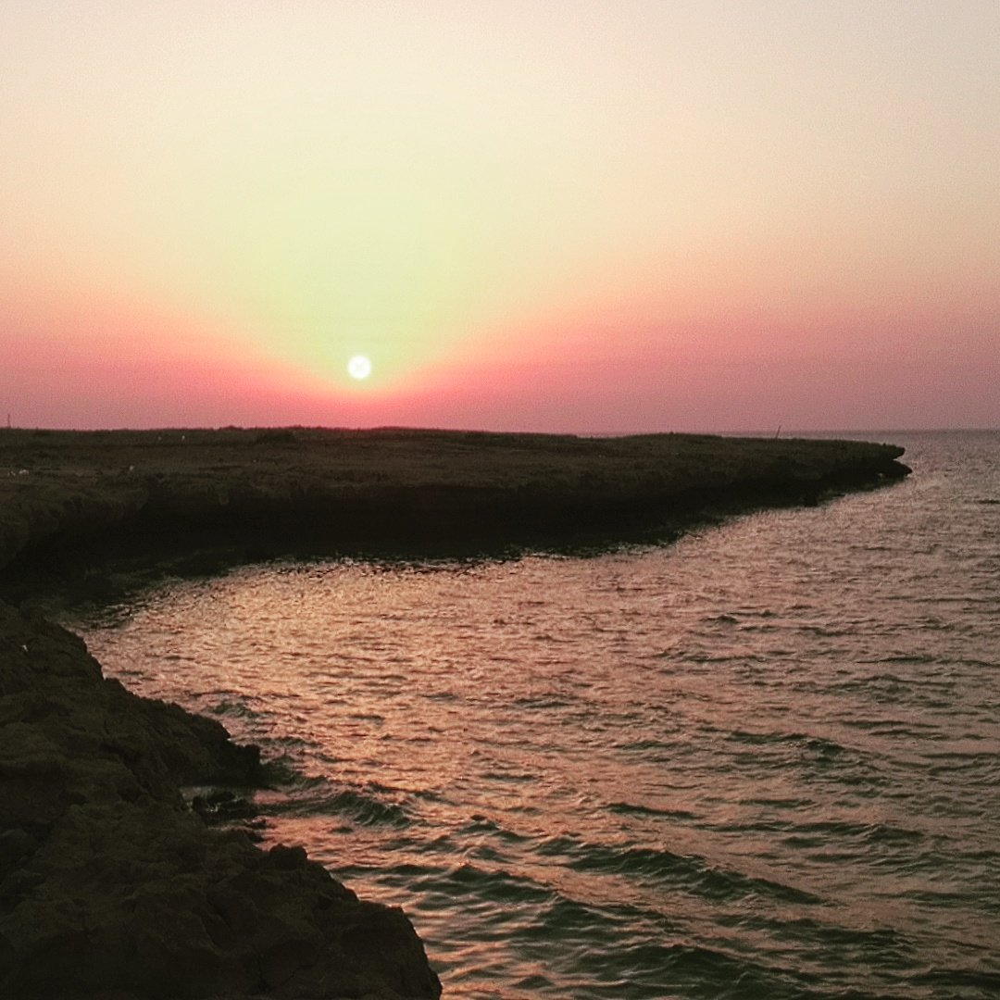

Amidst the tranquil turquoise coves of Nayband Bay along the rugged coastline of Bushehr province, maritime elders speak with dread of the *Boosalameh*—a shapeshifting aquatic fiend notorious for its cunning masquerades. Emerging from the undulating swells, the Boosalameh can assume the form of a floating driftwood log, a majestic sea turtle, a captivating maiden with pearls woven into her flowing tresses, or even the visage of a long-lost drowning shipmate. It calls sailors by their true birth names, enticing them toward the watery verge.

The moment an unwary fisherman leans over the gunwale or dips his hand beneath the foam, the Boosalameh sheds its alluring illusion. Revealing a slick, scaled body armed with razor-sharp talons and needle-like teeth, it drags its paralyzed victim into the churning undertows of Nayband. Lore among the elders of Asaluyeh recounts that this aquatic demon devours the vitality of its quarry, stranding the unblemished, lifeless corpse upon the coral reefs days later.

> "Whoever hears his name whispered by the whitecap waves must instantly strike steel upon the timber of the boat; Boosalameh flees the flash of iron, but feasts on human doubt." — Ancient maritime proverb of Bushehr.

Folklorist Dr. Seyed Jafar Hamidi notes in the *Bushehr Encyclopedia* that the Boosalameh represents a Persian Gulf parallel to the classical Hellenic Sirens, deeply attuned to the treacherous coral currents and whirlpools of the coastline. Historically, Nayband Bay’s unpredictable sub-surface undertows were deadly to traditional pearl divers. Belief in the Boosalameh served as an essential psychological safeguard, cautioning pearl divers against sensory illusions brought on by hypoxia and exhaustion. To this day, crews invoking divine protection whisper ancient maritime incantations before casting nets into the fathomless depths of Nayband.

### Sources & Image Attribution
- **Research Source:** Seyed Jafar Hamidi, *Encyclopedia of Bushehr*, Bushehr: Persian Gulf University Press, pp. 89-93; Iraj Afshar Sistani, *A Study on the Name and History of the Persian Gulf*, p. 214.
- **Image Attribution:** Documented on Wikimedia Commons by Rezakar85; License: [CC BY-SA 4.0](https://commons.wikimedia.org/wiki/File:Nayband_Gulf.jpg).
