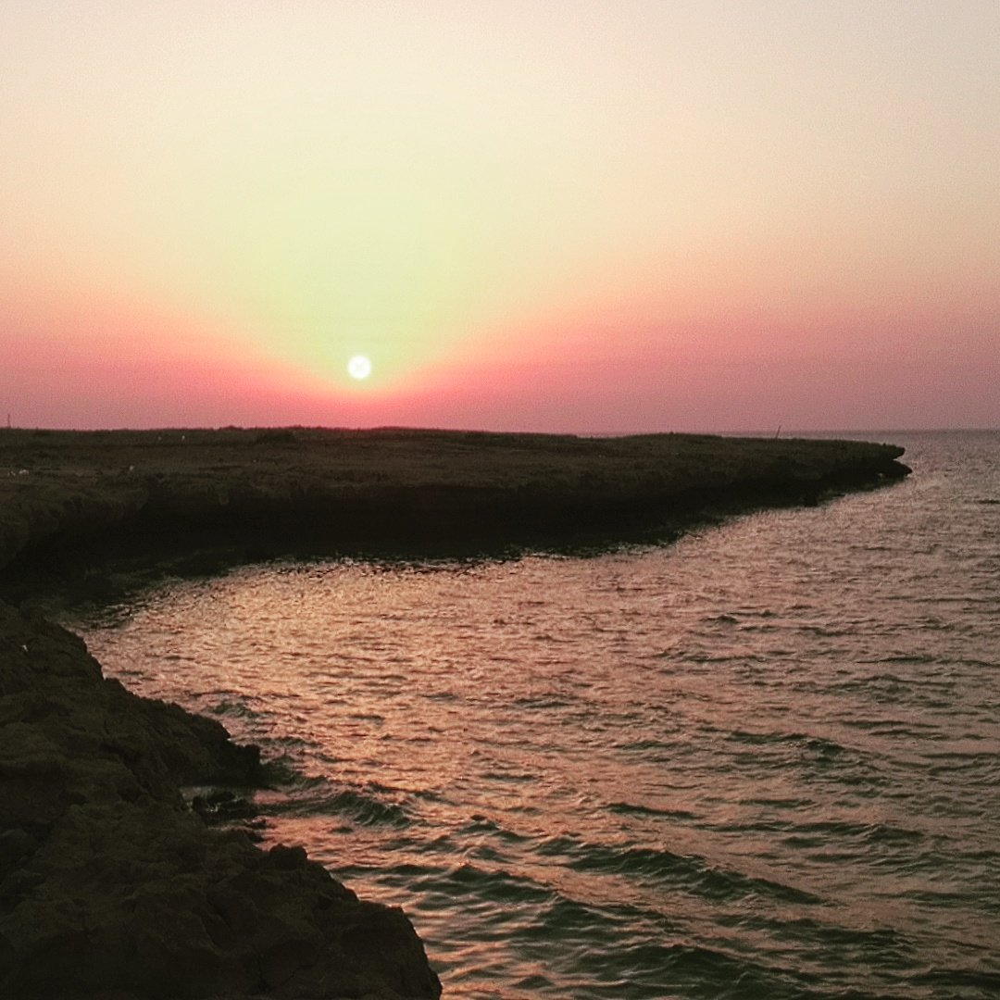

در آب‌های نیلگون خلیج نای‌بند و سواحل صخره‌ای خلیج فارس در استان بوشهر، صیادان از موجودی هولناک به نام «بوسلامه» یاد می‌کنند؛ شیطانی آبزی و چندچهره که توانایی دگرپیکری شگفت‌انگیزی دارد. بوسلامه در نگاه نخست ممکن است به شکل تکه چوبی شناور، گاوماهی غول‌آسا، زنی زیبا با گیسوان آغشته به مروارید یا حتی آشنایی گمشده در میان امواج ظاهر شود. او بر لبه قایق‌های صیادی ظاهر می‌گردد، صیادان را به نام کوچک صدا می‌زند و آنان را به شیرجه زدن در آب فرا می‌خواند.

اما به محض آنکه صیاد فریب‌خورده دست خود را به سوی او دراز کند یا پای در آب بگذارد، چهره‌ی حقیقی بوسلامه آشکار می‌شود: موجودی لزج، با دندان‌های اره‌ای و ناخن‌های برنده که قربانی را در چشم بر هم زدنی به گرداب‌های ژرف خلیج نای‌بند می‌کشاند. کهنسالان بندر عسلویه و نخل‌تقی روایت می‌کنند که بوسلامه جگر قربانیان خود را می‌مکد و جسد بی‌روح آنان را چند روز بعد بدون کمترین جای زخم بر صخره‌های مرجانی خلیج نای‌بند رها می‌سازد.

> «هر که در موج صدای نام خویش شنید، باید چاقوی پولادین بر چوب لنج بکوبد؛ بوسلامه از درخشش آهن فرار می‌کند، اما با تردید دل آدمی جان می‌گیرد.» — پند صیادان دشتی و بوشهری.

دکتر سید جعفر حمیدی در مدخل «بوسلامه» از کتاب مرجع «فرهنگ‌نامه بوشهر» اشاره می‌کند که این اسطوره شباهت شگفت‌انگیزی با سیرن‌ها (Siren) در اساطیر یونان باستان دارد، اما کاملاً با اقلیم و شرایط خطرناک خلیج فارس پیوند خورده است. سواحل نای‌بند با داشتن خلیج‌های کوچک و جریان‌های قوی زیرسطحی، همواره تهدیدی مرگبار برای شناگران و غواصان سنتی مروارید بوده است. باور به بوسلامه، هشداری آیینی بود تا غواصان در تاریکی غروب یا در خستگی مفرط صید مروارید، فریب سراب‌های دریایی را نخورند.

حتی امروزه، در میان لنج‌نشینان بوشهر، پیش از به آب انداختن تورهای شبانه در دهانه نای‌بند، نام مقدس خداوند را بر آب می‌خوانند تا طلسم فریبنده بوسلامه شکسته شود و دریا امان صید را از آنان نستاند.

در یادداشت‌های سفرنامه‌نویسان کهن خلیج فارس آمده است که غواصان سنتی مروارید برای ایمن ماندن از شبیخون بوسلامه، آداب غواصی سخت‌گیرانه‌ای داشتند. آنان هیچ‌گاه در زمان کسوف، خسوف یا هنگامه مدهای ناگهانی به صیدگاه‌های مرجانی نای‌بند نزدیک نمی‌شدند. همچنین در باور ساحل‌نشینان دشتی، بر لبه قایق‌ها روغن کوسه می‌مالیدند، چرا که باور داشتند بوی تند روغن جگر کوسه، بوسلامه را از پیرامون لنج‌ها متواری می‌سازد و مانع از آن می‌شود که این دیو آبزی با صدای لرزان خویش جاشوهای خسته را به خواب هیپنوتیزمی فروببرد.

### منابع و اعتبار تصویر
- **منبع پژوهشی افسانه:** سید جعفر حمیدی، «فرهنگ‌نامه بوشهر»، انتشارات دانشگاه خلیج فارس، ص ۸۹-۹۳؛ ایرج افشار سیستانی، «پژوهشی در نام و تاریخ خلیج فارس»، ص ۲۱۴.
- **اعتبار تصویر:** ثبت‌شده در ویکی‌مدیا کامنز توسط Rezakar85؛ مجوز انتشار: [CC BY-SA 4.0](https://commons.wikimedia.org/wiki/File:Nayband_Gulf.jpg).
