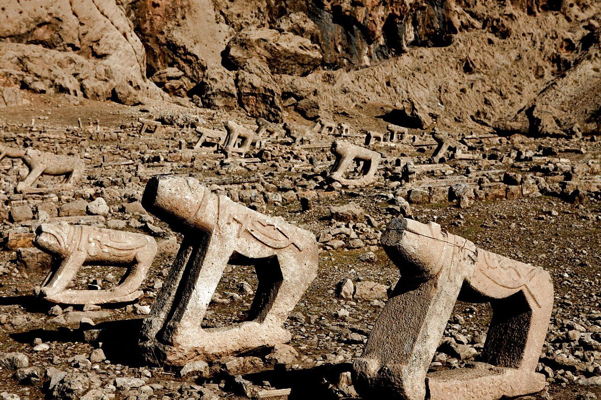

Gazing out over the windswept defiles of Tang-e Sayad in Chaharmahal and Bakhtiari, colossal monolithic stone lions with ridged manes and squared snouts stand guard over the graves of legendary tribal heroes. Known in the Bakhtiari vernacular as *Bard-e Shir*, these solemn statues are far more than funerary monuments; in folk cosmology, they are living repositories of warrior valor, tribal chivalry, and ancestral honor.

A legendary tale cherished among pastoralists recounts that centuries ago, when a ruthless horde of plunderers ambushed the encampments of Tang-e Sayad to seize women and livestock, the outnumbered tribal defenders fought to the last breath. At midnight, as the conquerors prepared to torch the encampments, a subterranean roar echoed from the graves. The chiselled limestone eyes of the Bard-e Shir ignited with red embers, stone limbs awoke with thunderous vitality, and the monoliths charged the invaders. Paralyzed with supernatural terror at the charging rock beasts, the invaders dropped their swords and fled into the dark.

> "A Bard-e Shir is not mere stone shaped by a sculptor's chisel; it is the petrified marrow of tribal valor. Defile the homeland, and the crag awakens to tear the invader asunder." — Oral tradition of Bakhtiari elders.

Folklorist Ali-Akbar Dehkordi notes in his *Monograph on the Folklore of Chaharmahal* that master masons carved emblems of flintlock rifles, curved scimitars, prayer beads, and war stallions onto the flanks of these lions to immortalize the deceased chieftain's virtue. Tribeswomen traditionally anointed the stone lions' brows with almond oil, believing the petrified guardians warded off plagues and droughts. The silent, dignified sentinels of Tang-e Sayad remain eternal testimonies to the mythological union of rock, memory, and defiant highland spirit.

### Sources & Image Attribution
- **Research Source:** Ali-Akbar Dehkordi, *Monograph on the Folklore of Chaharmahal*, Shahrekord, pp. 134-141; Hossein Pejman Bakhtiari, *Poems and Notes of the Bakhtiari People*, p. 95.
- **Image Attribution:** Documented on Wikimedia Commons by ninara; License: [CC BY-SA 2.0](https://commons.wikimedia.org/wiki/File:Ancient_Cemetry_Izeh1.jpg).
