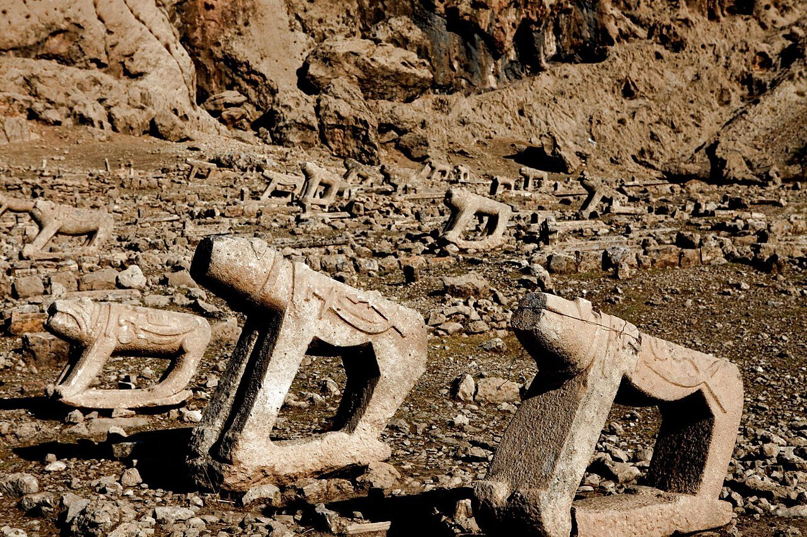

بر فراز تپه‌های مشرف به تنگه صیاد در چهارمحال و بختیاری، شیرهای سنگی ستبر و تراشیده‌ای با یال‌های شیاردار بر مزار پهلوانان ایل ایستاده‌اند؛ تندیس‌هایی که در زبان بختیاری به «بَردِ شیر» معروف‌اند. این مجسمه‌های صخره‌ای صرفاً یک اثر تاریخی نیستند، بلکه در باورهای عامه، پاسداران روح دلاوری، شرافت و وفاداری به ایل تلقی می‌شوند.

افسانه‌ای دیرین در میان رمه‌گردانان منطقه حکایت می‌کند که در سال‌های دور، هنگامی که لشکری غارتگر و بیگانه برای اسارت زنان و به تاراج بردن احشام به دهانه تنگه صیاد تاختند، مدافعان ایل پس از نبردی نابرابر جان باختند. در نیمه‌شب آن نبرد خونین، هنگامی که دشمن آماده به آتش کشیدن چادرهای عشایر شد، ناله‌ای عمیق از سینه سنگ‌های مزار پهلوانان برخاست. به ناگاه، چشمان تراشیده‌شده‌ی برد شیرها به اخگری سرخ بدل شد، سنگ‌های خارا جان گرفتند و صدای غرش مهیبی در تنگه پیچید. شیرهای سنگی با پنجه‌های سترگ خود بر مهاجمان تاختند و لشکریان از وحشت این هیبت سنگی سلاح‌ها را افکنده و در سیاهی شب متواری شدند.

> «برد شیر تنها سنگ و هنر تیشه‌تراش نیست؛ استخوان‌های غیرت ایل است که اگر حرمت خاک شکسته شود، صخره دهان باز می‌کند و سینه متجاوز را می‌درد.» — کلام کهنسالان بختیاری در پای مجسمه‌های سنگی تنگ صیاد.

علی‌اکبر دهکردی در کتاب «تک‌نگاری فرهنگ عامه چهارمحال» یادآور می‌شود که بر گرده و پهلوی این شیرهای سنگی، نقوش شمشیر، تسبیح، خنجر، اسب و قنداق تفنگ حکاکی می‌شده تا خصلت‌های دلاوری و جوانمردی متوفی در تن سنگ جاودانه شود. مردم محلی باور داشتند که در شب‌های جمعه، ارواح مردگان در کالبد این شیرها آرام می‌گیرند و دعای خیر آنان، ایل را از بیماری‌ها و خشک‌سالی حفظ می‌کند. زنان ایل برای سلامت فرزندان خود به این شیرها ادای احترام می‌کردند و گونه‌های آنان را با روغن بادام چرب می‌نمودند.

تندیس‌های برد شیر تنگ صیاد همچنان با سینه‌های فراخ و چهره‌های مصمم، بر بلندای دره‌ها ایستاده‌اند تا شاهدی ابدی بر پیوند ناگسستنی اساطیر دلاوری با طبیعت کوهستانی بختیاری باشند.

در آیین‌های پهلوانی بختیاری، تراشیدن برد شیر بر مزار درگذشتگان، افتخاری بزرگ بود که تنها نصیب سوارکاران تیرانداز، کدخدایان صلح‌جو و شیرزنان ایل می‌شد. سنگ‌تراشان هنرمند با قلم و چکش، روح غیرت را در رگ‌های سنگ خارا می‌دمیدند و باور بر این بود که غرش سنگی این شیرها در شب‌های طوفانی، شیاطین و ارواح خبیث را از حریم ایل فراری می‌دهد. تک‌تک خطوط حکاکی‌شده بر پیشانی این تندیس‌ها، راوی حماسه‌های ناگفته‌ای از پایداری ایل در برابر قحطی‌ها و تهاجمات بیگانگان است.

### منابع و اعتبار تصویر
- **منبع پژوهشی افسانه:** علی‌اکبر دهکردی، «تک‌نگاری فرهنگ عامه چهارمحال»، شهرکرد، ص ۱۳۴-۱۴۱؛ حسین پژمان بختیاری، «اشعار و یادداشت‌های قوم بختیاری»، ص ۹۵.
- **اعتبار تصویر:** ثبت‌شده در ویکی‌مدیا کامنز توسط ninara؛ مجوز انتشار: [CC BY-SA 2.0](https://commons.wikimedia.org/wiki/File:Ancient_Cemetry_Izeh1.jpg).
