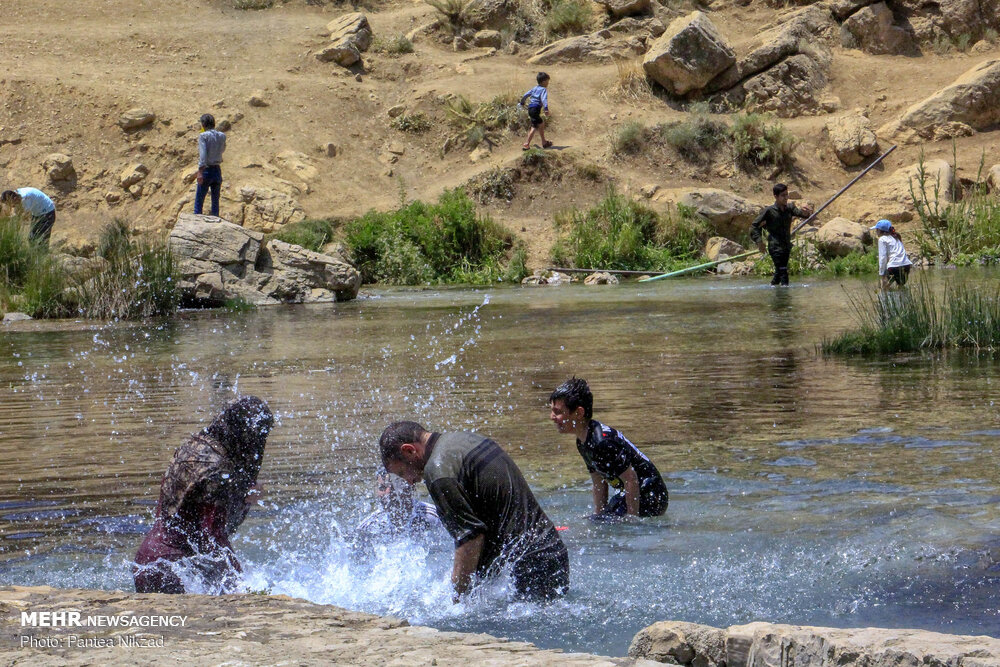

In the venerable folklore and oral geography of **چهارمحال و بختیاری**, ancient storytellers have passed down the evocative legend of **Dimeh Koohrang** across generations of elders, shepherds, and caravan travelers. Rooted in the living traditions of the region, the tale connects local landmarks with the mythic spirits believed to inhabit the mountains, forests, waters, and deserts of Iran.

Local traditions recount the essence of this legend:

> "دالو و چشمه جاودانگی دیمه در دامنه زردکوه"

Elders in the surrounding towns and villages long maintained that encounters with these mythical phenomena reminded humans to approach nature with humility, prudence, and ethical reverence. Those venturing through lonely mountain passes or desolate valleys observed traditional protective rites and respected sacred boundaries to remain safe from supernatural mischief.

Today, the living heritage of **Dimeh Koohrang** endures as a treasured emblem of Iranian regional folklore, preserving the ancestral imagination and ecological wisdom of its native land.

---

### Sources & Image Attribution
- **Folklore Source:** Preserved Iranian regional folklore and oral traditions of چهارمحال و بختیاری.
- **Image:** Historical visual artifact from Wikimedia Commons, documented in the public repository under open license.