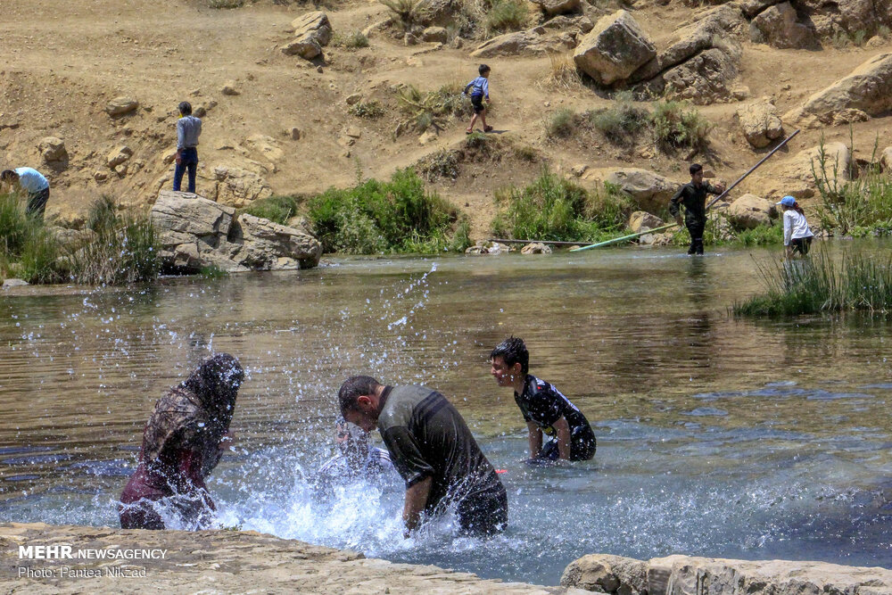

در سرزمین چهارمحال و بختیاری، در دامنه سپیدپوش و پرصلابت زردکوه، چشمه‌ای زلال، گوارا و پرآب از اعماق زمین می‌جوشد که از کهن‌ترین روزگاران به نام «چشمه دیمه» شناخته می‌شود. این چشمه که سرچشمه اصلی زاینده‌رود باستان به شمار می‌رود، در نگاه ایل بزرگ بختیاری تنها آبی خنک برای رفع عطش نیست؛ بلکه کانون زایش افسانه‌های شیرین، نماد برکت آب‌های زاگرس و نشیمنگاه «دالو» (مادرپیر اساطیری برف و باد در باورهای بختیاری) و پریان زلال چشمه‌ساران است. این جوشش بی‌وقفه نمادی از زایش جاودانه خاک بختیاری است که دشت لاله‌های واژگون را هر بهار زنده می‌سازد و عشایر را در کوچ سالانه به امیدواری فرامی‌خواند.

بنا بر روایت پیران کوچ‌رو و شاهنامه‌خوانان ایل، آب چشمه دیمه خاصیتی جادویی دارد؛ بومیان معتقدند نوشیدن از این آب، خستگی سالیان را از تن می‌زداید، دندان‌ها را از گزند بیماری مصون می‌دارد و نوری بر دیدگان می‌بخشد که گویی آدمی جهان را از نو می‌بیند. در قصه‌های کهن بختیاری آمده است که در روزگاران باستان، هنگامی که دیوان خشکسالی و سرما رمه‌های ایل را به نابودی می‌کشاندند، دالو (پیرزن دانای کوهستان) دست به آسمان برداشت و دوک پشم‌ریسی خود را در شکاف صخره زردکوه چرخاند. با چرخش دوک، سنگی عظیم شکافته شد و آب معجزه‌آسای دیمه با خروشی بی‌پایان به دشت سرازیر گشت تا زندگی را به ایل بازگرداند.

> شیرزنان بختیاری هنگام پر کردن مشک‌های چرمی در دیمه زمزمه می‌کنند: «ای دالو، ای مادر چشمه‌ها، برکت آب را از کوچ ما مگیر و نگذار پای بدخواهان به وارگه ایل برسد.»

روایتی دیگر بازگو می‌کند که در ژرفای جوشش ریگ‌های کف چشمه، تخته‌سنگی سپید وجود دارد که در حقیقت آینه دختر دالو (پری آب‌های بختیاری) است. دختر دالو تنها به خواب جوانانی می‌آید که دلی بی‌کینه دارند و برای حفظ خاک و شرف ایل اسب زین می‌کنند؛ او پیاله‌ای از آب دیمه به آنان می‌نوشاند تا در برابر سرمای استخوان‌سوز گردنه‌های تاراز و چری رویین‌تن شوند. صیادان کل و بز در کوهرنگ نقل می‌کنند که هر سال در آغاز بهار، هنگامی که نخستین لاله‌های واژگون در جوار دیمه سر برمی‌آورند، عطر خوشی بر دشت می‌پیچد که نشان از شست‌وشوی گیسوان پریان چشمه در آب گوارای دیمه دارد. دختران ایل با بستن روبان‌های رنگین بر شاخه‌های پیرامون چشمه، از پری دیمه بخت نیکو، سلامت مادران ایل و باران فراوان برای مراتع سبز زردکوه طلب می‌کنند. چشمه دیمه تا به امروز سرچشمه زندگی، موسیقی کهن، شادابی و امید پایدار در رگ‌های غیرتمند و پرشور ایل بختیاری است.

### منبع روایت و تصویر
- **خاستگاه افسانه:** ادبیات شفاهی و باورهای آیینی ایل بختیاری در کوهرنگ، متون مردم‌شناسی فرهنگ عامه زاگرس‌نشینان.
- **عکاس / پدیدآورنده تصویر:** Pantea Nikzad
- **منبع تصویر:** [صفحه تصویر در ویکی‌انبار](https://commons.wikimedia.org/wiki/File:Dimeh_Spring_2019-08-19_01.jpg)
- **نوع مجوز:** CC BY 4.0
