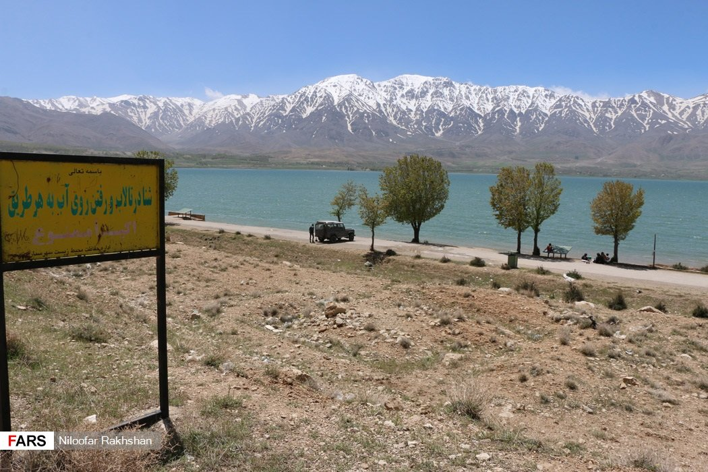

At the rugged foothills of Mount Kalar, in full view of the majestic glaciers of Zard-Kuh, the turquoise wetland of Choghakhor glistens across the high plateaus of Chaharmahal and Bakhtiari. Nomads of the Haft-Lang and Chahar-Lang confederacies have long cherished the oral romance of the *Pari of Zard-Kuh*—a celestial water fairy crowned with silver light whose translucent hair drifts across the lake's surface like ribbons of mountain mist.

Bakhtiari lore venerates this fairy as the holy custodian of subterranean aquifers, migratory birds, and the wild mountain ibex. On moonlit spring nights, as migrating tribes pitch their goat-hair tents, the Pari ascends upon a gleaming white limestone slab in the heart of the marsh. Combing her dew-drenched locks, she murmurs a serene, otherworldly hymn that calms the reeds and silences the ripples—a mystical stillness known by the elders as the *Berkeh-ye Lal* (The Mute Lagoon). In this sacred hour, even the alpine wind ceases its howling to hear her celestial harp.

> "When Choghakhor falls mute and the waters freeze into glass, the Pari of Kalar performs her sacred ablution; whoever drinks cures the soul's affliction, but whoever stalks her radiant visage is swallowed by the mist." — Proverb of the Bakhtiari matriarchs.

Folklorist Abdolali Khosravi notes in *Culture and Beliefs of the Bakhtiari* that this mountain nymph is an enduring incarnation of Aredvi Sura Anahita, the ancient Zoroastrian divinity of waters and purity. Pure-hearted shepherds in search of life-giving water were guided by her radiant aura to sweet springs, whereas avaricious hunters shooting nesting swans were struck by sudden gale-force squalls crashing down from Mount Kalar. To this day, the ethereal peace settling over Choghakhor's waving reeds is viewed as the tender breath of the immortal mountain peri.

### Sources & Image Attribution
- **Research Source:** Abdolali Khosravi, *Culture and Beliefs of the Bakhtiari*, Isfahan: Khak Publications, pp. 215-222; Hossein Pejman Bakhtiari, *Poems and Notes of the Bakhtiari People*, p. 102.
- **Image Attribution:** Documented on Wikimedia Commons by Niloofar Rakhshan; License: [CC BY 4.0](https://commons.wikimedia.org/wiki/File:Choghakhor_Wetland_2020-05-05_02.jpg).
