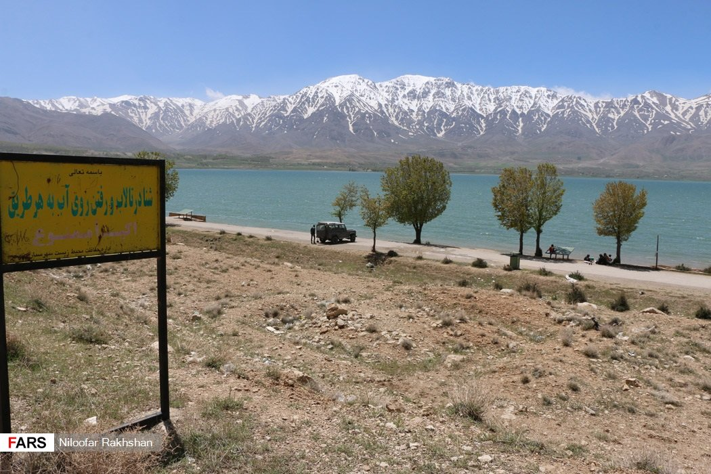

در پای کوهستان برف‌پوش کلار و مشرف به قله‌های سرکش زردکوه، تالاب فیروزه‌ای چغاخور همچون نگینی در دشت‌های چهارمحال و بختیاری آرمیده است. عشایر ایل هفت‌لنگ و چهارلنگ از دیرباز روایتی رازآلود از «پری زردکوه» سینه به سینه نقل کرده‌اند؛ بانویی اثیری و بسیار زیبا با بال‌هایی از نور نقره‌ای که گیسوانش تا سطح آب‌های تالاب امتداد می‌یابد و چشمانش بازتابی از برف کهن یخچال‌های بختیاری است.

باور بومیان بر این است که این پری، نگهبان چشمه‌های جوشان کف تالاب و حافظ قوچ‌های وحشی و پرندگان مهاجر چغاخور است. در شب‌های مهتابی بهار که ایل بختیاری در ییلاق بار می‌اندازد، پری زردکوه بر تخته‌سنگی سپید در میانه تالاب ظاهر می‌شود و با شانه زدن گیسوانش، نغمه‌ای سوزناک می‌خواند که آب‌های تالاب را آرام و بی‌موج می‌سازد؛ حالتی که عشایر آن را «برکه لال» می‌نامند. در این هنگام، حتی باد نیز از وزیدن بازمی‌ایستد تا صدای چنگ‌نوازی پری را بشنود.

> «چون چغاخور خاموش شود و برکه لال گردد، پری کلار در آب وضو می‌سازد؛ هر کس دست بر آن آب زند، درد جانش به شفا می‌نشیند، اما اگر پی دیدار پری برود، گیسوان مه او را در کام خود خواهد کشید.» — سخن بی‌بی‌های ایل بختیاری در سیاه چادرها.

عبدالعلی خسروی (قائد) در اثر پژوهشی «فرهنگ و باورهای بختیاری» بیان می‌کند که پری زردکوه بازمانده‌ی اعتقاد به اردویسور آناهیتا، ایزدبانوی زرتشتی آب‌ها و پاکی‌ها در کوهستان زاگرس است. اگر صیاد یا چوپانی با نیتی پاک و برای نجات گله از تشنگی نزد تالاب می‌آمد، پری چشمه‌های گوارا را به روی او می‌گشود؛ اما اگر کسی به حریم آب بی‌حرمتی می‌کرد یا پرنده‌ای را در فصل جفت‌گیری شکار می‌نمود، طوفانی سهمگین از جانب کوه کلار برمی‌خاست و چادر او را به قعر گرداب‌های تالاب می‌کشاند.

امروزه نیز هنگامی که دسته‌های پرندگان مهاجر بر فراز نیزارهای چغاخور چرخ می‌زنند، ایل‌نشینان سالخورده آرامش آب را به دم مسیحایی پری زردکوه نسبت می‌دهند که همچنان بر پاکی این آبخوان اساطیری نظارت دارد.

بی‌بی‌های ایل بختیاری نقل می‌کنند که پری زردکوه در شب‌های برداشت محصول غلات، با دست‌هایی سرشار از شبنم به خواب کشاورزان مؤمن می‌آید و محل حفر چشمه‌های خنک در کوهپایه را به آنان نشان می‌دهد. این پیوند باطنی میان عشایر و پری آب، سبب شده بود که چغاخور در طول تاریخ پناهگاهی امن برای حفظ نسل غازهای خاکستری و لک‌لک‌های سپید باشد. زنان ایل نیز به نشانه قدردانی، تکه‌هایی از دست‌بافته‌های رنگین جاجیم و شیر تازه میش را به عنوان هدیه در آب تالاب رها می‌کردند.

### منابع و اعتبار تصویر
- **منبع پژوهشی افسانه:** عبدالعلی خسروی (قائد)، «فرهنگ و باورهای بختیاری»، اصفهان، انتشارات خاک، ص ۲۱۵-۲۲۲؛ حسین پژمان بختیاری، «اشعار و یادداشت‌های قوم بختیاری»، ص ۱۰۲.
- **اعتبار تصویر:** ثبت‌شده در ویکی‌مدیا کامنز توسط Niloofar Rakhshan؛ مجوز انتشار: [CC BY 4.0](https://commons.wikimedia.org/wiki/File:Choghakhor_Wetland_2020-05-05_02.jpg).
