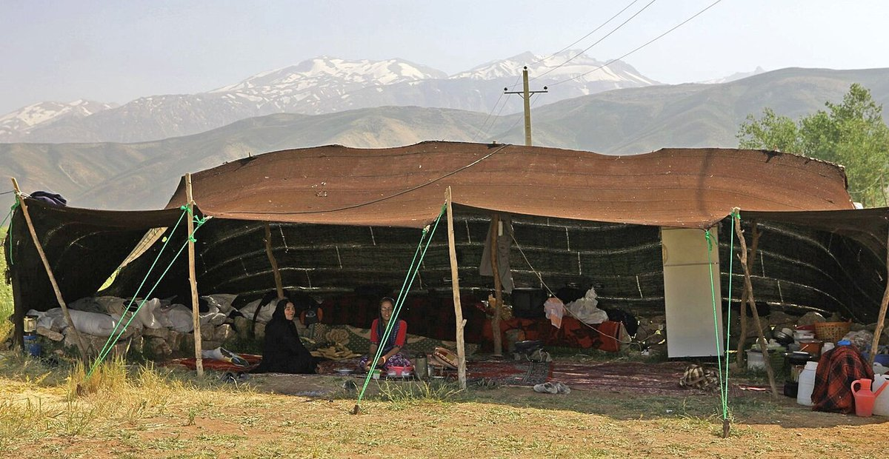

In the deep hush of night across the oak-cloaked highlands of Lordegan and Farsan in Chaharmahal and Bakhtiari province, when nomadic campfires fade and the wind whistles through ancestral branches, an eerie metallic rasp often echoes through the limestone ravines. In tribal folklore, this sound signals the nocturnal patrol of *Sar-Arreh Pa-Tisheh* (literally, "Saw-Headed Adze-Foot"), a formidable chimera endowed with a head shaped like a serrated steel crosscut saw and limbs ending in heavy carpenter adzes.

For the Bakhtiari nomads, the Zagros oak (*Belut*) is sacred—it provided acorns ground into flour (*Kelg*) that sustained generations through devastating famines. According to pastoral legends, a band of mercenary timber merchants once entered the protected communal groves under cover of darkness to fell living, acorn-bearing oaks for the lucrative charcoal trade. As their axes bit into the heartwood of an ancient guardian tree, the earth trembled and the towering figure of Sar-Arreh Pa-Tisheh materialized from the canopy.

> As Bakhtiari elders warn the young: "Fell a green oak without need, and Sar-Arreh Pa-Tisheh waits in ambush; touch not the living acorn tree, so the clan may live and the bread of survival remain."

With a sweep of his serrated crown, the guardian sliced through the merchants' forged iron axes as though they were dry twigs. Stamping his adze-feet into the bedrock, he unleashed seismic shocks that sent the terrified intruders fleeing down the gorge, leaving their pack-mules behind. The creature then applied wild pine resin and herbal moss to the tree's wounds, healing the damaged bark before vanishing back into the deep woods. From that day forward, strict tribal customary laws forbade harming living trees, establishing Sar-Arreh Pa-Tisheh as the supernatural protector of the forest ecosystem.

### Anthropological & Folklore Analysis
This Bakhtiari narrative is a compelling manifestation of indigenous eco-mythology. By incorporating the very tools of deforestation (the saw and the adze) into the anatomy of a supernatural woodland protector, the folklore turns the instruments of ecological destruction into guardians of environmental equilibrium, reinforcing conservation taboos essential for pastoral survival.

### Archival Sources & Attribution
- **Primary Source:** Mythological Analysis of the Bakhtiari Tale 'Sar-Arreh Pa-Tishehei', Journal of Folk Culture and Oral Literature, Tarbiat Modares University.
- **Source URL:** https://dovar.blogfa.com/post/19
- **Original Language:** Bakhtiari Luri & Persian
- **Image Attribution:** File:Bakhtiari Nomads, Iran (5869271694).jpg | Photographer: Ninara from Helsinki, Finland | License: CC BY 2.0
