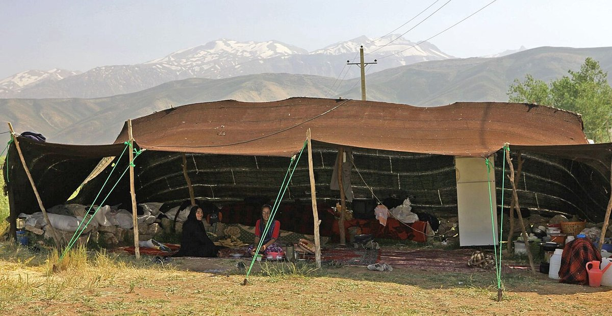

در شب‌های تاریک و سکوت سحرانگیز جنگل‌های بلوط لردگان و کوهپایه‌های زردکوه در چهارمحال و بختیاری، آنگاه که آتش هیزم چوپانان ایل فروکش می‌کند و باد در میان شاخه‌های کهنسال زوزه‌ می‌کشد، صدای ساییده شدن وهم‌انگیز دو فلز در اعماق دره به گوش می‌رسد؛ صدایی که بومیان آن را نشانه گام‌های «سر اره پا تیشه‌ای» (Sar-Arreh Pa-Tishehei) می‌دانند. این موجود اسطوره‌ای با سری دندانه‌دار چونان اره‌ای فولادین و ساق‌هایی که به تیشه‌های سنگین نجاری ختم می‌شوند، در باور کهن بختیاری نگهبان بی‌بدیل طبیعت و ارواح درختان است.

روایات متل‌های بختیاری حکایت از آن دارند که درخت بلوط (بَلوط) برای ایل تنها یک گیاه نیست، بلکه نان و پناهگاه و مایه بقای عشایر در قحطی‌های بزرگ بوده است. در روزگارانی دور، گروهی از سودجویان بی‌رحم شبانه با تبرهای تیز به جنگل‌های لردگان وارد شدند تا درختان پربار و سبز بلوط را برای تجارت زغال قطع کنند. در حالی که ریشه کهنسال‌ترین بلوط بیشه در حال فرو ریختن بود، زمین دهان گشود و هیبت سهمگین «سر اره پا تیشه‌ای» در برابر تبرداران آشکار شد.

> بختیاری‌ها در تاریکی بیشه‌ها زمزمه می‌کنند: «دارِ سوزی که بوری، سر اره پا تیشه دِ کَمینتِه؛ بلوط رِ دَس مزن تا ایل زنده بمونه و نانِ کهلو از بین نره.» (درخت سبزی را که بی‌رحمانه ببُری، سر اره پا تیشه‌ای در کمین توست؛ به حریم بلوط دست‌درازی مکن تا ایل زنده بماند و نان بلوط پایدار بماند).

این نگهبان خشمگین با جنبش سر دندانه‌دار خود، تبرهای آهنین مهاجمان را با ضربه‌ای برق‌آسا چون چوب کبریت دو نیم کرد و با کوبیدن پاهای تیشه‌گون خود بر زمین، چنان لرزه‌ای بر اندام چوب‌بران افکند که همگی نعره‌زنان ادوات خود را رها کرده و به دشت گریختند. این موجود سپس صمغ درختان کهنسال را بر زخم تنه‌های بریده‌شده مالید و آنها را التیام بخشید. از آن پس، هیچ چوپان یا هیزم‌شکنی در ایل بختیاری بدون ضرورت شاخه‌ای از درخت زنده را نشکست؛ چرا که می‌دانستند هر ضربه بر تن درخت سبز، خشم سر اره پا تیشه‌ای را برمی‌انگیزد. این افسانه به عنوان قانون نانوشته حفاظت از منابع طبیعی زاگرس برای نسل‌ها سینه به سینه منتقل شده است.

### بن‌مایه‌ها و ویژگی‌های مردم‌شناختی
افسانه سر اره پا تیشه‌ای تجلی شگفت‌انگیز «بوم‌اسطوره‌شناسی» (Ecomythology) در فرهنگ زاگرس‌نشینان است. تبدیل ابزارهای تخریب صنعتی جنگل (اره و تیشه) به اندام‌های کالبدی یک هیولای محافظ، استعاره‌ای درخشان از کاربرد سلاح دشمن علیه خود او برای پاسداری از بوم‌سازگان بلوط است که ضامن امنیت غذایی (نان بلوط / کلگ) و زیست عشایری ایل بختیاری محسوب می‌شده است.

### منابع و پژوهش
- **منبع اصلی:** بررسی و تحلیل اسطوره‌شناختی متلی از گویش لری بختیاری به نام «سر اره پا تیشه‌ای»، نشریه علمی فرهنگ و ادبیات عامه، دانشگاه تربیت مدرس.
- **پیوند مرجع:** https://dovar.blogfa.com/post/19
- **زبان اصلی متن:** لری بختیاری و فارسی
- **تصویر:** File:Bakhtiari Nomads, Iran (5869271694).jpg | عکاس: Ninara from Helsinki, Finland | مجوز: CC BY 2.0
