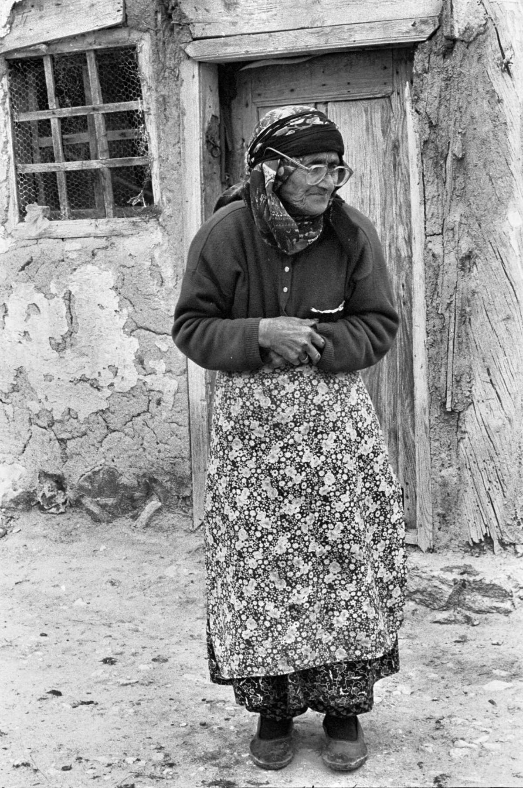

When the bone-chilling blizzards of the southern Caucasus sweep down the jagged crags of Mount Mishov, burying the secluded pastoral hollows of Yekanat near Marand, local folklore cautions travelers against the legendary predator known as the *Adamjil Qurd* (literally, the "Man-Hunting Wolf"). Unlike ordinary wolves that avoid human settlements when game is abundant, the Adamjil Qurd is remembered as an uncanny beast possessing human-like cunning, sinister red eyes, and a terrifying ability to outwit weary mountain wanderers.

According to regional oral folklore, an agile young mountaineer from Yekan Kahriz named Aydin was returning home along a frozen bridle path when an encroaching pack trapped him in a rocky gully. Leading the pack was the formidable Adamjil Qurd. Displaying calculated malice, the creature did not charge blindly; instead, it used its powerful hind legs to fling clouds of blinding frozen snow directly into Aydin's eyes to disorient him and drive him over the precipice.

> As preserved in the vernacular folklore of Yekanat: "A common wolf starves in the frost, but the Adamjil Qurd battles with the mind of man; to survive its ambush requires a heart of forged steel."

Having heard the fireside warnings of his elders, Aydin anticipated the beast's supernatural cunning. Working with instinctive agility, he peeled off his thick sheepskin vest (*Kapanak*), wrapped it firmly around his left forearm as an improvised shield, and gripped his heavy knotted wild-almond cudgel in his right fist. When the demonic wolf leaped toward his throat, Aydin thrust the wool-padded arm deep into the snapping jaws, absorbing the crushing bite, while bringing down his heavy club onto the beast's crown. Stunned by the crushing blow and terrified by the youth's unyielding defiance, the pack leader retreated into the ravines with a wounded howl, and the rest of the pack vanished into the swirling blizzard. Aydin's victory remains an enduring testament in Azerbaijani folklore to the superiority of human presence of mind over primal wilderness terror.

### Anthropological & Folklore Analysis
The tale belongs to the ancient werewolf and shape-shifter folklore complex preserved across northwestern Iran. It reflects the intense historical struggle of isolated rural communities against severe winter blizzards and wolf predation, highlighting traditional survival technologies such as padded arm-wrapping and defensive tactical psychology.

### Archival Sources & Attribution
- **Primary Source:** Old Traditional Folktales of Yekan Kahriz, compiled in the Yekanat Historical and Folkloric Archive.
- **Source URL:** https://sehrgalam.blogfa.com/category/21/12-%DB%8C%DA%A9%D8%A7%D9%86-%DA%A9%D9%87%D8%B1%DB%8C%D8%B2%D8%AF%D9%87-%D8%B1%D8%A7%DB%8C%D8%AC-%D8%A7%D9%88%D9%84%D8%A7%D9%86-%D9%82%D8%AF%DB%8C%D9%85%DB%8C-%D9%86%D8%A7%D8%BA%DB%8C%D9%84-%D9%84%D8%A7%D8%B1
- **Original Language:** Azerbaijani Turkish & Persian
- **Image Attribution:** File:Bahar (2599760344).jpg | Photographer: runran | License: CC BY-SA 2.0
