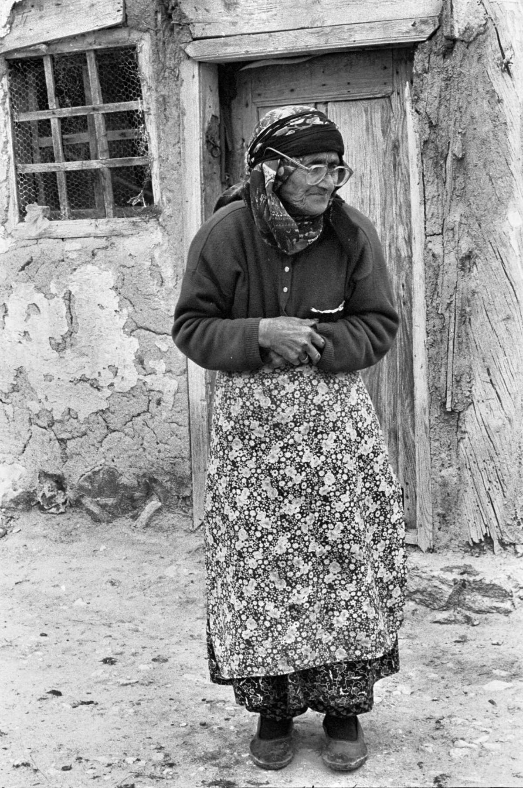

هنگامی که سوز زمستان‌های استخوان‌سوز قفقاز و ارسباران بر گردنه‌های کوه میشو و دره‌های خشک یکانات مرند سایه می‌افکند، کولاک شدید ردپای هر جنبنده‌ای را پاک می‌کند و زمان جولان هیولایی اسطوره‌ای به نام «آدامجیل قورد» (Adamjil Qurd؛ گرگ انسان‌نمای افسانه‌ای) فرا می‌رسد. در ناغیل‌های کهن دهستان یکانات، گرگ‌های معمولی در تابستان و پاییز به دلیل فراوانی شکار به آدمی کاری ندارند، اما آدامجیل قورد موجودی دگرگون‌شده است؛ گرگی با جثه‌ای تنومند، چشمان سرخ شراره‌گون و درایتی شیطانی که نیرنگ‌های آدمی را می‌شناسد و با پاشیدن برف بر دیدگان رهگذران، طعمه‌های خود را در دام می‌اندازد.

در یکی از غروب‌های برفی زمستان، جوانی دلیر از تبار یکان کهریز به نام «آیدین» در حال بازگشت از آبادی بالادست بود که در میان گردنه مه‌آلود به گله‌ای از گرگان درنده برخورد کرد. در پیشاپیش گله، آدامجیل قورد با یال نقره‌فام و هیکلی سترگ ایستاده بود. این درنده با شگردی شگفت‌آور، به جای حمله مستقیم، با پاهای عقبی خود برف‌های یخ‌زده را به هوا پرتاب کرد تا چشم و روی جوان را کور کند و او را به ورطه لغزش در دره بکشاند.

> در ضرب‌المثل‌ها و نقل‌های قدیمی یکانات آمده است: «قورد قیشدا آج اولار، آمّا آدامجیل قورد اینسانین عاغلی ایله ساواشار؛ بو ساواشدا پولاد اورک و زیرک قول گرکدیر.» (گرگ در زمستان گرسنه است، اما آدامجیل قورد با هوش انسان می‌جنگد؛ در چنین نبردی دلی از پولاد و بازویی هشیار لازم است).

آیدین که از کودکی داستان‌های شب‌نشینی پدربزرگش را درباره این هیولا شنیده بود، دستپاچه نشد. او به سرعت جلیقه و شال پشمین ضخیم چوپانی خود را از تن به درآورد و آن را همچون سپری نفوذناپذیر بر دور دست چپ پیچید و در دست راست، چماق گره‌دار بادام‌کوهی را محکم فشرد. هنگامی که آدامجیل قورد برای دریدن گلوی او خیز برداشت، آیدین دست پیچیده‌شده در نمد را در کام هیولا فرو برد و با تمام قدرت چوبدستی سنگین خود را بر فرق سر درنده کوبید. نعره دردناک گرگ در کوهسار پیچید و دیگر اعضای گله با دیدن شکست سرکرده خود، در شیار دره‌ها پراکنده شدند. آیدین با پیکری کوفته اما پیروز به آبادی بازگشت و نشان داد که در برابر خوی درندگی آدامجیل قورد، تنها دلیری ریشه‌دار و تدبیر انسان بومی می‌تواند بر تباهی چیره شود.

### بن‌مایه‌ها و ویژگی‌های مردم‌شناختی
این افسانه کهن ترکی-آذربایجانی بازتاب‌دهنده نبرد تاریخی انسان و طبیعت خشن کوهستان در ماه‌های محاصره برفی است. بن‌مایه «گرگ باهوش یا گرگینه» (Werewolf motif) در فولکلور آذربایجان ارتباط وثیقی با باورهای توتمی دیرین، مقاومت چوپانان در برابر قحطی‌های زمستان و لزوم حفظ خونسردی و تدبیر در بحران‌های جغرافیایی دارد.

### منابع و پژوهش
- **منبع اصلی:** مجموعه ناغیل‌های قدیمی رایج در یکان کهریز، گردآوری‌شده در وبلاگ ادبی-تاریخی یئکاناتا بیر باخیش.
- **پیوند مرجع:** https://sehrgalam.blogfa.com/category/21/12-%DB%8C%DA%A9%D8%A7%D9%86-%DA%A9%D9%87%D8%B1%DB%8C%D8%B2%D8%AF%D9%87-%D8%B1%D8%A7%DB%8C%D8%AC-%D8%A7%D9%88%D9%84%D8%A7%D9%86-%D9%82%D8%AF%DB%8C%D9%85%DB%8C-%D9%86%D8%A7%D8%BA%DB%8C%D9%84-%D9%84%D8%A7%D8%B1
- **زبان اصلی متن:** ترکی آذربایجانی و فارسی
- **تصویر:** File:Bahar (2599760344).jpg | عکاس: runran | مجوز: CC BY-SA 2.0
