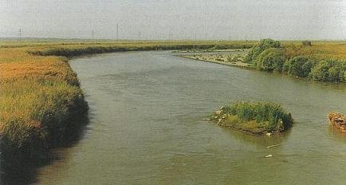

In the archaic belief system of the Aras River basin and the ancient rural hamlets of Yekanat in northern East Azerbaijan, no supernatural entity struck greater fear into the hearts of expectant mothers than *Alay-Bani* (the regional manifestation of *Al Arvadi*). Portrayed as a wild, nocturnal specter clad in ragged white robes with disheveled tresses and elongated breasts slung over her shoulders, she was believed to haunt irrigation kanats and humid ravines, waiting for the twilight hour to seize the liver of newly delivered mothers and dip it in running stream water, causing their immediate demise. To ward off this danger, households never left a mother unattended without placing an iron hearth rod known as an *Arsin* beneath her pillow, for cold iron was revered as the ultimate counter-charm against supernatural entities.

According to the oral chronicle of Yekan Kahriz, a quick-witted patriarch caught sight of an Alay-Bani creeping through the shadows toward his daughter-in-law's bedchamber. Before the demoness could strike, he leaped forward and plunged a tempered steel tailor's pin deep into her collar and flesh. Paralyzed by the contact with iron, Alay-Bani lost her magical power of flight and invisibility, becoming a docile domestic servant within the homestead.

> As ancient narrators in Yekanat recall: "Never leave a postpartum mother without cold iron; where the Arsin lies, Alay-Bani is bound, but pull the pin, and she vanishes like morning mist."

For seven winters, the captive demoness served the household faithfully, grinding heavy stone millstones and baking flatbread that miraculously never diminished in the dough trough. Yet she continually whispered to the household's innocent infants, pleading with them to pluck out the painful needle from her chest. One afternoon, a young child innocently pulled the steel pin from her garment. Unleashing a terrifying laugh, Alay-Bani vaulted through the rooftop smoke-hole, hurled a handful of ash across the courtyard, and vanished into the rocky crags, leaving behind a solemn reminder of the eternal vigilance required against the dark spirits of the steppe.

### Anthropological & Folklore Analysis
The myth of Alay-Bani addresses ancient anxieties concerning maternal and neonatal mortality in pre-modern rural Azerbaijan. The core motif of binding supernatural beings through iron needles and pins illustrates the deep Eurasian folkloric belief in metallurgy as a sacred protective force capable of mastering chaotic wilderness spirits.

### Archival Sources & Attribution
- **Primary Source:** Anthropological Survey of Folk Beliefs and Legends in Yekanat (Yekanata Bir Bakhish Folklore Archive).
- **Source URL:** https://sehrgalam.blogfa.com/post/832/%D8%A7%D9%81%D8%B3%D8%A7%D9%86%D9%87-%DB%8C%D8%A7-%D9%88%D8%A7%D9%82%D8%B9%DB%8C%D8%AA
- **Original Language:** Azerbaijani Turkish & Persian
- **Image Attribution:** File:Aras Nehri.jpg | Photographer: Sabri76 | License: Public domain
