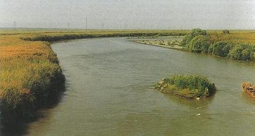

در باورداشت‌های اسطوره‌ای حوزه ارس و روستاهای کهنسال یکانات در شمال مرند، پدیده‌ای شب‌رو به نام «آلای بانی» (Alay-Bani؛ گونه‌ای از آل آروادی با جامه سپید، گیسوانی ژولیده و پستان‌هایی کشیده که بر دوش می‌افکند) لرزه بر تن زنان باردار و تازه‌زا می‌انداخت. مردم عامه باور داشتند که این موجود شوم در ساعات گرگ‌ومیش از کناره قنات‌ها و دره‌های نمناک بیرون می‌خزد تا جگر مادران تازه‌زا را برباید و با کشیدن آن بر آب زلال چشمه، جان آنان را بستاند. به همین سبب، در اجاق هر خانه‌ای تکه‌ای فلز گداخته یا میله آهنین نان‌پزی به نام «ارسین» (Arsin) قرار می‌دادند، زیرا فلز آهن بزرگ‌ترین باطل‌السحر قدرت‌های آل به شمار می‌رفت.

روایت محلی یکان کهریز از مردی کارآزموده سخن می‌گوید که در شبی تاریک، هنگامی که عروس جوانش وضع حمل کرده بود، در گوشه تاریک انبار متوجه جنبش شبحی سپیدپوش شد. مرد هوشیار پیش از آنکه آلای بانی بتواند به بستر زن نزدیک شود، با جهشی برق‌آسا یک سنجاق فولادین را به گریبان و سینه او فرو نشاند. با فرو رفتن سوزن فلزی، آلای بانی توان جادویی و ناپدید شدن خود را از دست داد و به اسیری رام در خانه بدل گشت.

> سالخوردگان ترک‌زبان یکانات نقل می‌کنند: «یئنی دوغموش آنانی دمیرسیز قویمایین؛ ارسین اولان یئرده آلای بانی اسیر اولار، آمّا اینه چکیلنده بیر گؤز قیرپیمیندا یوخ اولار.» (مادر تازه‌زا را بدون آهن رها نکنید؛ جایی که ارسین باشد آلای بانی به اسارت درمی‌آید، اما اگر سوزن کشیده شود در چشم بر هم زدنی ناپدید می‌شود).

آلای بانی هفت سال در آن خانه خدمت کرد؛ نان می‌پخت، آرد می‌کرد و کارهای طاقت‌فرسا را انجام می‌داد. در دوران حضور او، برکت گندم و آرد خانه بی‌پایان بود و خمیر نان هرگز تمام نمی‌شد. با این حال، او پیوسته مترصد فرصت بود و از کودکان خردسال خانه با زاری می‌خواست تا سنجاق را از سینه‌اش بیرون کشند. سرانجام روزی کودکی نادان به التماس‌های او دل سوزاند و سنجاق را کشید. آلای بانی با قهقهه‌ای وحشتناک به روی بام گریخت، در دهانه تنور دست کرد و با پاشیدن خاکستر فریاد زد: «برکت از اجاقتان برود، همان‌گونه که آزادی‌ام بازآمد!» او سپس در میان مه کوهستان ناپدید شد و از آن پس، آیین نهادن ارسین و قیچی فولادی در کنار بستر مادران برای نسل‌ها پایدار ماند.

### بن‌مایه‌ها و ویژگی‌های مردم‌شناختی
افسانه آلای بانی جلوه‌ای برجسته از کهن‌الگوی اهریمن مادینگی در تقابل با باروری پاک انسانی است. نقوش مرکزی این قصه شامل هراس دیرین از مرگ‌ومیر مادران و نوزادان در زایمان‌های روستایی، باور باستانی به خواص جادویی و محافظتی فلز آهن (Iron apotropaic charm) در برابر جن و آل، و ضرورت پاسداری از قوانین آیینی خانواده سنتی است.

### منابع و پژوهش
- **منبع اصلی:** پژوهش‌های مردم‌شناختی و باورهای عامیانه یکانات (ثبت‌شده در وبلاگ یئکاناتا بیر باخیش).
- **پیوند مرجع:** https://sehrgalam.blogfa.com/post/832/%D8%A7%D9%81%D8%B3%D8%A7%D9%86%D9%87-%DB%8C%D8%A7-%D9%88%D8%A7%D9%82%D8%B9%DB%8C%D8%AA
- **زبان اصلی متن:** ترکی آذربایجانی و فارسی
- **تصویر:** File:Aras Nehri.jpg | عکاس: Sabri76 | مجوز: Public domain
