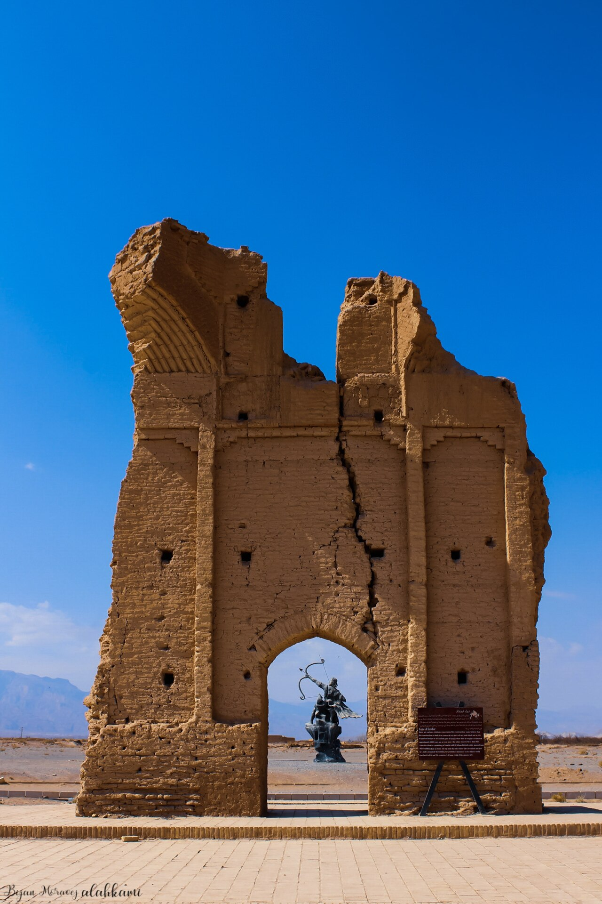

Preserved across centuries within the rich oral folklore of **East Azerbaijan** (encircling the historical domains of **تبریز**), the legendary lore of **Arash (The Archer)** stands as a compelling testament to Iran's enduring mythic imagination. Transmitted across hearths, mountain paths, and rural caravans, the tale has survived through the living memories of local elders.

Folklorists generally categorize **Arash (The Archer)** within the mythological taxonomy of *Legendary Hero*. As with many traditional entities of Iranian folk belief, it embodies both the untamed natural elements and the ancestral anxieties regarding solitary wilderness. Classical collectors recorded its traditional traits as follows:

> "Illustration by Mo.Rasoulipour In ancient literature, in the Avesta (Yasht 8.6), there is a reference to a story that seems to be part of a familiar epic: Arash shot an arrow from the mountain "Airyo.khshaota" to the mountain "Xvanvant." The identity of these places is uncertain. Some believe it is a peak in northeastern Khorasan. Therefore, it was supposed to be his shot towards the east, perhaps towards the region of Hari Rud. The event is also mentioned in the text "Mah-e Farvardin Rooz-e Khordad." On the sixth of Farvardin, Manuchehr and Arash successfully reclaimed the land from Afrasiab the Turanian. In contrast, in the Minuvi Kherad's prosecutor 27.44, only Manuchehr is mentioned as the one who recaptured the territory of Iran from Padeshkhar-Gar (Tabaristan) to Bon Gazi. The recent area is likely between Gorgan and Aksus. In Modern Literature: The story of Arash is not extensively described in epics, courtly romances, and general literature, and apart from occasional brief references, it had been largely lost in the world of Persian literature until Ehsan Yarshater revived Arash in his book "Stories of Ancient Iran." The story of Arash caught the attention of writers and poets and quickly gained prominence. In the following years, Arash became the subject of numerous works: "Arash Tirandaz" by Arsalan Pouya: It begins with a seventy-line poem, followed by a one-act play, and concludes with a prose version of the story. The long poem "Arash" by Siavash Kasraei. The short story "Arash in the Realm of Doubt" by Nader Ebrahimi. The poem "Epic of Arash" by Mehrdad Osta. "Arash" by Behram Beyzai, published in 1977. … Iranica - Ārāš"

In local oral tradition, an encounter with **Arash (The Archer)** was regarded as a formidable threshold between familiar domestic reality and the unseen realm. Elders customarily advised night travelers, shepherds, and caravan drivers traversing the historic passes of East Azerbaijan to heed ancient apotropaic rituals—such as carrying iron amulets, maintaining solemn reverence towards nature, and never uttering provocative words—to pass through its territorial domain unharmed.

Today, the chronicle of **Arash (The Archer)** forms an invaluable component of Iran's intangible cultural heritage, offering modern readers an evocative window into how ancient communities interpreted their ecology, mystery, and moral balance.

---

### Sources & Image Attribution
- **Folklore Research & Origin:** Sourced and adapted from the Eranshahr Folklore Archive (`eranshahr.com/myths`) and regional oral narratives of East Azerbaijan.
- **Visual Artifact:** *"Gate of Farafar.jpg"*, sourced via Wikimedia Commons, contributed by Bijan Moravej alahkami, licensed under `CC BY-SA 4.0` ([Source Link](https://commons.wikimedia.org/wiki/File:Gate_of_Farafar.jpg)).