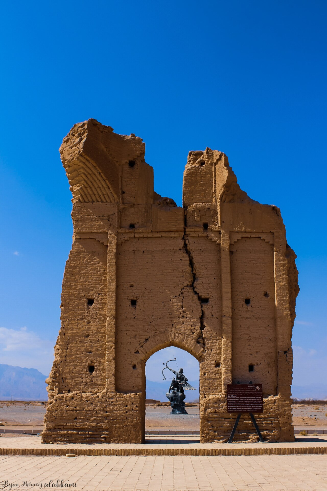

در یادمان‌های شفاهی و باورهای عامیانه‌ی مردم **آذربایجان شرقی** (به‌ویژه در گستره‌ی **تبریز**)، روایت‌های پرشماری از پدیده‌ای شگفت و موجودی دیرپا به نام **«Arash (The Archer)»** سینه به سینه از روزگاران باستان تا کنون بازگو شده است. راویان بومی که با گویش و لهجه‌ی **ترکی آذربایجانی** به نقل قصه‌ها می‌نشستند، پیدایش این پدیده را با کوهساران، دشت‌های بی‌کران، جنگل‌ها یا آب‌های مرموز این خطه پیوند می‌زدند.

در طبقه‌بندی فرهنگ عامه، **Arash (The Archer)** را غالباً با تیره‌ی *Legendary Hero* هم‌بسته می‌دانند؛ چهره‌ای که تجسم نیروهای ناشناخته‌ی اقلیم و جهان نادیدنی پیرامون نیاکان بوده است. در توصیف‌ها و متون بازمانده‌ی پژوهشی پیرامون این افسانه آمده است:

> «ĀRAŠ | ƎRƎXŠA | ĒRAŠ | Āraš-e Kamāngīr|در فارسی میانه "اِیرَش" | در اوستا "اِرِخشه" | آرش کمانگیر آرش کمانگیرآرش (در اوستا "اِرِخشه" (ƎRƎXŠA)، در فارسی میانه "اِیرَش" (ĒRAŠ)) قهرمانی تیرانداز در افسانه های ایرانی است.پس از آنکه افراسیاب، منوچهر، پادشاه پیشدادی را در طبرستان محاصره کرد، هر دو توافق کردند که صلح کنند. منوچهر از تورانیان درخواست کرد که سرزمین ایران را به اندازه پرواز یک تیر به او بازگردانند و افراسیاب موافقت کرد. فرشته ای (در بیرونی «اسفندارمذ» یعنی بخشنده جاودانه اسپندارماد) به منوچهر دستور داد که تیر و کمان مخصوصی آماده کند. چوب، پر و پیکانش از جنگل، عقاب و معدنی مخصوص گرفته شده باشد. به آرش، تیرانداز ماهر دستور پرتاب داده شد. به گفته بیرونی، آرش خود را برهنه نشان داد و گفت: «اینک! بدن من عاری از هر گونه زخم یا بیماری است. اما بعد از این تیراندازی من از بین خواهم رفت.» او تیر را در سپیده دم پرتاب کرد و بلافاصله تکه تکه شد. خداوند به باد فرمان داد و تیر تا نواحی دورافتاده خراسان رفت و به این ترتیب مرز میان پادشاهی ایران و توران مشخص شد.در ادبیات قدیمیدر اوستا (یشت ۸.۶) به داستانی اشاره شده که گویا بخشی از حماسه ای آشنا بوده است: ارخشا تیری از کوه "اَیریُو خَشَوثَه" (Airyō.xšaoθa) به کوه "خَوَنوَت" (Xᵛanvant) پرتاب کرد. هویت این مکان ها مشخص نیست. برخی آن را قله ای در شمال شرقی خراسان میدانند. بنابراین قرار بود پرتاب او به سمت شرق، شاید به سمت منطقه هری رود باشد. در متن "ماه فروردین روز خرداد" نیز به این واقعه اشاره شده است. در ششم فروردین فرخنده بود که منوچهر و اِیرش شباگ تیر زمین را از افراسیاب تورانی پس گرفتند. در مقابل، دادستان مینوی خرد ۲۷.۴۴ صرفاً به منوچهر به عنوان کسی که قلمرو ایران را از پادشخر-گر (طبرستان) به بون گزی بازپس گرفت، اشاره می کند. منطقه اخیر احتمالاً بین گوزگان و آکسوس قرار دارد.افسانه آرش تنها در منابع دوره اسلامی با جزئیات کامل آورده شده است، هرچند بین آن ها تفاوت وجود دارد. مثلاً، طالبی، اگرچه به سنت رایج اشاره می کند، اما داستان آرش را مربوط به زمان سلطنت زاو، پسر طهماسب می داند. بیرونی و گردیزی در مقابل فارسی میانه، متن ماه فروردین، تاریخ تیراندازی قهرمان را سیزدهم تیر، یعنی در جشن تیرگان، ذکر میکنند. احتمالاً این مسئله به دلیل شباهت «تیر» (خدای تیشتار) با «تیر»(خدنگ) پیش آمده است. در ادبیات مدرن داستان آرش در حماسه ها، عاشقانه های درباری و ادبیات عامه به هیچ وجه به تفصیل دیده نمی شود و جدا از اشارات گاه و بی گاه مختصر، اساساً در دنیای ادب فارسی گم شده بود تا اینکه احسان یارشاطر در کتاب "داستان های ایران باستان" خود دوباره آرش را زنده کرد. موضوع داستان آرش در میان نویسندگان و شاعران جا باز کرد و به سرعت مورد توجه قرار گرفت. آرش در سال‌های بعد موضوع آثار متعددی شد: -شعر بلند "آرش»" اثر سیاوش کسرایی -داستان کوتاه «آرش در قلمروی تردید» اثر نادر ابراهیمی -منظومه «حماسه‌آرش» اثر مهرداد اوستا -"آرش" اثر بهرام بیضایی که در سال ۱۹۷۷ منتشر شد. چهار اثر از این آثار، آرش را منجی ایران از ظلم و ستم افراسیاب معرفی می کنند. به نظر می رسد در دوران آشفته پس از مصدق، داستان آرش برای بسیاری از ایرانیان نماد امیدهای سیاسی آنها بوده است، در حالی که داستان ابراهیمی، جایی که آرش در مأموریت خود به دلیل نبود اراده شکست می خورد، بیانگر سرخوردگی این امیدهاست. در سال ۱۳۴۰ مجله‌ای ادبی به نام آرش در تهران تأسیس شد که حدود هشت سال فعالیت داشت.»

پیران و ریش‌سفیدان منطقه در شب‌نشینی‌ها گوشزد می‌کردند که رویارویی با **Arash (The Archer)** همواره نشانه‌ای از لزوم هشیاری در برابر ناشناخته‌های طبیعت بوده است. در اعصار گذشته، مسافران، شبانان و کاروانیانی که شب‌هنگام در این نواحی گذر می‌کردند، برای مصون ماندن از گزند یا فریب این موجودات، آیین‌ها و دعاهای محافظتی خاصی را به کار می‌بستند و از شکستن سکوت شب یا نزدیک شدن به زیستگاه‌های آنان پرهیز می‌کردند.

امروزه داستان **Arash (The Archer)** یکی از گنجینه‌های ماندگار میراث معنوی و مردم‌شناسی دیار **آذربایجان شرقی** به شمار می‌رود که پیوند عمیق روان‌شناختی انسان کهن را با رمزورازهای زیست‌بوم سرزمین ایران به تصویر می‌کشد.

---

### منابع و اعتبار تصویر
- **پژوهش و خاستگاه روایت:** برگرفته از دانشنامه فولکلور و اسطوره‌شناسی ایران‌شهر (`eranshahr.com/myths`) و روایت‌های شفاهی بومی آذربایجان شرقی.
- **تصویر:** اثر *«Gate of Farafar.jpg»*، بارگذاری‌شده در ویکی‌انبار (Wikimedia Commons)، پدیدآورنده: Bijan Moravej alahkami، تحت مجوز آزاد `CC BY-SA 4.0` ([مشاهده منبع](https://commons.wikimedia.org/wiki/File:Gate_of_Farafar.jpg)).