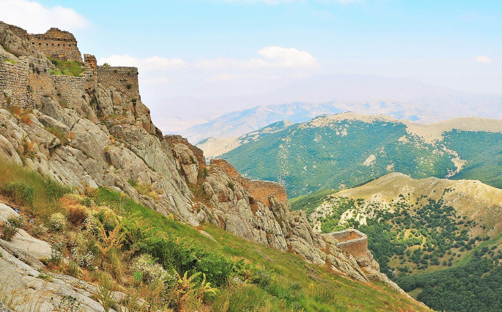

Perched upon the razor-sharp, mist-shrouded spires of the Arasbaran highland forests in Kaleybar, the monumental ruins of *Babak Fort* (*Qaleh-ye Baz*) command dizzying vertical escarpments. In the oral folklore of East Azerbaijan, this impregnable fortress is celebrated not solely as the historical citadel of legendary resistance fighters, but as the domain of the *Rock Div of Kaleybar* and the legend of the *Blood Spring*—a chthonic giant hewn from native limestone with a beard of mountain briars who guards the secret cisterns of the citadel.

Qaradaq Turkish oral tradition recounts that during an ancient siege when invading armies surrounded the fortress and cut off all aqueducts, the Rock Div awakened from the mountain's roots. Smashing his fist into the escarpment, he ruptured a hidden aquifer that sustained the besieged garrison with sweet water. But when traitors guided the enemy into the defile, the giant was overcome with fury: the spring boiled crimson, and the titan hurled monolithic boulders down upon the attackers, crushing the advancing army in the gorge.

> "The crags of Babak are unbreachable; the Div of Baz sleeps not, and the red spring is the blood of the mountain’s honor—step with malice, and the cliffs shall become your tomb." — Heroic ballad of the Ashiqs of Qaradaq.

Pioneering folklore scholars Samad Behrangi and Behrooz Dehghani in *Legends of Azerbaijan* and Gholam-Hossein Sa'edi in *Ilkhchi* emphasize that folk narratives of resistance in Azerbaijan frequently elevated nature giants into patriotic sentinels protecting the homeland against foreign despotism. Today, ascending the narrow, vertigo-inducing stone stairs of Babak Fort through the swirling Arasbaran mist evokes the primeval grandeur of this mythical mountain sentinel.

### Sources & Image Attribution
- **Research Source:** Samad Behrangi & Behrooz Dehghani, *Legends of Azerbaijan*, Tehran: Nil, pp. 56-62; Gholam-Hossein Sa'edi, *Ilkhchi*, p. 121.
- **Image Attribution:** Documented on Wikimedia Commons by Elnazmostaan; License: [CC BY-SA 4.0](https://commons.wikimedia.org/wiki/File:Babak_fort_back_view.jpg).
