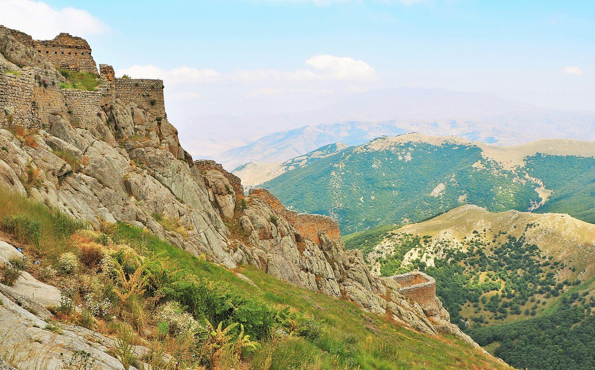

بر فراز قله‌های مه‌آلود و صخره‌های عمودی جنگل‌های ارسباران در کلیبر، ویرانه‌های نفوذناپذیر «دژ بابک» (قلعه بذ) همچون عقابی سنگی بر پرتگاه‌های ژرف اشراف دارد. در حافظه تاریخی و ادبیات عامه مردم آذربایجان، این دژ دست‌نیافتنی تنها پایگاه دلاوران تاریخ نبوده، بلکه آشیانه‌ی افسانه‌ای سهمگین پیرامون «دیو صخره‌نشین کلیبر» و «چشمه خونین» است؛ دیوی هولناک با قامتی از سنگ خارا و ریشی از شاخه‌های خارهای جنگلی که بر دهانه چاه مخفی دژ تکیه زده است.

روایت ترکی قره‌داغ بازگو می‌کند که در هنگامه نبردهای خونین گذشته، هنگامی که هزاران سوارکار مهاجم دژ بابک را در محاصره‌ای آهنین گرفتند و راه‌های آب را بستند، دیو صخره از شکاف کوه سر برآورد. او که نگهبان ریشه‌های کوهستان بذ بود، با ضربه مشت سنگین خویش، صخره‌های بالادست را شکافت و چشمه‌ای از آب زلال جاری ساخت که به شکل معجزه‌آسایی تشنگی مدافعان قلعه را فرونشاند. اما چون لشکر متجاوزان با خیانت قصد ورود به دژ را کردند، دیو خشمگین شد؛ آب چشمه به ناگاه به رنگ خون جوشید و دیو تخته‌سنگ‌هایی به وزن صد من را بر سر مهاجمان در تنگه باریک فروریخت، به گونه‌ای که دره کلیبر از اجساد مهاجمان مسدود شد.

> «صخره‌های بابک نفوذناپذیر است؛ دیو بذ در خواب نیست و چشمه سرخ، خون غیرت کوهستان است که اگر پای ستمگر بر آن نهاده شود، صخره‌ها بر سرش آوار خواهد گشت.» — سخن حماسی عاشیق‌های قره‌داغ در پای قلعه بابک.

صمد بهرنگی و بهروز دهقانی در شاهکار گردآوری فولکلور «افسانه‌های آذربایجان» و غلامحسین ساعدی در «ایلخچی» تأکید می‌کنند که چگونه اسطوره‌های مربوط به مقاومت ملی در کوهستان‌های آذربایجان با باور به نیروهای اساطیری دیوان طبیعت پیوند خورده است. دیو در این منطقه چهره‌ای میهن‌پرست و حامی مدافعان خاک است و خشم او تنها دامن‌گیر متجاوزان به مرزهای کوهستان می‌شود.

امروزه پله‌های سنگی و راه‌های پرتگاهی قلعه بابک در کلیبر با پیچیدن مه غلیظ ارسباران در میان دیواره‌ها، هنوز ابهت حماسی این دیو صخره‌نشین را به یاد می‌آورد که حافظ آزادی و سرافرازی تاریخ آذربایجان بوده است.

عاشیق‌های قره‌داغ در منظومه‌های حماسی خویش سروده‌اند که دیو صخره‌نشین کلیبر و بابک، دو چهره از یک روح واحد در دفاع از آزادی بوده‌اند؛ یکی در کالبد سلحشور تاریخ و دیگری در هیبت صخره‌های نفوذناپذیر ارسباران. هر تخته‌سنگی که از فراز قلعه به زیر افکنده می‌شد، در ذهن مردم آذربایجان مشت خشمگین دیوی بود که اجازه نمی‌داد خاک پاک میهن در چنگال بیگانگان ستمگر اسیر بماند.

### منابع و اعتبار تصویر
- **منبع پژوهشی افسانه:** صمد بهرنگی و بهروز دهقانی، «افسانه‌های آذربایجان»، تهران، نشر نیل، ص ۵۶-۶۲؛ غلامحسین ساعدی، «ایلخچی»، ص ۱۲۱.
- **اعتبار تصویر:** ثبت‌شده در ویکی‌مدیا کامنز توسط Elnazmostaan؛ مجوز انتشار: [CC BY-SA 4.0](https://commons.wikimedia.org/wiki/File:Babak_fort_back_view.jpg).
