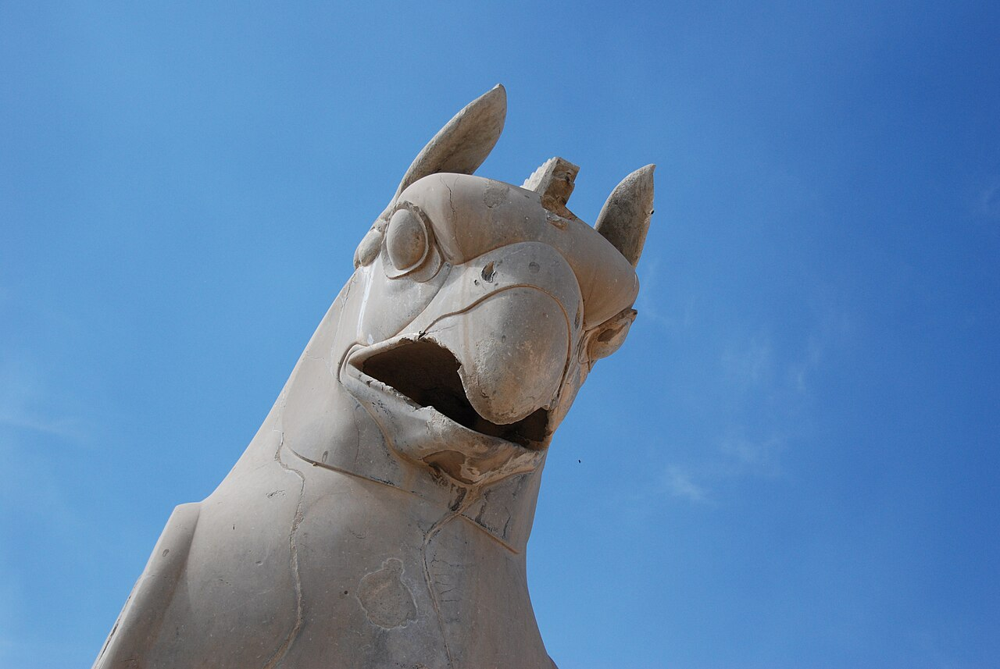

Preserved across centuries within the rich oral folklore of **East Azerbaijan** (encircling the historical domains of **تبریز**), the legendary lore of **HOMA** stands as a compelling testament to Iran's enduring mythic imagination. Transmitted across hearths, mountain paths, and rural caravans, the tale has survived through the living memories of local elders.

Folklorists generally categorize **HOMA** within the mythological taxonomy of *موجود افسانه‌ای*. As with many traditional entities of Iranian folk belief, it embodies both the untamed natural elements and the ancestral anxieties regarding solitary wilderness. Classical collectors recorded its traditional traits as follows:

> "Illustration by Erfan Aghvami Huma is a famous "bone-eating" bird that belongs to the order of hunters.Homay has a legendary position in Persian literature. About the word Homay, it is stated that: "Homay: Homayun, meaning auspicious and blessed".Some consider the name of this bird to be reminiscent of the famous Hum or Huma plant. It is known that anyone whose shadow falls on his head will achieve happiness. For this reason, it is also known as the "bird of felicity". In ornithology, "Gypaetus barbatus" or "Bearded Vulture" is equated with Humai.The Huma, Humia, Huma, Humiyeh, or Humayah, in the Avesta, means "blessed" and in the Shahnameh, it is mentioned about Darfesh. The Huma is a bird that can be seen in Iranian flags and column heads in ancient Iranian culture, especially Persepolis. It seems that Iranian people, who considered Homai to be auspicious, used the image and figure of this bird in their designs and took it as a good omen. …"

In local oral tradition, an encounter with **HOMA** was regarded as a formidable threshold between familiar domestic reality and the unseen realm. Elders customarily advised night travelers, shepherds, and caravan drivers traversing the historic passes of East Azerbaijan to heed ancient apotropaic rituals—such as carrying iron amulets, maintaining solemn reverence towards nature, and never uttering provocative words—to pass through its territorial domain unharmed.

Today, the chronicle of **HOMA** forms an invaluable component of Iran's intangible cultural heritage, offering modern readers an evocative window into how ancient communities interpreted their ecology, mystery, and moral balance.

---

### Sources & Image Attribution
- **Folklore Research & Origin:** Sourced and adapted from the Eranshahr Folklore Archive (`eranshahr.com/myths`) and regional oral narratives of East Azerbaijan.
- **Visual Artifact:** *"Griffin head.jpg"*, sourced via Wikimedia Commons, contributed by Paul Keller, licensed under `CC BY 2.0` ([Source Link](https://commons.wikimedia.org/wiki/File:Griffin_head.jpg)).