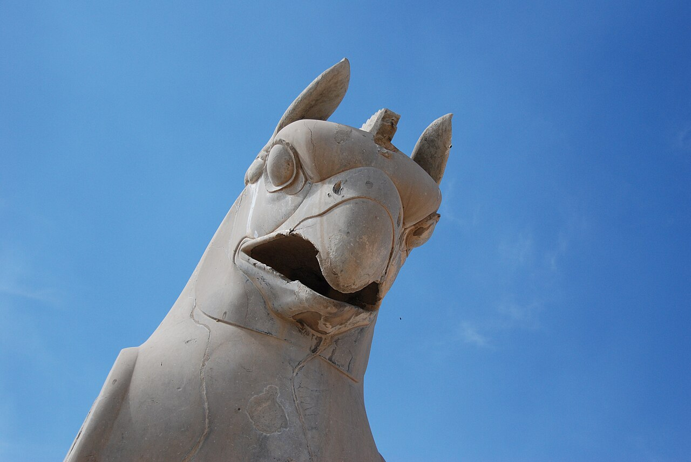

در یادمان‌های شفاهی و باورهای عامیانه‌ی مردم **آذربایجان شرقی** (به‌ویژه در گستره‌ی **تبریز**)، روایت‌های پرشماری از پدیده‌ای شگفت و موجودی دیرپا به نام **«HOMA»** سینه به سینه از روزگاران باستان تا کنون بازگو شده است. راویان بومی که با گویش و لهجه‌ی **ترکی آذربایجانی** به نقل قصه‌ها می‌نشستند، پیدایش این پدیده را با کوهساران، دشت‌های بی‌کران، جنگل‌ها یا آب‌های مرموز این خطه پیوند می‌زدند.

در طبقه‌بندی فرهنگ عامه، **HOMA** را غالباً با تیره‌ی *موجود افسانه‌ای* هم‌بسته می‌دانند؛ چهره‌ای که تجسم نیروهای ناشناخته‌ی اقلیم و جهان نادیدنی پیرامون نیاکان بوده است. در توصیف‌ها و متون بازمانده‌ی پژوهشی پیرامون این افسانه آمده است:

> «Homā | Huma | Humay | همای | هما هما یا «همای» مرغ استخوان‌خوار معروفی است که در راسته‌ی شکاریان قرار می‌گیرد و در ادبیات پارسی جایگاه اسطوره‌ای دارد. واژه ی «همای» به معنای «همایون؛ فرخنده و خجسته». برخی نیز نام این پرنده را یادآور گیاه معروف هوم یا هوما می‌دانند. ‌معروف است که سایه‌اش بر سر هر کسی بیفتد به سعادت خواهد رسید. به همین دلیل به مرغ سعادت نیز معروف است.‌ او پرنده‌ای است که در فرهنگ ایران باستان در پرچم‌ها و درفش‌های ایرانیان دیده می‌شود. به نظر می‌رسد ایرانیان براساس اعتقادات خود که «همای» را فرخنده می‌پنداشتند، از نقش و پیکر این پرنده در درفش‌های خود استفاده می‌کردند و آن را به فال نیک می‌گرفتند. درفشی پس پشت پیکر همای سپهبد همی داشت بر پیل جای فردوسی پس هر درفشی، درفشی به پای چه از اژدها و چه پیکر همای فردوسی مقاله جستاری پیرامون《همای》نوشته‌ی دکتر اسماعیل شفق، جمیله زارعی»

پیران و ریش‌سفیدان منطقه در شب‌نشینی‌ها گوشزد می‌کردند که رویارویی با **HOMA** همواره نشانه‌ای از لزوم هشیاری در برابر ناشناخته‌های طبیعت بوده است. در اعصار گذشته، مسافران، شبانان و کاروانیانی که شب‌هنگام در این نواحی گذر می‌کردند، برای مصون ماندن از گزند یا فریب این موجودات، آیین‌ها و دعاهای محافظتی خاصی را به کار می‌بستند و از شکستن سکوت شب یا نزدیک شدن به زیستگاه‌های آنان پرهیز می‌کردند.

امروزه داستان **HOMA** یکی از گنجینه‌های ماندگار میراث معنوی و مردم‌شناسی دیار **آذربایجان شرقی** به شمار می‌رود که پیوند عمیق روان‌شناختی انسان کهن را با رمزورازهای زیست‌بوم سرزمین ایران به تصویر می‌کشد.

---

### منابع و اعتبار تصویر
- **پژوهش و خاستگاه روایت:** برگرفته از دانشنامه فولکلور و اسطوره‌شناسی ایران‌شهر (`eranshahr.com/myths`) و روایت‌های شفاهی بومی آذربایجان شرقی.
- **تصویر:** اثر *«Griffin head.jpg»*، بارگذاری‌شده در ویکی‌انبار (Wikimedia Commons)، پدیدآورنده: Paul Keller، تحت مجوز آزاد `CC BY 2.0` ([مشاهده منبع](https://commons.wikimedia.org/wiki/File:Griffin_head.jpg)).