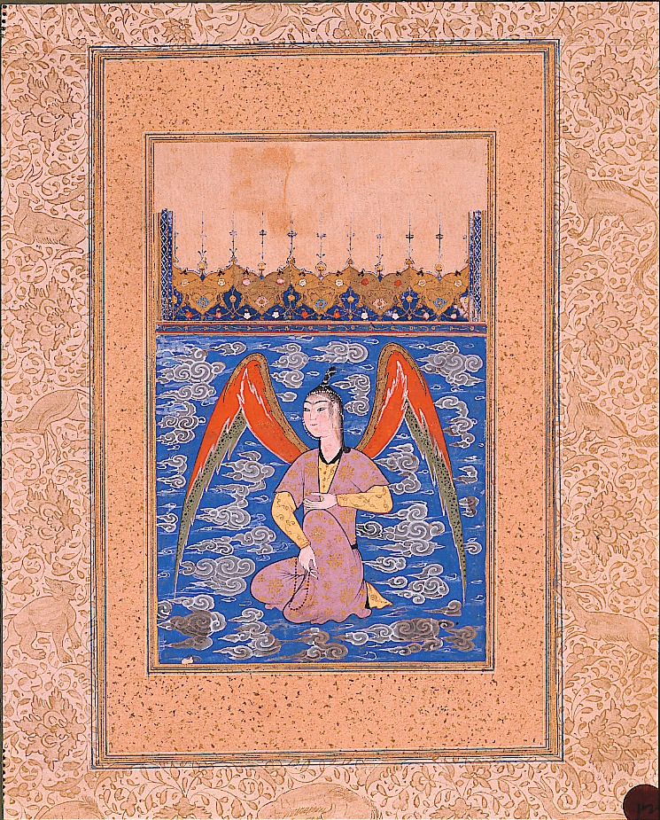

در یادمان‌های شفاهی و باورهای عامیانه‌ی مردم **آذربایجان شرقی** (به‌ویژه در گستره‌ی **تبریز**)، روایت‌های پرشماری از پدیده‌ای شگفت و موجودی دیرپا به نام **«پری»** سینه به سینه از روزگاران باستان تا کنون بازگو شده است. راویان بومی که با گویش و لهجه‌ی **ترکی آذربایجانی** به نقل قصه‌ها می‌نشستند، پیدایش این پدیده را با کوهساران، دشت‌های بی‌کران، جنگل‌ها یا آب‌های مرموز این خطه پیوند می‌زدند.

در طبقه‌بندی فرهنگ عامه، **پری** را غالباً با تیره‌ی *موجود افسانه‌ای* هم‌بسته می‌دانند؛ چهره‌ای که تجسم نیروهای ناشناخته‌ی اقلیم و جهان نادیدنی پیرامون نیاکان بوده است. در توصیف‌ها و متون بازمانده‌ی پژوهشی پیرامون این افسانه آمده است:

> «Peri|اژدر پری از موجودات خیالی و افسانه ای در فرهنگ فولکلور مردم ایران، آسیای جنوبی و آسیای میانه است. پری( فری) در اوستا موجودی اهریمنی است با ظاهری زیبا و فریبنده ی خود مردم را فریب میدهد و آن ها را به بیراهه میکشاند و یا موجب جنون آن ها میشود اما در فرهنگ ایرانیان پس از اسلام پریان موجودات دوست داشتنی هستند که مردم نیکوکار و خوش طینت را دوست دارند و آن ها را به خوشبختی و کامروایی میرسانند، آن ها از نسل فرشتگان تبعیدی از بهشت هستند که در صورت توبه کردن به بهشت باز میگردند پادشاه پریان مردی نیک و آزاده است و دختر و پسر شاه پریان رمزی از کمال، زیبایی، ثروت و خوشبختی هستند که هر دختر و پسر جوان آرزوی همسری ایشان را دارد. در منابع قدیمی تر آن ها عاملان شیاطین بودند؛ مانند هفت خوان های رستم و اسفندیار پری زنی زیبا و آراسته در حالی که عود مینوازد به پهلوان نزدیک میشود و او را به شادکامی دعوت میکند تا آن ها را فریب دهد اما هر دو پهلوان او را میشناسند و در نبرد او را میکشند پری ها هدف موجودات شروری به نام دیوسان بودند. دیوسانان با حبس پری ها در قفس های آهنین اقدام به آزار آن ها میکردند. پریان در باور مردم جهان موجودات نیکو و کارسازند، جایگاهشان در رودخانه و جنگل است و از آهن می‌ترسند و می‌توانند غیب شوند؛ از اسرار همه چیز آگاه‌اند، غیب‌گویند و با دیوها دوست و گاهی دشمن‌اند. به باور مردم ایران هم پریان موجوداتی نیکو و پرخیر و برکت، و گاه شریر و آزاررسان‌اند که در چشمه‌ها، رودها ، دریاها و کوهها جای دارند و چشمه‌ها، رودها و کوههای پری‌دار مقدس‌اند. پریان گاه به شکل حیواناتی مثل مار، قورباغه و ماهی و... درمی‌آیند و یا چهره‌ای انسان‌نما و اندامی ماهی‌وار دارند. زنی بسیار زیبا و فریبنده موجوداتی بالدار، بسیار دلنشین و با ظاهر فرشته تاریخچه مختصر هیولایی اسطوره ای به نام اژدها - گجت نیوز (gadgetnews.net) اژدها - ویکی‌پدیا، دانشنامهٔ آزاد (wikipedia.org)»

پیران و ریش‌سفیدان منطقه در شب‌نشینی‌ها گوشزد می‌کردند که رویارویی با **پری** همواره نشانه‌ای از لزوم هشیاری در برابر ناشناخته‌های طبیعت بوده است. در اعصار گذشته، مسافران، شبانان و کاروانیانی که شب‌هنگام در این نواحی گذر می‌کردند، برای مصون ماندن از گزند یا فریب این موجودات، آیین‌ها و دعاهای محافظتی خاصی را به کار می‌بستند و از شکستن سکوت شب یا نزدیک شدن به زیستگاه‌های آنان پرهیز می‌کردند.

امروزه داستان **پری** یکی از گنجینه‌های ماندگار میراث معنوی و مردم‌شناسی دیار **آذربایجان شرقی** به شمار می‌رود که پیوند عمیق روان‌شناختی انسان کهن را با رمزورازهای زیست‌بوم سرزمین ایران به تصویر می‌کشد.

---

### منابع و اعتبار تصویر
- **پژوهش و خاستگاه روایت:** برگرفته از دانشنامه فولکلور و اسطوره‌شناسی ایران‌شهر (`eranshahr.com/myths`) و روایت‌های شفاهی بومی آذربایجان شرقی.
- **تصویر:** اثر *«An airborne peri with a rosary (6124504583).jpg»*، بارگذاری‌شده در ویکی‌انبار (Wikimedia Commons)، پدیدآورنده: thesandiegomuseumofartcollection، تحت مجوز آزاد `Public domain` ([مشاهده منبع](https://commons.wikimedia.org/wiki/File:An_airborne_peri_with_a_rosary_(6124504583).jpg)).