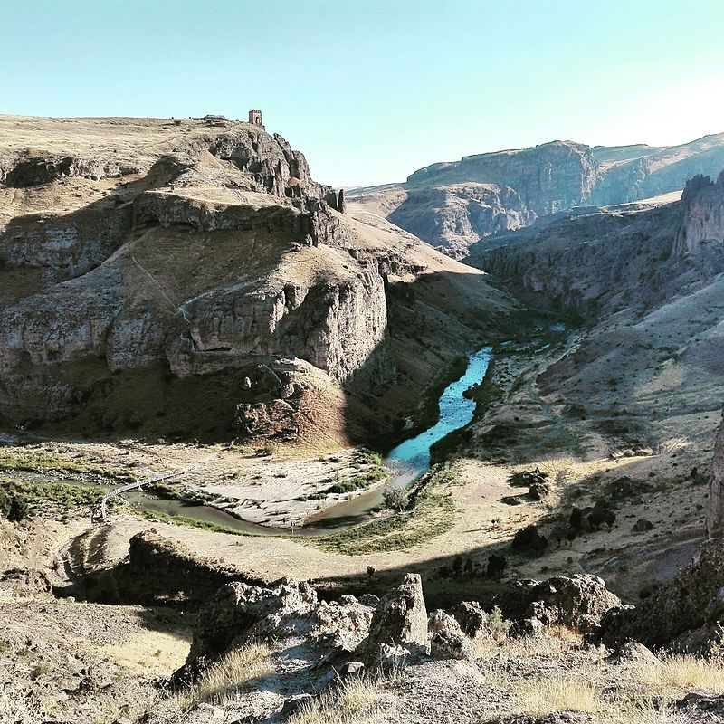

در پیچ‌وخم صخره‌های مخوف و رودخانه‌های خروشان هشترود در آذربایجان شرقی، بر فراز کوهی سترگ و منزوی، برج و باروی دژی باستانی خودنمایی می‌کند که قرن‌هاست در میان مردم محلی به «قلعه ضحاک» (یا قالا ضحاک) شهرت دارد. این دژ کهن که آثاری از دوره اشکانیان و ساسانیان را با چهارطاقی آجری شگفت‌انگیزش در سینه حفظ کرده، در ذهن و زبان روستاییان پیرامون، پایتخت زمستانی و صخره‌ای ضحاک ماردوش (اژدهاک شاهنامه) است؛ مکانی که در آن ظلمت، سحر و ارواح ماران هنوز در تاریک‌روشن سنگ‌ها پرسه می‌زنند. دیواره‌های پرتگاهی که پیرامون دژ را فراگرفته‌اند، شبیه به خندقی طبیعی و دهشت‌زا هستند که عبور از آن برای هر لشکری ناممکن می‌نمود و غرش رود قرانقو در پای صخره‌ها ترسی دوچندان بر جان راهگذران می‌افکند.

روایت‌های محلی نقل می‌کنند که ضحاک پس از بوسه ابلیس و رویش دو مار سیاه بر شانه‌هایش، اطبای جهان را فراخواند اما هیچ مرهمی نیافت مگر خوراک مغز جوانان پاک‌نهاد. او این دژ دست‌نیافتنی را در هشترود بنا کرد تا صدای ناله‌های شبانه قربانیان در غرش رود قرانقو گم شود. کهنسالان روستاهای اطراف می‌گویند دیوارهای قلعه با ساروجی ویژه آمیخته به زهر افعی‌ها برپا شده تا هیچ سواری نتواند از دیواره‌های عمودی آن صعود کند. در تالارهای زیرین چهارطاقی، کوره و انبار بزرگی وجود داشت که مارهای ضحاک در آن پرورش می‌یافتند و دیوان نگهبان با گرزهای سنگین بر درگاه آن پاسبانی می‌دادند. بومیان معتقدند این دیوان شب‌ها به شکل خفاش‌هایی غول‌پیکر بر فراز باروها پرواز می‌کردند.

> روستاییان هشترود با اشاره به رگه‌های تیره سنگ‌های کوهستان می‌گویند: «آن خطوط سیاه روی صخره، رد خزیدن مارهای غول‌پیکر ضحاک است که پس از شکست او از فریدون، با طلسمی جاودانه به سنگ سخت تبدیل شدند.»

هنگامی که کاوه آهنگر درفش کاویانی برافراشت و فریدون دژ را محاصره نمود، ضحاک کوشید تا از طریق راهروهای مخفی که تا قعر رودخانه امتداد داشت بگریزد؛ اما ارواح جوانان دربند و بادهای کوهستان راه را بر او بستند. بنا به روایت فولکلور آذربایجان، فریدون پیش از بردن ضحاک به دماوند، مارهای جادویی او را با شمشیر آهنینی که کاوه گداخته بود بر دیواره صخره کوبید و آنان در دم سنگ شدند. چوپانانی که گله‌های خود را در شیب‌های تند قلعه می‌چرانند، مدعی هستند که در شب‌های طوفانی، از میان روزنه‌های چهارطاقی صدایی شبیه به فشفش مارهای خشمگین و همهمه زنجیرهای سنگین به گوش می‌رسد. مردم هشترود این قلعه را نماد زنده دادخواهی ستمدیدگان در برابر طاغوت‌های روزگار می‌دانند. قلعه ضحاک هشترود با پلکان‌های صخره‌ای و پرتگاه‌های وهم‌انگیزش، گواهی زنده بر پیروزی روشنایی بر تباهی در فرهنگ عامه این سرزمین است.

### منبع روایت و تصویر
- **خاستگاه افسانه:** روایت‌های عامیانه و فولکلور روستاهای هشترود پیرامون نام‌گذاری دژ اشکانی به نام ضحاک، مقالات مردم‌شناسی میراث فرهنگی آذربایجان شرقی.
- **عکاس / پدیدآورنده تصویر:** Ahmad Kavoosi (Wisehomo)
- **منبع تصویر:** [صفحه تصویر در ویکی‌انبار](https://commons.wikimedia.org/wiki/File:Zahack_castle_photo_by_-_wisehomo_-_Ahmad_kavoosi.jpg)
- **نوع مجوز:** CC BY-SA 4.0
