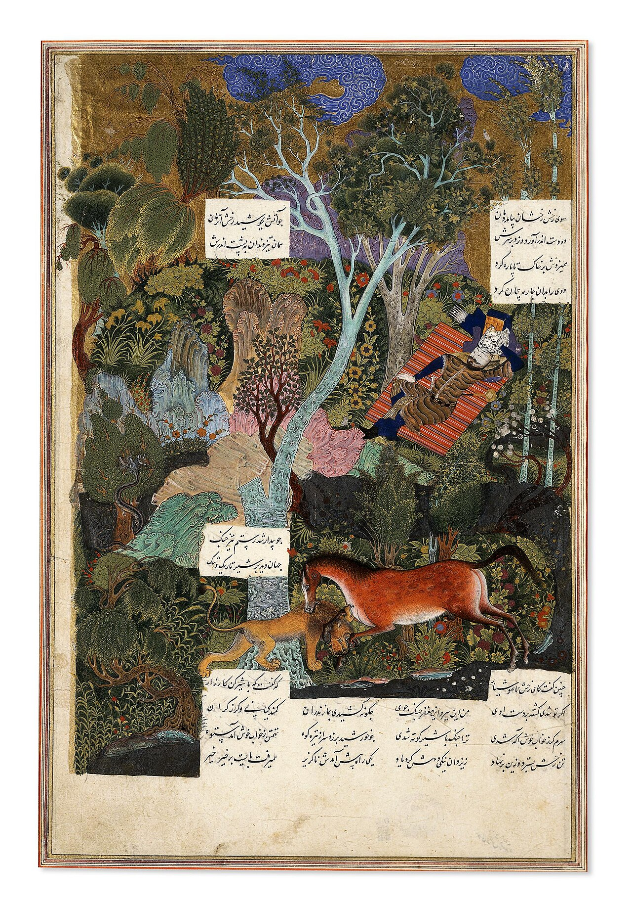

Preserved across centuries within the rich oral folklore of **East Azerbaijan** (encircling the historical domains of **تبریز**), the legendary lore of **Rakhsh** stands as a compelling testament to Iran's enduring mythic imagination. Transmitted across hearths, mountain paths, and rural caravans, the tale has survived through the living memories of local elders.

Folklorists generally categorize **Rakhsh** within the mythological taxonomy of *موجود افسانه‌ای*. As with many traditional entities of Iranian folk belief, it embodies both the untamed natural elements and the ancestral anxieties regarding solitary wilderness. Classical collectors recorded its traditional traits as follows:

> "Illustration by Farima Keshavarz Rakhsh (meaning "luminous") is a wondrous stallion -the brave and faithful steed of the preeminent hero Rostam in the Persian national epic, Shahnameh.The color of Rakhsh is described as "rose leaves that have been scattered upon a saffron ground" and it is first noticed by Rostam amongst the herds of horses brought over from Zabulistan and Kabul. In this first encounter Rakhsh is described as a mighty colt with the chest and shoulders of a lion and it appears to have the strength of an elephant. He is highly intelligent and his loyalty is legendary. No one but Rostam ever rides Rakhsh, and Rakhsh recognizes no one but Rostam as his master. Also, he is the only horse ever that Rostam could ride, since his great strength and weight would kill other horses. … …"

In local oral tradition, an encounter with **Rakhsh** was regarded as a formidable threshold between familiar domestic reality and the unseen realm. Elders customarily advised night travelers, shepherds, and caravan drivers traversing the historic passes of East Azerbaijan to heed ancient apotropaic rituals—such as carrying iron amulets, maintaining solemn reverence towards nature, and never uttering provocative words—to pass through its territorial domain unharmed.

Today, the chronicle of **Rakhsh** forms an invaluable component of Iran's intangible cultural heritage, offering modern readers an evocative window into how ancient communities interpreted their ecology, mystery, and moral balance.

---

### Sources & Image Attribution
- **Folklore Research & Origin:** Sourced and adapted from the Eranshahr Folklore Archive (`eranshahr.com/myths`) and regional oral narratives of East Azerbaijan.
- **Visual Artifact:** *"Rustam Sleeping while Rakhsh Fights a Lion.jpg"*, sourced via Wikimedia Commons, contributed by Sultan Muhammad., licensed under `CC BY-SA 4.0` ([Source Link](https://commons.wikimedia.org/wiki/File:Rustam_Sleeping_while_Rakhsh_Fights_a_Lion.jpg)).