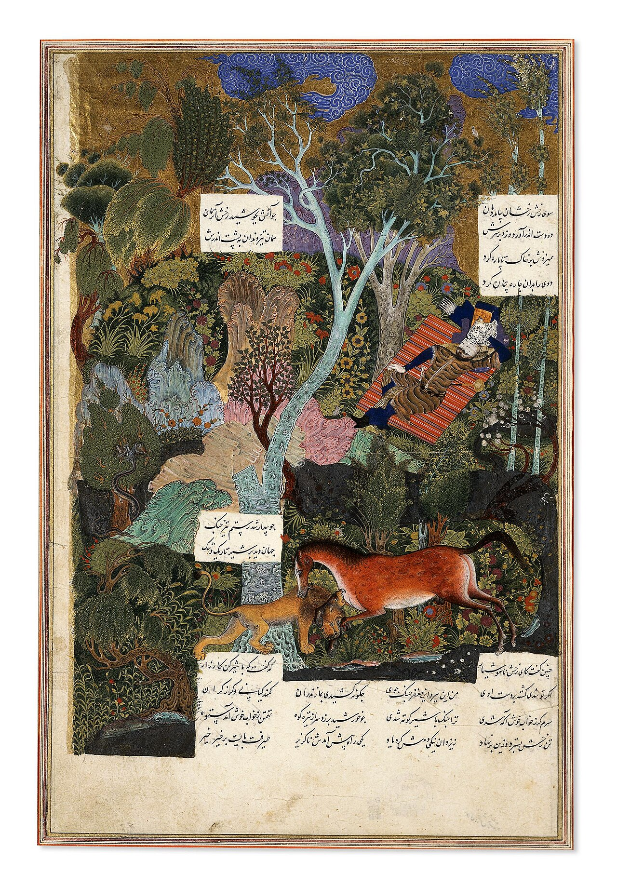

در یادمان‌های شفاهی و باورهای عامیانه‌ی مردم **آذربایجان شرقی** (به‌ویژه در گستره‌ی **تبریز**)، روایت‌های پرشماری از پدیده‌ای شگفت و موجودی دیرپا به نام **«رخش»** سینه به سینه از روزگاران باستان تا کنون بازگو شده است. راویان بومی که با گویش و لهجه‌ی **ترکی آذربایجانی** به نقل قصه‌ها می‌نشستند، پیدایش این پدیده را با کوهساران، دشت‌های بی‌کران، جنگل‌ها یا آب‌های مرموز این خطه پیوند می‌زدند.

در طبقه‌بندی فرهنگ عامه، **رخش** را غالباً با تیره‌ی *موجود افسانه‌ای* هم‌بسته می‌دانند؛ چهره‌ای که تجسم نیروهای ناشناخته‌ی اقلیم و جهان نادیدنی پیرامون نیاکان بوده است. در توصیف‌ها و متون بازمانده‌ی پژوهشی پیرامون این افسانه آمده است:

> «Rakhsh|رخش رَخْش، نام اسب رستم در شاهنامه است. رخش مانند بیشتر اسبهای اساطیری، از توانایی‌های ویژه‌ای برخوردار بوده. در لغت‌نامه‌های فارسی، رخش به معنی «دورنگ، یکی سرخ و دوم سپید» و آمده و فردوسی نیز در شاهنامه، در بخش پادشاهی گرشاسب، رخش را این طور توصیف می‌کند " تنش پرنگار از کران تا کران/ چو داغ گل سرخ بر زعفران".زال، پدر رستم فرمان داد که هر چه اسب در زابلستان و کابلستان است بیاورند تا رستم یکی را انتخاب کند. پشت تمام اسب‌ها از نیروی رستم خم می‌شد و شکم اسب به زمین می‌رسید، اما رخش به آسانی رستم را بر پشت خود نگه داشت.رخش همواره همراه رستم بوده و او را با هوش و ذکاوت خود در سختی‌ها یاری کرده است. رخش عمری طولانی‌تر از اسب‌های معمولی نیز داشته‌.در خان اول، هنگامی که رستم خواب است، شیری ظاهر می‌شود و ابتدا به رخش حمله می‌کند. رخش با سم و دندان شیر را از پا درمی‌آورد. تنها پس از پایان این جنگ رستم بیدار می‌شود.در خان سوم، هنگام حملۀ اژدها، باز هم رستم در خواب است. این‌بار رخش تلاش می‌کند تا رستم را بیدار کند، اما رستم رخش را تهدید می‌کند که اگر به بیدار کردن او ادامه دهد پاهایش را خواهد برید. اما در نهایت بیدار می‌شود و با اژدها می‌جنگد. رخش به یاری رستم می‌آید و با دندان کتف اژدها را از هم می‌درد.در خان پنجم نیز وقتی رستم به جایی می‌رسد که روشنایی در آن وجود ندارد، اختیار خود را به رخش می‌سپارد و رخش نیز با هوشیاری او را به سمت روشنایی می‌برد.رستم و رخش در نهایت به دست برادر خیانتکار رستم، شغاد، کشته می‌شوند. منابعشاهنامه»

پیران و ریش‌سفیدان منطقه در شب‌نشینی‌ها گوشزد می‌کردند که رویارویی با **رخش** همواره نشانه‌ای از لزوم هشیاری در برابر ناشناخته‌های طبیعت بوده است. در اعصار گذشته، مسافران، شبانان و کاروانیانی که شب‌هنگام در این نواحی گذر می‌کردند، برای مصون ماندن از گزند یا فریب این موجودات، آیین‌ها و دعاهای محافظتی خاصی را به کار می‌بستند و از شکستن سکوت شب یا نزدیک شدن به زیستگاه‌های آنان پرهیز می‌کردند.

امروزه داستان **رخش** یکی از گنجینه‌های ماندگار میراث معنوی و مردم‌شناسی دیار **آذربایجان شرقی** به شمار می‌رود که پیوند عمیق روان‌شناختی انسان کهن را با رمزورازهای زیست‌بوم سرزمین ایران به تصویر می‌کشد.

---

### منابع و اعتبار تصویر
- **پژوهش و خاستگاه روایت:** برگرفته از دانشنامه فولکلور و اسطوره‌شناسی ایران‌شهر (`eranshahr.com/myths`) و روایت‌های شفاهی بومی آذربایجان شرقی.
- **تصویر:** اثر *«Rustam Sleeping while Rakhsh Fights a Lion.jpg»*، بارگذاری‌شده در ویکی‌انبار (Wikimedia Commons)، پدیدآورنده: Sultan Muhammad.، تحت مجوز آزاد `CC BY-SA 4.0` ([مشاهده منبع](https://commons.wikimedia.org/wiki/File:Rustam_Sleeping_while_Rakhsh_Fights_a_Lion.jpg)).