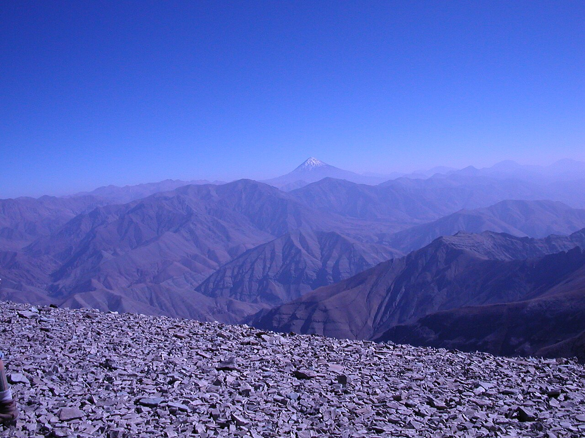

Preserved across centuries within the rich oral folklore of **East Azerbaijan** (encircling the historical domains of **تبریز**), the legendary lore of **Simorgh** stands as a compelling testament to Iran's enduring mythic imagination. Transmitted across hearths, mountain paths, and rural caravans, the tale has survived through the living memories of local elders.

Folklorists generally categorize **Simorgh** within the mythological taxonomy of *موجود افسانه‌ای*. As with many traditional entities of Iranian folk belief, it embodies both the untamed natural elements and the ancestral anxieties regarding solitary wilderness. Classical collectors recorded its traditional traits as follows:

> "Illustrated By Farima Keshavarz The Simorgh is a legendary bird that, according to ancient narratives, makes its nest atop the Tree of All Seeds. Whenever the Simorgh takes flight, a thousand branches grow. Upon its return, a thousand branches break. The Simorgh appears in the Shāhnāme, Avestā, and Middle-Persian narratives, as having beautiful, colorful wings, the face of a dog (or at times a human visage), and an eagle-like beak that can easily carry an elephant. This king of birds has a lifespan of one thousand and seven hundred years. In Ferdowsi's Shāhnāme, the Simorgh dwelled atop the Alborz Mountain* and raised Zaal (Rostam's father) alongside itschicks. When Zaal returned to his human family, the Simorgh gave him a feather to burn if he ever encountered danger. Simorgh appeared once during Rostam's birth and again to aid Zaal and Rostam during the battle with Esfandyar."

In local oral tradition, an encounter with **Simorgh** was regarded as a formidable threshold between familiar domestic reality and the unseen realm. Elders customarily advised night travelers, shepherds, and caravan drivers traversing the historic passes of East Azerbaijan to heed ancient apotropaic rituals—such as carrying iron amulets, maintaining solemn reverence towards nature, and never uttering provocative words—to pass through its territorial domain unharmed.

Today, the chronicle of **Simorgh** forms an invaluable component of Iran's intangible cultural heritage, offering modern readers an evocative window into how ancient communities interpreted their ecology, mystery, and moral balance.

---

### Sources & Image Attribution
- **Folklore Research & Origin:** Sourced and adapted from the Eranshahr Folklore Archive (`eranshahr.com/myths`) and regional oral narratives of East Azerbaijan.
- **Visual Artifact:** *"Damavand (5671) from Tochal (near the top of Tochal mountain) - panoramio.jpg"*, sourced via Wikimedia Commons, contributed by Alireza Javaheri, licensed under `CC BY 3.0` ([Source Link](https://commons.wikimedia.org/wiki/File:Damavand_(5671)_from_Tochal_(near_the_top_of_Tochal_mountain)_-_panoramio.jpg)).