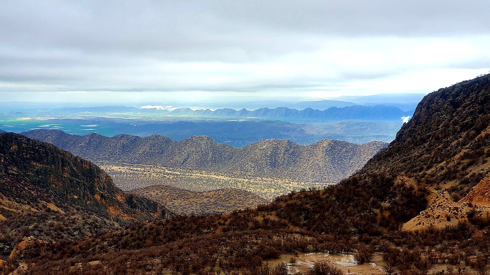

در جنوب شهرستان کازرون در استان فارس، در پای کوه‌های سرسبز فامور و در مجاورت جنگل‌های بلوط دشت برم، تالابی باستانی و آب‌شیرین گسترده شده است که بومیان آن را «دریاچه پریشان» (یا دریاچه فامور) می‌نامند. این تالاب که در گذشته زیستگاه میلیون‌ها پرنده مهاجر و نیلوفرهای زرین آبی بود، در باورهای مردم کهنسال کازرون و ایلات لر ممسنی، نام خویش را از پری زیبارویی به نام «پری‌ماه» وام گرفته است؛ دختر پاک‌نهادی از تبار ایزدبانوی آب‌ها که برای نجات خاک فارس از خشکسالی، جان خویش را فدای زایش چشمه‌ها ساخت تا زندگی در دشت کازرون جاری بماند.

روایت محلی نقل می‌کند که در سالی شوم از روزگاران پیشین، دیو خشکسالی تمام چشمه‌های دشت کازرون را خشکاند و زمین‌ها شکاف برداشتند. دختر حاکم نیکوکار دشت، دست به دعا برداشت و به درگاه پروردگار لابه نمود تا باران بر این خاک ببارد. ندایی در خواب به او فرمود که اگر دختری پاکدامن گیسوان بلند خویش را در پای صخره فامور به دست باد بسپارد و قطره اشکی به زمین هدیه کند، چشمه‌ها خواهند جوشید. پری‌ماه بر لبه صخره ایستاد، گیسوان ابریشمینش در باد پریشان شد و با خلوص دل گریست؛ با افتادن اشک او، آب‌های شیرین از صدها چشمه جوشیدند و دریاچه‌ای به وسعت دل او پدید آمد که «پریشان» نام گرفت.

> مادران کازرونی در کنار نیزارها می‌خوانند: «پریشان گیسوان دختر دریاست؛ هر بهار که گل‌های زرد بر آب می‌روید، پری‌ماه با پیراهنی از گلبرگ برای برکت مزارع دعا می‌کند.»

در افسانه‌های فامور آمده است که در اعماق آرام دریاچه، قصری از صدف و بلور وجود دارد که پریان آب در آن نغمه‌سرایی می‌کنند. صیادان کهنسال باور داشتند اگر کسی به پرندگان دریاچه آزار نرساند و آب را پاکیزه بدارد، پری دریاچه تور او را پر از ماهیان حلال می‌کند؛ اما اگر آزمندی دست به خشکانیدن نیزارها بزند، پری به خوابی عمیق فرومی‌رود و دریاچه تا زمان بازگشت انصاف خشک خواهد ماند. زنان روستایی کازرون با بافتن شاخه‌های نی به یکدیگر، نمادهایی از گیسوان پری‌ماه می‌سازند و در آستانه درگاه خانه می‌آویزند تا رزق و برکت در کاشانه بماند. دشت برم و نرگس‌زارهای کازرون در همسایگی پریشان، در باور پیران ممسنی، گردنبند عطرآگینی است که پری‌ماه بر گردن خاک فارس آویخته است. چوپانانی که در غروب‌های دل‌انگیز پاییز نی‌لبک می‌نواختند، باور داشتند نوای موسیقی سنتی اگر با سوز دل همراه باشد، پرندگان مهاجر را از آسمان‌های دور به آغوش آرامش‌بخش نیزارهای پریشان فرود می‌آورد تا زمستان را در امن و امان سپری کنند. دریاچه پریشان با چشم‌انداز دل‌انگیز و تاریخ پرشکوهش، گواهی زنده بر پیوند ناگسستنی طبیعت، زن و برکت در فرهنگ غنی دیار فارس است.

### منبع روایت و تصویر
- **خاستگاه افسانه:** فولکلور و ادبیات شفاهی مردم کازرون، فامور و ممسنی، پژوهش‌های مردم‌شناسی تالاب‌های استان فارس.
- **عکاس / پدیدآورنده تصویر:** Behnam9395
- **منبع تصویر:** [صفحه تصویر در ویکی‌انبار](https://commons.wikimedia.org/wiki/File:Dashte_Barm_Forest_and_Parishan_Lake_of_Kazerun.jpg)
- **نوع مجوز:** CC0 (Public Domain)
