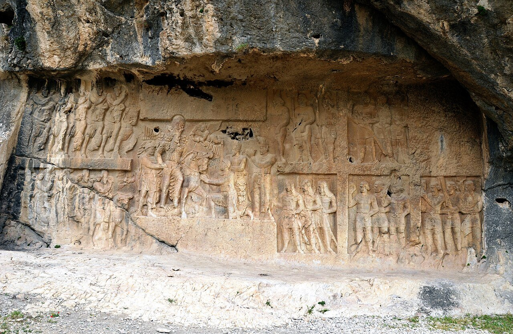

Within the verdant, cliff-lined canyon of *Tang-e Chogan* near the Sasanian capital of Bishapur in Kazerun, where the rushing Shapour River carves through monumental limestone escarpments adorned with monumental victory reliefs of Persian emperors, endures the legend of the *Pari of the Shapour River*. Depicted in regional lore as a celestial water nymph crowned with turquoise droplets and draped in lotus blossoms, she is revered as the spiritual guardian of the sacred springs feeding the subterranean Temple of Anahita.

Kazeruni folklore attributes the perennial abundance of the river to the benevolent breath of this water nymph. Tradition recounts that when Emperor Shapur I founded the city of Bishapur, he erected an open-air subterranean stone water temple to honor the divine waters. In response to this royal reverence, the Water Pari pledged that so long as the valley dwellers preserved the purity of the river and kept its waters untainted by blood or filth, the springs of Tang-e Chogan would never run dry. Whenever unjust tyrants invaded the gorge, the Pari retreated into the depths of the Great Shapur Cave, and the river ran crimson as an omen of impending strife.

> "The water of the Shapour is pure as a fairy's tear; cast no stone into the spring, lest the fury of the Bishapur Pari turn Kazerun's orchards to barren salt." — Proverb of the elders in Tang-e Chogan.

Folklorist Ali-Ashraf Darvishian in *Encyclopedia of Iranian Folktales* and Sadegh Hedayat in *Folk Culture of Iran* emphasize the living mythological connection between Sasanian reliefs and local river lore. During summer heatwaves, Kazeruni villagers historically gathered beside the rock reliefs, casting sprigs of wild eglantine roses into the swirling pools to honor the nymph’s ancient covenant. The rushing roar of the Shapour River today remains an enduring echo of this primeval communion between water, stone, and memory.

### Sources & Image Attribution
- **Research Source:** Ali-Ashraf Darvishian, *Encyclopedia of Iranian Folktales*, Tehran, Vol. 5, pp. 163-170; Sadegh Hedayat, *Folk Culture of Iran*, p. 220.
- **Image Attribution:** Documented on Wikimedia Commons by Alireza Javaheri; License: [CC BY 3.0](https://commons.wikimedia.org/wiki/File:Kazeroun_-_Tange_Chogan_-_panoramio.jpg).
