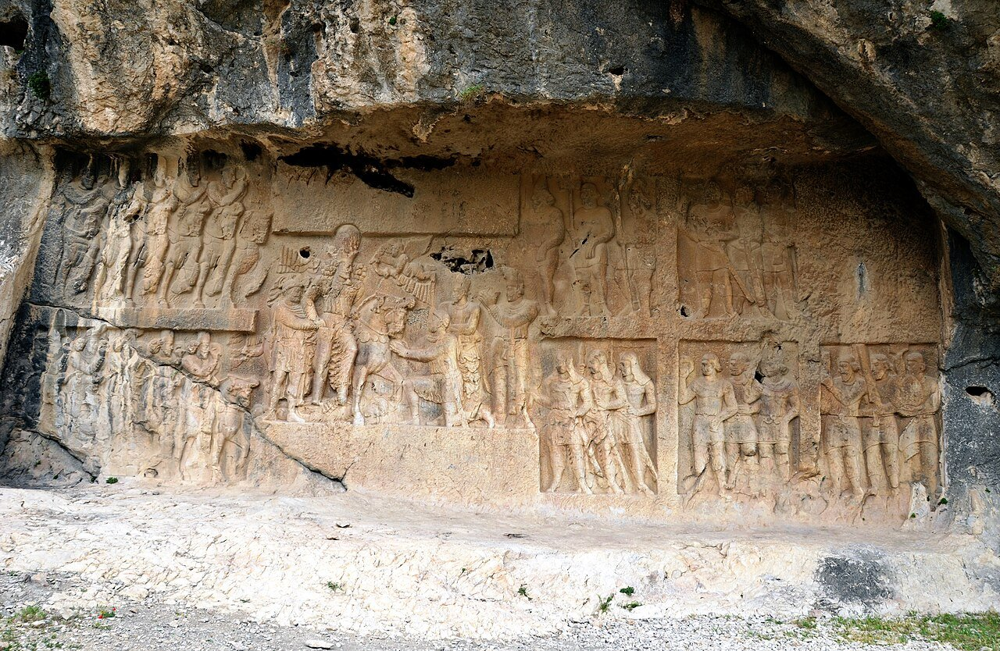

در بستر سرسبز و شگفت‌انگیز تنگ چوگان در نزدیکی شهر باستانی بیشاپور کازرون، جایی که رودخانه پرخروش شاپور صخره‌های ستبر را می‌شکافد و سنگ‌نگاره‌های پیروزی شاهان ساسانی بر دیواره‌ها خودنمایی می‌کنند، یکی از لطیف‌ترین اسطوره‌های آب در فارس جریان دارد: «پری رود شاپور». این پری، دوشیزه‌ای آسمانی با چشمانی به رنگ فیروزه و لباسی آراسته به گل‌های نیلوفر است که در حوضچه‌های عمیق غار شاپور و زیر سنگ‌نگاره نیایش آناهیتا زندگی می‌کند.

باور مردم کازرون بر این است که رودخانه شاپور برکت و خنکای همیشگی خود را مدیون دم حیات‌بخش این پری است. روایت کهن بازگو می‌کند که در عهد باستان، هنگامی که شاپور اول ساسانی پس از نبردهای دشوار شهری نو در این دشت بنا نهاد، برای اطمینان از جریان همیشگی آب چشمه‌ها، معبدی بی‌سقف برای ایزدبانوی آب در بیشاپور ساخت. پری رودخانه در پاسخ به این احترام، سوگند یاد کرد که تا زمانی که مردم قدردان زلالی آب باشند و جویبار را با آلودگی و خون نیالایند، چشمه‌های تنگ چوگان هرگز نخشکد. اما هرگاه در دوران‌های بعد ستمگری یا غارتگری به دره هجوم می‌آورد، پری به درون غار مرتفع شاپور می‌گریخت و آب رودخانه برای روزها به رنگ سرخ درمی‌آمد تا زنگ خطری برای اهالی باشد.

> «آب شاپور زلال است چون اشک پری؛ سنگ بر چشمه نزن و آب را مکدر مکن، که قهر پری بیشاپور دشت‌های کازرون را به نمک‌زار بدل خواهد ساخت.» — پند کهنسالان روستاهای تنگ چوگان کازرون.

علی‌اشرف درویشیان در جلد پنجم «فرهنگ افسانه‌های مردم ایران» و صادق هدایت در «فرهنگ عامیانه مردم ایران» به پیوند ناگسستنی سنگ‌نگاره‌های ساسانی بیشاپور با باورهای بومی پریان آب اشاره می‌کنند. مردم کازرون در روزهای گرم تابستان با احترامی قلبی به کنار چشمه‌های تنگ چوگان می‌رفتند و در کنار نقش‌برجسته پادشاهان، شاخه‌های گل نسترن وحشی را به آب می‌سپردند تا رضایت پری آب را حفظ کنند.

امروزه صدای خروشان رودخانه شاپور در سایه تندیس عظیم شاپور اول، یادآور عهد دیرین پری آب با انسان است؛ پیوندی عمیق میان تاریخ باستان و محیط زیست کوهپایه‌های زاگرس.

مردم روستاهای کازرون و بیشاپور روایت می‌کنند که پری رودخانه شاپور در هنگام غروب آفتاب، با صدای زمزمه آب سخن می‌گوید و هر قطره از شبنم‌های سحرگاهی بر روی گل‌های نسترن تنگ چوگان، بازتابی از لبخند اوست. این باور سبب شده بود که اهالی منطقه همواره از قطع درختان بید و چنار حاشیه رودخانه خودداری ورزند تا آرامش پری آب در دره تنگ چوگان بر هم نخورد.

### منابع و اعتبار تصویر
- **منبع پژوهشی افسانه:** علی‌اشرف درویشیان، «فرهنگ افسانه‌های مردم ایران»، تهران، جلد ۵، ص ۱۶۳-۱۷۰؛ صادق هدایت، «فرهنگ عامیانه مردم ایران»، ص ۲۲۰.
- **اعتبار تصویر:** ثبت‌شده در ویکی‌مدیا کامنز توسط Alireza Javaheri؛ مجوز انتشار: [CC BY 3.0](https://commons.wikimedia.org/wiki/File:Kazeroun_-_Tange_Chogan_-_panoramio.jpg).
