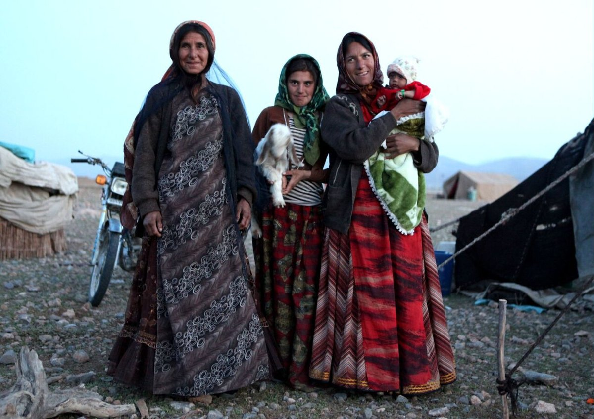

Along the ancestral transhumance migration corridors of southern Fars, where black goat-hair tents (*Bokhcheh*) dot the slopes between Firuzabad and the Zagros steppes, the Qashqai confederacy has preserved a vibrant tradition of animal fables known as *Matallar*. Collected and documented by folklorist Nahid Nowruz Chegini, the story of *Tilki and Dava* (The Fox and the Camel) stands as a foundational moral fable teaching tribal youth the paramount importance of communal integrity over selfish deceit.

The tale takes place during a severe drought along the seasonal migration trail. A starving, cunning fox (*Tilki*) was unable to negotiate a surging river to reach the fertile farmland on the opposite bank. Approaching an experienced, majestic pack-camel (*Dava*) leading the clan's baggage train, the fox employed flattering rhetoric, promising that if the camel carried him across upon its high hump, he would guide the beast to an untouched meadow of sweet wild clover. Trusting the fox's oath of mutual alliance, the benevolent camel carried the fox safely through the roaring currents.

> As the Qashqai elders declare in their customary proverbs: "Though the fox knows a thousand tricks, the camel knows one path that undoes them all; honesty is the heaviest burden of the migration, and the treacherous never walk proud in the tribe."

Once on the opposite bank, however, the ungrateful fox rushed into a private melon patch, gorged himself, and began howling at the top of his lungs. When the bewildered camel asked why he was making such an uproar, the fox mocked him, claiming: "It is my ancient habit to sing loudly after a heavy meal!" Alerted by the noise, armed farm guards rushed out and beat the slow-moving camel with clubs while the nimble fox slipped into a rock fissure. On the return journey, the stranded fox again begged the camel for passage across the torrent. The camel remained silent and allowed the fox onto his hump. When they reached the deepest, most turbulent whirlpool of the river, the camel paused and said: "It is my ancient habit to roll in cool water after enduring a beating!" Dipping his hump beneath the foaming waves, the camel washed the treacherous parasite into the torrent, teaching him an unforgettable lesson in retributive justice.

### Anthropological & Folklore Analysis
The fable demonstrates the core pastoral values of the Qashqai confederacy: steadfast endurance, reciprocal loyalty (*Dozluq*), and the inevitable moral collapse of opportunistic treachery. In nomadic semiotics, the camel symbolizes ancestral dignity, fortitude, and retributive justice, counterbalancing the destructive individualism represented by the predatory fox.

### Archival Sources & Attribution
- **Primary Source:** Tilki and Qarghe Matallari: Qashqai Folkloric Tales, collected and edited by Nahid Nowruz Chegini and Asadollah Mardani Rahimi, Qashqai Publications, Shiraz.
- **Source URL:** https://shiraznashr.blogfa.com/post/69
- **Original Language:** Qashqai Turkic & Persian
- **Image Attribution:** File:Iran (5716622182).jpg | Photographer: Ninara from Helsinki, Finland | License: CC BY 2.0
