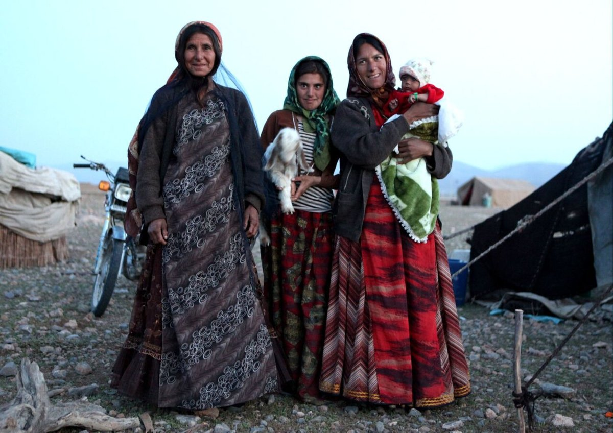

در امتداد ایل‌راه‌های تاریخی فارس، آنجا که چادرهای سیاه‌پشم قشقایی در دامنه‌های فیروزآباد و کوهپایه‌های زاگرس جنوبی برپا می‌شوند، متل‌های حیوانات (متل‌لری) بازتابی خردمندانه از تجربه زیستی عشایر در کوچ‌های دشوار است. در پژوهش‌های ادبیات فولکلوریک قشقایی که توسط ناهید نوروزی چگینی گردآوری شده، متل کهن «تیلکی‌اینن ده‌وه» (Tilki ilə Dəvə؛ روباه و شتر) جایگاهی ویژه در انتقال ارزش‌های اخلاقی ایل دارد.

داستان در خشکسالی بزرگی رخ می‌دهد؛ روباهی گرسنه و حیله‌گر به نام «تیلکی» که توان پیمودن گردنه‌های سخت و گذر از رودخانه طغیان‌گر را نداشت، با چرب‌زبانی و ستایش‌های دروغین به سراغ شتری صبور و کارآزموده به نام «ده‌وه» رفت که کاروان ایل را با وقار هدایت می‌کرد. روباه با وعده اینکه شتر را به مزرعه‌ای پر از یونجه و خارشترهای آبدار در آن‌سوی رود رهنمون خواهد شد، از او التماس کرد تا وی را بر کوهان بلند خود سوار کرده و از امواج خروشان آب عبور دهد. شتر مهربان فریب زبان چرب او را خورد و روباه را بر پشت گرفت و با گام‌های استوار از رودخانه پرخروش گذراند.

> قاشقایی‌ها در زبان تمثیل و متل می‌گویند: «تیلکی مین کَلَک بیلسه، ده‌وه بیر یول بیلر کی هامیسینی پوزار؛ دوزلوک کؤچون ان آغیر یوکودور و خائن هئچ زامان ایل ایچینده باش اوجالدا بیلمز.» (روباه اگر هزار نیرنگ بداند، شتر یک راه بلد است که همه را نقش بر آب می‌کند؛ صداقت سنگین‌ترین بار کوچ است و خیانتکار هرگز در ایل سرافراز نمی‌ماند).

اما چون به ساحل امن رسیدند، روباه به جای وفای به عهد، به باغ صیفی‌جات مجاور تاخت، هندوانه‌های رسیده را درید و سیر شد. سپس با صدای بلند شروع به عوعو کردن کرد تا دشتبانان با چوب و چماق سر برسند. هنگامی که شتر با حیرت پرسید چرا چنین می‌کنی، روباه با تمسخر گفت: «عادت من بعد از سیر شدن آواز خواندن است!» دشتبانان سر رسیدند و شتر بی‌گناه را با چوبدستی نواختند، در حالی که روباه در سوراخی پنهان شد. در راه بازگشت، روباه دوباره از شتر خواست او را از رودخانه عبور دهد. شتر خاموش ماند، روباه را بر کوهان نشاند، اما چون به میانه عمیق‌ترین و سهمگین‌ترین گرداب رسید، به روباه گفت: «عادت من هم بعد از خستگی، غلتیدن در آب زلال است!» شتر در آب غوطه‌ور شد و روباه فریبکار در امواج سهمگین گرفتار آمد و به سختی جان به در برد. این افسانه تا امروز نماد پیروزی شکیبایی بر فریبکاری در ایل قشقایی باقی مانده است.

### بن‌مایه‌ها و ویژگی‌های مردم‌شناختی
این متل اصیل قشقایی تجسم جهان‌بینی عشایری در باب وفای به عهد، مذمت بی‌چشم‌ورویی، و مرزبندی اخلاقی میان دانایی حقیقی (Wisdom) و فریبکاری کوته‌بینانه (Cunning) است. شتر در فرهنگ قشقایی نماد پایداری، وقار و سنگینی منش ایلیاتی، و روباه تجلی رندی فرصت‌طلبانه است که سرانجام در برابر عدالت طبیعت به زانو درمی‌آید.

### منابع و پژوهش
- **منبع اصلی:** تيلكي‌اينن قارغا متللري (داستان‌هاي فولكلوريك قشقايي)، گردآوری و ترجمه ناهید نوروزی چگینی، ویراسته اسداله مردانی رحیمی، انتشارات قشقایی شیراز.
- **پیوند مرجع:** https://shiraznashr.blogfa.com/post/69
- **زبان اصلی متن:** ترکی قشقایی و فارسی
- **تصویر:** File:Iran (5716622182).jpg | عکاس: Ninara from Helsinki, Finland | مجوز: CC BY 2.0
