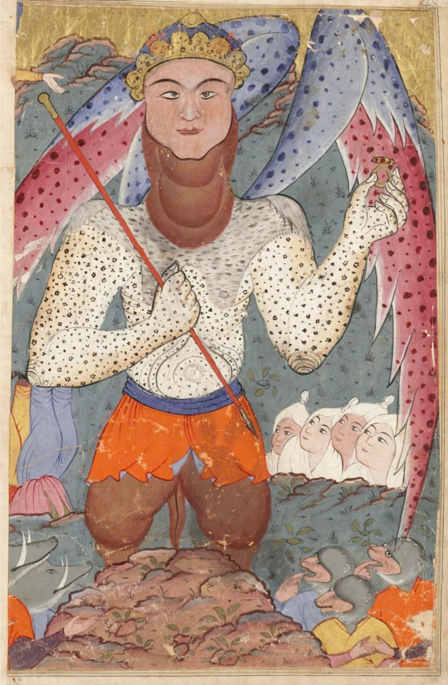

Preserved across centuries within the rich oral folklore of **Gilan** (encircling the historical domains of **رشت / لاهیجان**), the legendary lore of **Al** stands as a compelling testament to Iran's enduring mythic imagination. Transmitted across hearths, mountain paths, and rural caravans, the tale has survived through the living memories of local elders.

Folklorists generally categorize **Al** within the mythological taxonomy of *موجود افسانه‌ای*. As with many traditional entities of Iranian folk belief, it embodies both the untamed natural elements and the ancestral anxieties regarding solitary wilderness. Classical collectors recorded its traditional traits as follows:

> "Mother of the Sea Illustration by Erfan Aghvami … https://en.wikipedia.org/w/index.php?title=Al_(folklore)&oldid=303104784"

In local oral tradition, an encounter with **Al** was regarded as a formidable threshold between familiar domestic reality and the unseen realm. Elders customarily advised night travelers, shepherds, and caravan drivers traversing the historic passes of Gilan to heed ancient apotropaic rituals—such as carrying iron amulets, maintaining solemn reverence towards nature, and never uttering provocative words—to pass through its territorial domain unharmed.

Today, the chronicle of **Al** forms an invaluable component of Iran's intangible cultural heritage, offering modern readers an evocative window into how ancient communities interpreted their ecology, mystery, and moral balance.

---

### Sources & Image Attribution
- **Folklore Research & Origin:** Sourced and adapted from the Eranshahr Folklore Archive (`eranshahr.com/myths`) and regional oral narratives of Gilan.
- **Visual Artifact:** *"16th-century Persian miniature of Dabbat al-Ard (the Beast of the Earth). Dresd. Eb. 445.jpg"*, sourced via Wikimedia Commons, contributed by Unknown author, licensed under `Public domain` ([Source Link](https://commons.wikimedia.org/wiki/File:16th-century_Persian_miniature_of_Dabbat_al-Ard_(the_Beast_of_the_Earth)._Dresd._Eb._445.jpg)).