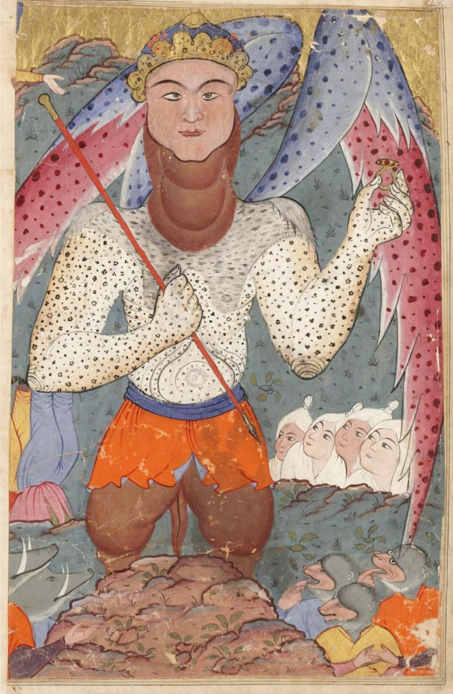

در یادمان‌های شفاهی و باورهای عامیانه‌ی مردم **گیلان** (به‌ویژه در گستره‌ی **رشت / لاهیجان**)، روایت‌های پرشماری از پدیده‌ای شگفت و موجودی دیرپا به نام **«Aal آل»** سینه به سینه از روزگاران باستان تا کنون بازگو شده است. راویان بومی که با گویش و لهجه‌ی **گیلکی** به نقل قصه‌ها می‌نشستند، پیدایش این پدیده را با کوهساران، دشت‌های بی‌کران، جنگل‌ها یا آب‌های مرموز این خطه پیوند می‌زدند.

در طبقه‌بندی فرهنگ عامه، **Aal آل** را غالباً با تیره‌ی *موجود افسانه‌ای* هم‌بسته می‌دانند؛ چهره‌ای که تجسم نیروهای ناشناخته‌ی اقلیم و جهان نادیدنی پیرامون نیاکان بوده است. در توصیف‌ها و متون بازمانده‌ی پژوهشی پیرامون این افسانه آمده است:

> «آل از ریشه کلمه ی «اَلْـ بَستی»، از ریشۀ ایرانی و به معنی سرخ است در باور های عوام در صحراها و چشمه ها زندگی میکند روایت آل بدین گونه است که تا زمانی که زائو به حمام نرفته و ناپاک است، معمولاً تا شش روز یا ده روز پس از زایمان، اگر تنها بماند آل از دیوار خانه یا راهِ پشت بام یا پنجره و روزن و درِ اتاق، به سراغش می‎ آید و جگرش مادر را با خود می‎برد. اگر آل بتواند جگر زن تازه‌زا را به آب برساند و یا از آب بگذراند، سبب بیماری و حتیٰ مرگ او می‎شود. زائویی که آل جگرش را زده و برده اصطلاحاً «آل‌زده» و آشفتگی ناشی از آن را «آل‎زدگی» می‎نامند. گاهی نیز ممکن است آل «جفت بچه» را ببرد. اگر آل جفت بچه را هم ببرد و بخورد، می‎گویند که زائو به بیماری آل‎زدگی دچار می‎شود. برخی از مردم جامعه‎ های باستانی به موجودات وهمی و خبیثۀ تقریباً شبیه آل، مانند «اَلو»، «لَمَشْتُو» و «لی لیث» اعتقاد می‎داشتند. برخی دیگر آل را با «ام‎الصبیان» اشتباه گرفته و تصور کرده‎اند که آل نوزاد را هم می‎زند و می‎برد یا به او آسیب می‎رساند؛ از این‎ رو برای حفظ نوزاد از آل‎زدگی نیز چاره‎ اندیشی کرده‎ اند. برای مثال مردم اهل همدان دو گهواره مانند هم درست می‎کنند و در اتاق زائو می‎گذارند تا آل از شناسایی نوزاد درماند و دچار اشتباه شود. خراسانیها هفت سوزن به لچک نوزاد و هفت سوزن به لچک زائو می‎زنند و به این وسیله از نزدیک شدن آل به زائو و نوزاد جلوگیری می‎کنند و در شبِ ششِ زائو صورت و بدن نوزاد را با سوختۀ باروت، سیاه می‎کنند تا آل از سیاهی و زشتی روی نوزاد بترسد و به او نزدیک نشود. زنی است که دستهای باریکِ بلند دارد، و پایش هم استخوان فقط است و گوشت هیچ ندارد، رنگ چهره‎اش قرمز می‎باشد و بینی او از گِل» (خوانساری، کلثوم‌ننه، ۱۶۹) و یا از خمیر (اسدیان و دیگران، باور ها و دانسته ها در لرستان و ایلام) است. چشمانی درشت، موهایی سفید (بلوکباشی، فرهنگ عامه ۵۹۰) و یا سرخ (اسدیان و دیگران، ۱۶۶)، بینی قرمز رنگ (ساعدی، خیاو یا مشکین شهر، ۱۴۲) آل (افسانه) - ویکی‌پدیا، دانشنامهٔ آزاد (wikipedia.org) آل، موجود | دائرةالمعارف بزرگ اسلامی | مرکز دائرةالمعارف بزرگ اسلامی (cgie.org.ir) جمال خوانساری، کلثوم‌ننه»

پیران و ریش‌سفیدان منطقه در شب‌نشینی‌ها گوشزد می‌کردند که رویارویی با **Aal آل** همواره نشانه‌ای از لزوم هشیاری در برابر ناشناخته‌های طبیعت بوده است. در اعصار گذشته، مسافران، شبانان و کاروانیانی که شب‌هنگام در این نواحی گذر می‌کردند، برای مصون ماندن از گزند یا فریب این موجودات، آیین‌ها و دعاهای محافظتی خاصی را به کار می‌بستند و از شکستن سکوت شب یا نزدیک شدن به زیستگاه‌های آنان پرهیز می‌کردند.

امروزه داستان **Aal آل** یکی از گنجینه‌های ماندگار میراث معنوی و مردم‌شناسی دیار **گیلان** به شمار می‌رود که پیوند عمیق روان‌شناختی انسان کهن را با رمزورازهای زیست‌بوم سرزمین ایران به تصویر می‌کشد.

---

### منابع و اعتبار تصویر
- **پژوهش و خاستگاه روایت:** برگرفته از دانشنامه فولکلور و اسطوره‌شناسی ایران‌شهر (`eranshahr.com/myths`) و روایت‌های شفاهی بومی گیلان.
- **تصویر:** اثر *«16th-century Persian miniature of Dabbat al-Ard (the Beast of the Earth). Dresd. Eb. 445.jpg»*، بارگذاری‌شده در ویکی‌انبار (Wikimedia Commons)، پدیدآورنده: Unknown author، تحت مجوز آزاد `Public domain` ([مشاهده منبع](https://commons.wikimedia.org/wiki/File:16th-century_Persian_miniature_of_Dabbat_al-Ard_(the_Beast_of_the_Earth)._Dresd._Eb._445.jpg)).