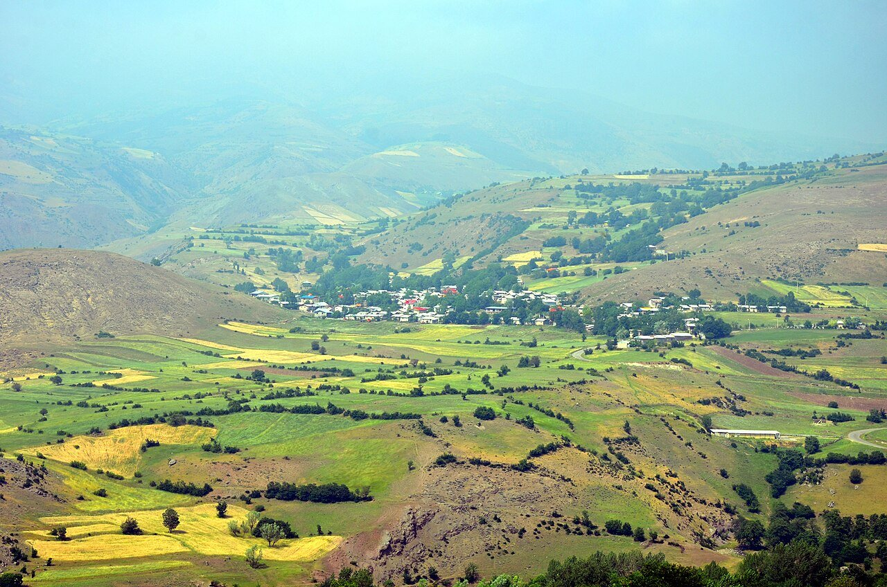

Amidst the primeval Hyrcanian cloud forests and moss-draped slopes of Deylaman in Gilan, the veteran *Galesh* pastoralists recount the legend of *Chamoosh*—the fiery-maned, untamed phantom steed of the northern highlands. Chamoosh is a magnificent creature whose hooves have never touched an iron shoe and whose broad back has never yielded to a saddle. Far from an ordinary stallion, it is revered as the wild guardian spirit of the ancient Caspian forests, appearing only on autumn nights enveloped in thick highland mists.

Deylami oral lore depicts Chamoosh as a silvery-gray steed with luminous, torch-like eyes that pierce the darkness of the beechwoods. As the protector of wild alpine herds, Chamoosh charges down when wolves or leopards threaten the livestock, its thunderous hooves scattering predators across the ridges. Yet, should an avaricious herder approach with lasso and bridle seeking to subjugate this noble beast, Chamoosh snorts a gale from flaring nostrils, knocking the hunter to the sodden forest floor before vanishing into the fog without leaving a single print.

> "Seek not to bind Chamoosh with ropes; he is the mount of Deylaman’s free winds. Gaze into his eyes with a pure heart and he offers protection, but cast a tether and he flings you into the abyss." — Ancient adage of the Galesh elders.

Renowned northern folklorist Ali Abdoli in *Culture and Legends of Talesh and Deylaman* observes that the Chamoosh myth reflects the legendary cavalry traditions of the ancient Deylamite warriors who defended these rugged passes against foreign empires. The phantom stallion stands as an enduring emblem of the fierce autonomy of the mountain people of Gilan. The echoing rumble of wild horses galloping through the mist of Deylaman continues to evoke the unyielding spirit of Chamoosh.

### Sources & Image Attribution
- **Research Source:** Ali Abdoli, *Culture and Legends of Talesh and Deylaman*, Tehran, pp. 119-125; Asadollah Emadi, *Myths of Deylam and Tapur*, p. 76.
- **Image Attribution:** Documented on Wikimedia Commons by Alireza Javaheri; License: [CC BY 3.0](https://commons.wikimedia.org/wiki/File:Deylaman_-_Arushaki_-_panoramio.jpg).
