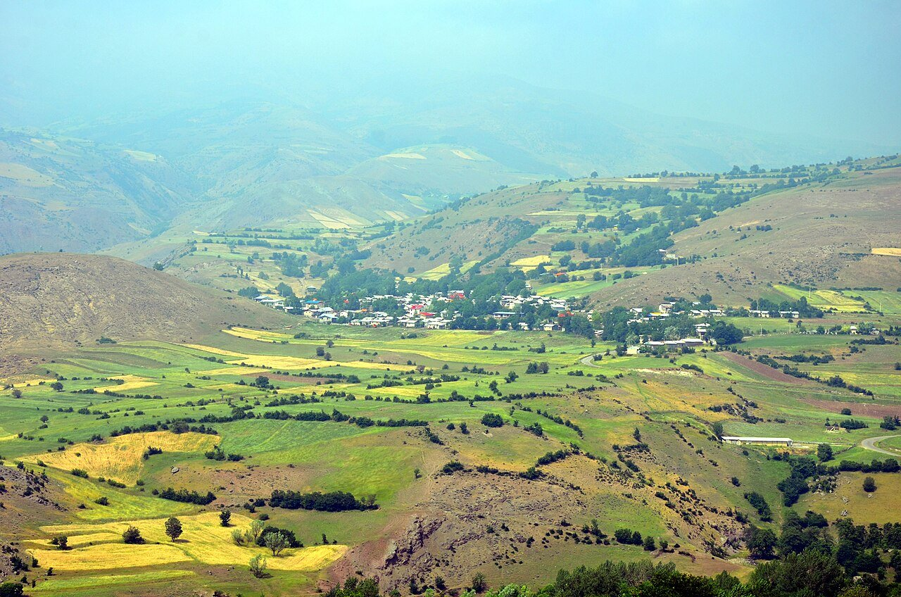

در جنگل‌های باستانی هیرکانی و دامنه‌های مه‌آلود دیلمان در گیلان، گالش‌ها و دامداران کهنسال از اسبی آتشین‌یال و وحشی به نام «چَموش» یاد می‌کنند. چموش اسبی است که سم‌هایش هرگز به نعل کشیده نشده و هیچ سوارکاری نتوانسته است زین بر گرده‌ی او بنهد. او نه یک مادیان یا نریان معمولی، بلکه روحی آزاد و سرکش از کهن‌جنگل‌های تپورستان است که تنها در نیمه‌شب‌های پاییز و در میان مه غلیظ راشستان‌ها بر دامداران شجاع پدیدار می‌شود.

روایت گیلکی دیلمی بازگو می‌کند که چموش به رنگ خاکستری مایل به نقره‌ای است و چشمانش چون دو مشعل در تاریکی جنگل می‌درخشد. او پاسدار گله‌های اسب‌های وحشی البرز است و هرگاه گرگی درنده یا پلنگی به گله‌های رمه‌داران دستبرد بزند، چموش با سم‌های پولادین خود صخره‌ها را به لرزه درآورده و درندگان را متواری می‌سازد. با این حال، اگر چوپانی آزمند با کمند و طناب به قصد اسیر کردن چموش نزدیک شود، اسب بادی سهمگین از سوراخ‌های بینی خود می‌دمد، چوپان را بر زمین می‌کوبد و در تاریکی مه‌ها ناپدید می‌گردد، بی‌آنکه رد پایی از او بر خاک خیس جنگل باقی بماند.

> «چموش را به بند مخواه؛ او اسب بادهای دیلمان است. اگر به چشمانش بیاموزی، رامِ صفا می‌شود، اما اگر کمند بیندازی، تو را در ژرفای دره سرنگون خواهد کرد.» — پند کهنسالان گالش در ییلاقات دیلمان.

علی عبدلی، پژوهشگر نامدار فرهنگ تالش و دیلمان، در کتاب «فرهنگ و افسانه‌های تالش و دیلمان» اشاره می‌کند که اسطوره چموش پیوندی ناگسستنی با فرهنگ پرورش اسب در دوران دیلمیان و اشکانیان دارد. دیلمیان به عنوان سوارکارانی شکست‌ناپذیر در تاریخ شناخته می‌شدند و چموش، کهن‌الگوی آرمانی اسب جنگی سرکشی بود که تسلیم بیگانگان نمی‌شد و نمادی از استقلال‌طلبی مردم کوهستان گیلان در طول هزاره‌ها به شمار می‌رفت.

امروزه نیز صدای تاختن اسب‌های وحشی در سکوت شبانه جنگل‌های سیاهکل و دیلمان، برای مردم یادآور افسانه چموش است؛ تجسمی از آزادی بی‌مهار که روح جنگل‌های هیرکانی را زنده نگه داشته است.

گالش‌های کوهستان دیلمان روایت می‌کنند که چموش نه تنها یک اسب، بلکه تجسد بادهای بهاری است که دانه‌های درختان را در جنگل‌های هیرکانی می‌پراکند. در گذشته، رمه‌داران هنگامی که اسبی جوان و تندپا در گله متولد می‌شد، گوش‌های او را با دعای برکت لمس می‌کردند و به او نام چموش می‌نهادند تا شجاعت و آزادگی اسب اساطیری دیلمان در رگ‌های اسب‌های بومی تداوم یابد و هیچ گرگی جرئت نزدیک شدن به گله را پیدا نکند.

### منابع و اعتبار تصویر
- **منبع پژوهشی افسانه:** علی عبدلی، «فرهنگ و افسانه‌های تالش و دیلمان»، تهران، ص ۱۱۹-۱۲۵؛ اسدالله عمادی، «اسطوره‌های دیلم و تپور»، ص ۷۶.
- **اعتبار تصویر:** ثبت‌شده در ویکی‌مدیا کامنز توسط Alireza Javaheri؛ مجوز انتشار: [CC BY 3.0](https://commons.wikimedia.org/wiki/File:Deylaman_-_Arushaki_-_panoramio.jpg).
