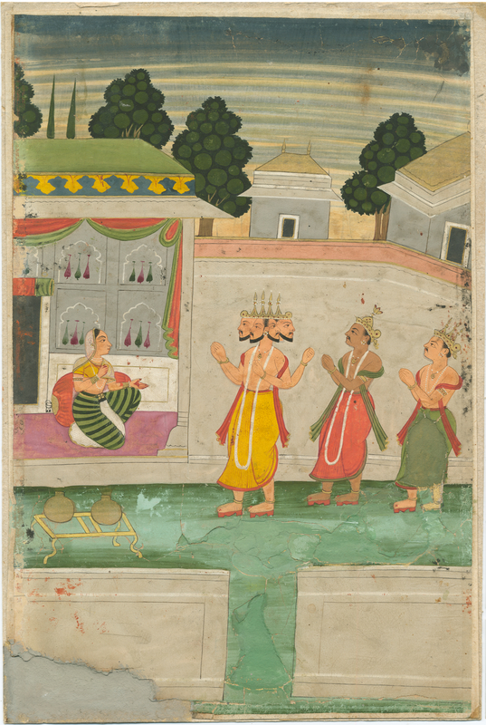

در یادمان‌های شفاهی و باورهای عامیانه‌ی مردم **گیلان** (به‌ویژه در گستره‌ی **رشت / لاهیجان**)، روایت‌های پرشماری از پدیده‌ای شگفت و موجودی دیرپا به نام **«دانا»** سینه به سینه از روزگاران باستان تا کنون بازگو شده است. راویان بومی که با گویش و لهجه‌ی **گیلکی** به نقل قصه‌ها می‌نشستند، پیدایش این پدیده را با کوهساران، دشت‌های بی‌کران، جنگل‌ها یا آب‌های مرموز این خطه پیوند می‌زدند.

در طبقه‌بندی فرهنگ عامه، **دانا** را غالباً با تیره‌ی *Deity* هم‌بسته می‌دانند؛ چهره‌ای که تجسم نیروهای ناشناخته‌ی اقلیم و جهان نادیدنی پیرامون نیاکان بوده است. در توصیف‌ها و متون بازمانده‌ی پژوهشی پیرامون این افسانه آمده است:

> «Daena|دانا|دِئنا|دین دین، یا دِئنا نمود ایزدگونه‌ی وجدان است که انسان به راه راست حدایت میکند.در باور مزدایی برای فرد درست کار این ایزد بانو بر سر پلِ جینود (صراط در اسلام) به گونه‌ی فرشته ای زیبا به همراه سگان و برای فرد نادرست، به گونه‌ی دیوی نمایان میشود.این واژه‌ی اوستایی در سنت هندی به گونه‌ی دِهی نمایان شده و بعد ها به شکل «زِن» هم دیده میشود. منابعایرانیکا»

پیران و ریش‌سفیدان منطقه در شب‌نشینی‌ها گوشزد می‌کردند که رویارویی با **دانا** همواره نشانه‌ای از لزوم هشیاری در برابر ناشناخته‌های طبیعت بوده است. در اعصار گذشته، مسافران، شبانان و کاروانیانی که شب‌هنگام در این نواحی گذر می‌کردند، برای مصون ماندن از گزند یا فریب این موجودات، آیین‌ها و دعاهای محافظتی خاصی را به کار می‌بستند و از شکستن سکوت شب یا نزدیک شدن به زیستگاه‌های آنان پرهیز می‌کردند.

امروزه داستان **دانا** یکی از گنجینه‌های ماندگار میراث معنوی و مردم‌شناسی دیار **گیلان** به شمار می‌رود که پیوند عمیق روان‌شناختی انسان کهن را با رمزورازهای زیست‌بوم سرزمین ایران به تصویر می‌کشد.

---

### منابع و اعتبار تصویر
- **پژوهش و خاستگاه روایت:** برگرفته از دانشنامه فولکلور و اسطوره‌شناسی ایران‌شهر (`eranshahr.com/myths`) و روایت‌های شفاهی بومی گیلان.
- **تصویر:** اثر *«Kneeling woman is greeted by three deities, one of whom is a four-headed man.jpg»*، بارگذاری‌شده در ویکی‌انبار (Wikimedia Commons)، پدیدآورنده: Unknown author Unknown author، تحت مجوز آزاد `Public domain` ([مشاهده منبع](https://commons.wikimedia.org/wiki/File:Kneeling_woman_is_greeted_by_three_deities,_one_of_whom_is_a_four-headed_man.jpg)).