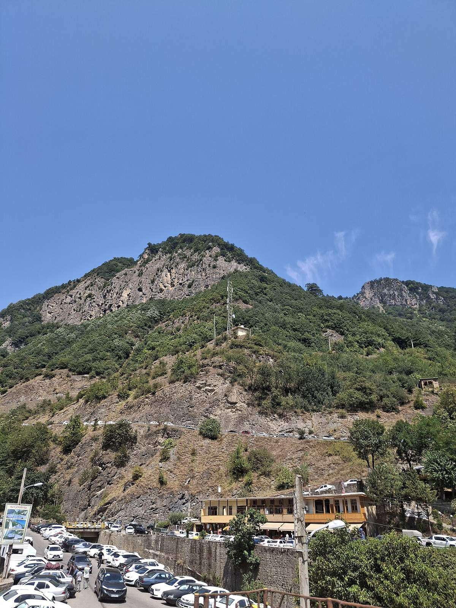

Dense mist often rises like a fleece blanket through the granite chasms of Masouleh-Roudkhan, cloaking the ancient high-altitude pastures where Taleshi pastoralists have grazed their flocks for millennia. In regional oral traditions, no names evoke greater respect than the two brothers, Ledo and Mamoud, and their intrepid sister, Zibar. Together, they led the seasonal transhumance of their clan, driving thousands of sheep, goats, and horses between the coastal lowlands of Gilan and the windswept mountain pastures known as *Gireyeh*.

Zibar was revered far beyond her domestic duties for her peerless mastery of the *Laleh*, the sacred reed flute of the Talesh highlands. It was believed across the ridges that the mountain winds carried her melodies directly into the spirits of the herds. At dawn, her soothing notes guided the flocks into the alpine meadows; at twilight, her twilight calls gathered the scattered animals safely back to the stone corral (*Sera*). 

> In the ancient memory of the Talesh shepherds: "Zibar's breath through the reed pipe held the heart of the herds; whenever her melody rose, neither storm nor beast dared harm the camp."

One sweltering summer afternoon, while the clan was stationed on the high plateau, Ledo and Mamoud descended deep into the riverbed of Baskameh to fetch salt blocks and winter flour, leaving Zibar alone guarding the seasonal tents. A ruthless band of lowland raiders, aware of the brothers' absence, crept up the ravine to plunder the unprotected livestock. Instead of fleeing into the crags, Zibar climbed atop an imposing granite outcrop overlooking the pass and pressed the *Laleh* to her lips. 

Rather than playing the gentle pasture hymn, she blew the piercing, resonant notes of *Kall-e Sar*—the ancient alarm tune that cuts through alpine winds. Echoing from cliff to cliff across the gorge, the urgent sound reached Ledo and Mamoud miles below. Recognizing their sister's clarion call, the brothers raced up the rocky slopes wielding heavy seasoned oak staves. Caught between the furious counterattack of the two brothers and heavy boulders rolled down by Zibar from the ridge above, the raiders scattered in terror. The siblings' triumph solidified an enduring regional archetype celebrating pastoral loyalty, musical communion with nature, and feminine fortitude in the Alborz mountain chain.

### Anthropological & Folklore Analysis
The tale reflects key structural components of Talesh cultural identity: the functional role of the *Laleh* flute as an acoustic early-warning and herd-management system, the active defensive role of women in high-altitude pastoralism, and the sacred code of sibling solidarity (*Baravari*) in harsh geographical environments.

### Archival Sources & Attribution
- **Primary Source:** Taleshi Oral Narratives of Masouleh-Roudkhan, documented by local cultural ethnographers in the Kadosian Folklore Archive.
- **Source URL:** https://kados2.blogfa.com/tag/%D8%AA%D8%A7%D9%84%D8%B4%D9%87-%D9%86%D9%82%D9%84
- **Original Language:** Taleshi & Persian
- **Image Attribution:** File:20250808 Masuleh mountains.jpg | Photographer: PAper GOL | License: CC BY 4.0
