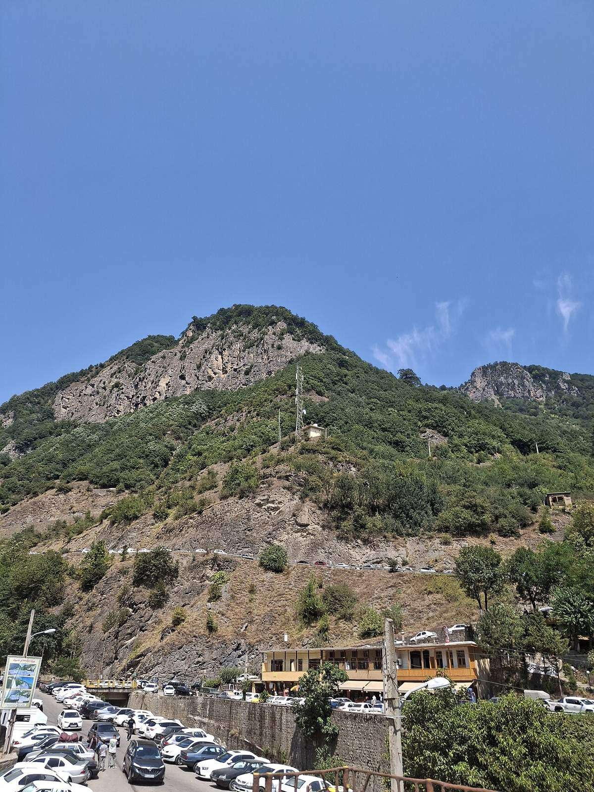

مه غلیظی که از شکاف صخره‌های ماسوله‌روخان بالا می‌خزید، دامنه‌های ییلاق را در سپیدی پنبه‌گونی فرو می‌برد؛ جایی که در روزگاران کهن، نام دو برادر مالدار به نام‌های «لێدو» (Ledo) و «مه‌مود» (Mamoud) با شجاعت و دلاوری در ایل تالش گره خورده بود. این دو برادر همراه با خواهر شیرزن خود «زیبه‌ر» (Zibar)، زندگی خویش را بر مدار کوچ سنتی می‌گذراندند؛ شش ماه بهار و تابستان را در بلندی‌های «گیرېه» (مرتع کوهستانی) با گله‌های بی‌شمار گوسفند، بز و مادیان سپری می‌کردند و با آغاز سوز پاییز، راهی قشلاق‌های جلگه گیلان می‌شدند. 

در این میان، زیبهر تنها یک بانوی ایلیاتی ساده نبود؛ سرانگشتان او بر نی هفت‌بند بومی تالش یعنی «له‌له» (Laleh)، معجزه‌ای برمی‌انگیخت که آرامش را به جان کوهسار می‌ریخت. صدای نی سحرانگیز او چنان زلال و گیرا بود که گوسفندان و اسبان با نخستین نغمه‌های سحرگاهی‌اش به چراگاه روانه می‌شدند و هنگام غروب، با نوای زیر و بم له‌له به «سِرا» (آغل و بارگاه شبانی) بازمی‌گشتند. 

> تالݖشون زݖبون کو نوم زیبه‌ر، هݖنته چاکه له‌له ژه‌نی کݖ مالموله و خه‌لکې رو ده‌چیندین؛ چه‌وون په‌له‌وونی تالݖش‌ئارا کو نو‌م‌ئاۏازه داری.

در یکی از روزهای گرم تابستان، هنگامی که ایل در مراتع مرتفع اتراق کرده بود، لدو و محمود به قصد تهیه آذوقه و نمک برای دام‌ها، به سوی دره و رودخانه باسکه ره‌بار رهسپار شدند و زیبر در سیاه چادر ییلاق تنها ماند. در غیاب برادران، گروهی از راهزنان جلگه که از حضور گله‌های پرشمار آگاه شده بودند، پنداشتند چادرها بی‌دفاع رها شده است و برای غارت دام‌ها به بالادست هجوم آوردند. 

زیبر به جای گریز و هراس، به بالای صخره‌ای مشرف به دره رفت و نی له‌له خود را بر لب نهاد. او به جای نغمه آرامش‌بخش شبانی، نوای رزمی و هشداردهنده «کَل‌سَر» را با تمام قدرت در شیپور باد دمید. پیچش این صدای سوزناک و رعدآسا در امتداد دیواره‌های صخره‌ای ماسوله، به گوش لدو و محمود در اعماق دره رسید. برادران بی‌درنگ با چوبدستی‌های بلوطین خویش شتابان به گردنه بازگشتند. با یورش دلاورانه برادران و حمایت زیبر که از فراز صخره سنگ‌های عظیم را بر سر متجاوزان فرو می‌ریخت، مهاجمان تارومار شدند و دام‌های ییلاق در امان ماند. از آن پس، مردم تالش وفاداری، پیوند خواهری و برادری و هنر دلاورانه زیبر را به عنوان نماد پایداری کوهستان ثبت کردند.

### بن‌مایه‌ها و ویژگی‌های مردم‌شناختی
این روایت اصیل تالشی بر چند پایه استوار است: جایگاه والا و کنشگر زن در فرهنگ کوچ‌نشینی تالش، قداست ساز سنتی «له‌له» به عنوان زبان ارتباطی میان شبان و طبیعت، و الگوی همبستگی ایلیاتی در برابر گزندهای بیرونی. این افسانه نشان می‌دهد موسیقی در کوهستان کاسپین صرفاً ابزار سرگرمی نبوده، بلکه نقشی حیاتی در امنیت جمعی ایفا می‌کرده است.

### منابع و پژوهش
- **منبع اصلی:** مجموعه روایات شفاهی ماسوله‌روخان، منتشرشده در دانشنامه فرهنگ و تمدن کادوسیان (وبلاگ کادوس ماسوله رودخان).
- **پیوند مرجع:** https://kados2.blogfa.com/tag/%D8%AA%D8%A7%D9%84%D8%B4%D9%87-%D9%86%D9%82%D9%84
- **زبان اصلی متن:** تالشی ماسوله‌ای و فارسی
- **تصویر:** File:20250808 Masuleh mountains.jpg | عکاس: PAper GOL | مجوز: CC BY 4.0
