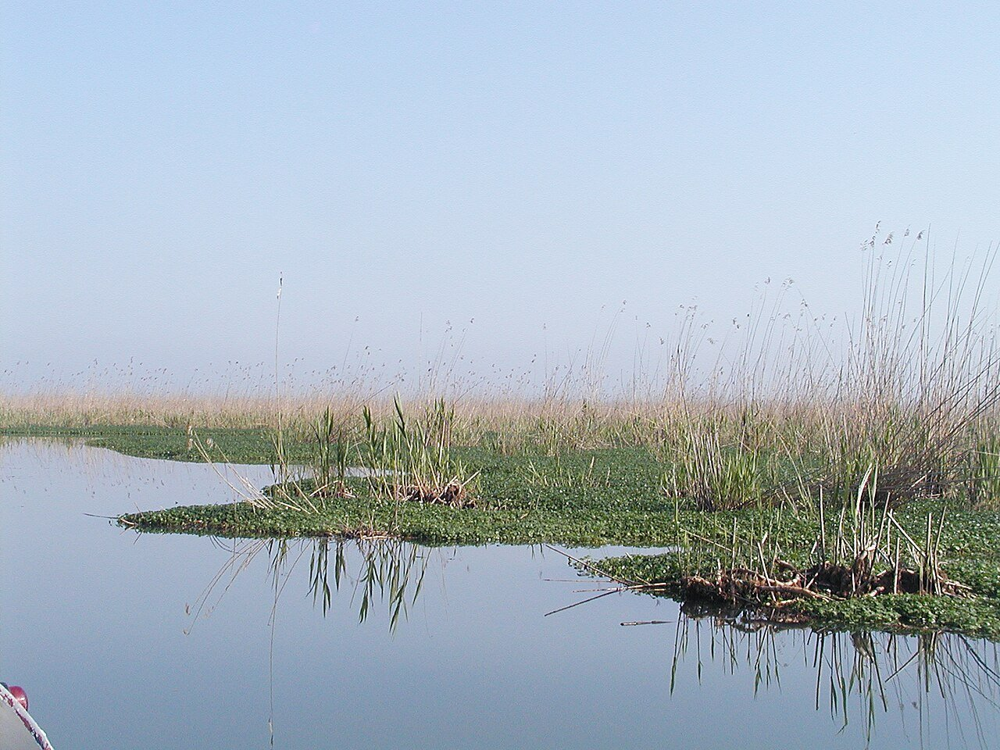

Winding through the maze of floating peat islands and swaying reed marshes of Anzali Lagoon, veteran Gilani fishermen recount encounters with the enigmatic *Mard-e Aabi* (The Blue Water-Man) or the Elder of the Marsh. Depicted as a withered, slender elder with indigo skin mirroring the reflective lake, his beard is composed of tangled water-lily roots and his webbed fingers resemble those of migrating wild swans.

According to folk belief in Bandar Anzali and Abkenar, the Blue Water-Man serves as the mystic warden of Caspian sturgeon and the protected Caspian lotus (*Nelumbo caspica*). Residing beneath the submerged carpet of flora, he manifests only when mortals violate the sanctified laws of the marsh—such as poaching during the spawning season or polluting the creeks. Blowing into hollow reeds, he mimics the distress call of an injured crane; avaricious fishermen lured by the sound find their wooden hulls ensnared by submerged root tangles, marooned forever. Conversely, for impoverished, honest boatmen, he gently herds schools of silvery fish toward their nets.

> "Tread softly upon the marsh mud and grant mercy to the fingerlings; the Blue Water-Man watches beneath the lily pads, knotting the hands of the merciless into the reeds." — Saying of the veteran boatmen of Anzali.

Renowned geographer Dr. Manouchehr Sotoudeh notes in his masterwork *From Astara to Astarabad* that this folklore represents an indigenous conservation ethic cultivated by Caspian coastal communities. Traditionally, fishermen releasing the first catch of the season honored the aquatic entity by returning the largest sturgeon to the waters as the "Offering to the Blue Water-Man." In the misty dawns when the lotuses unfold over Anzali’s ripples, the gentle parting of the reeds is still attributed to the unseen patrol of this primeval marsh warden.

### Sources & Image Attribution
- **Research Source:** Manouchehr Sotoudeh, *From Astara to Astarabad*, Tehran: National Heritage Council, Vol. 1, pp. 245-252; Fereydoun Nowzad, *Gileh-Gab: Folk Culture of Gilan*, p. 304.
- **Image Attribution:** Documented on Wikimedia Commons by No machine-readable author provided. Hara1603 assumed (based on copyright claims).; License: [Public domain](https://commons.wikimedia.org/wiki/File:Anzali_(Iran)-_Lagoon-CaspianSea.JPG).
