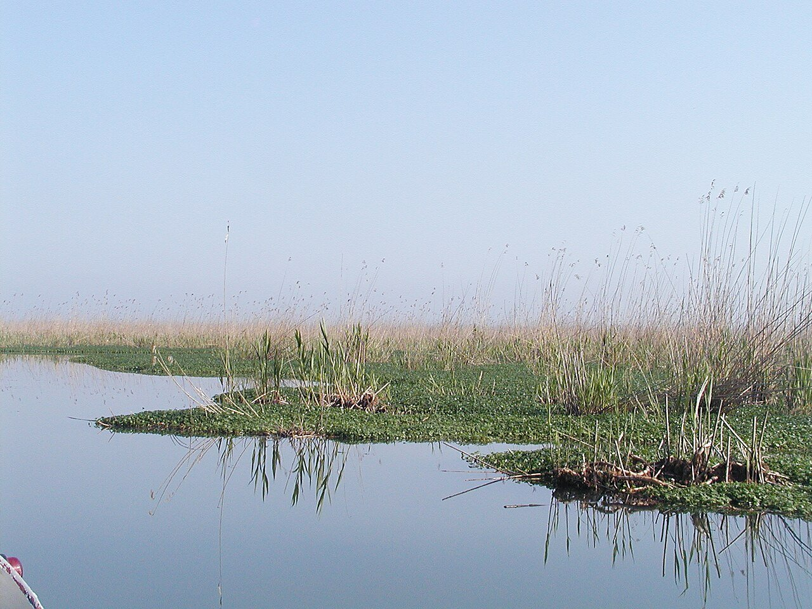

در میان آبراه‌های تودرتو و جزایر متحرک نیزاری در تالاب بین‌المللی انزلی، قایق‌رانان بومی و صیادان کهنه‌کار از موجودی شگفت‌انگیز به نام «مرد آبی» یا «پیر آب» یاد می‌کنند. او پیرمردی باریک‌اندام و کهنسال است که چهره و پوست تنش به رنگ نیلی آب‌های تالاب آمیخته است، موهایی از ریشه‌های شناور نیلوفر دارد و دستانش با پره‌هایی نازک شبیه پای غازهای وحشی پیوند خورده است.

بر اساس باورهای صیادان بندرانزلی و روستای آبکنار، مرد آبی نگهبان قلمرو زیرین تالاب و پاسدار ماهیان خاویاری و لاله تالابی (کاسپین) است. او زیر بسترهایی از جلبک‌ها و گل‌های شناور زندگی می‌کند و تنها هنگامی که صیادان حرمت تالاب را بشکنند—مثلاً با صید بی‌رویه در فصل تخم‌ریزی یا مسموم کردن آب—چهره نشان می‌دهد. مرد آبی با دمیدن در ساقه‌های توخالی نی، صدایی شبیه ناله‌ی پرنده‌ای زخمی سر می‌دهد؛ قایق صیاد طماع در میان ریشه‌های پیوسته گیاهان کف تالاب به دام می‌افتد و قایق‌ران هرگز راه بازگشت به بندر را نمی‌یابد. در نقطه مقابل، اگر صیادی تهیدست و منصف به تالاب آید، مرد آبی ماهیان فراوان را با تکان دادن دستانش به سوی تورهای او هدایت می‌کند.

> «بر گِل تالاب پا مگذار و به ماهیان خرد امان بده؛ مرد آبی زیر لایه‌های مرداب بیدار است و هر دستی را که بی‌رحمانه بر آب کوبیده شود، به ریشه‌های نیلوفر گره خواهد زد.» — متل کهنسالان قایق‌ران در محله شنبه‌بازار انزلی.

دکتر منوچهر ستوده در کتاب بی‌بدیل «از آستارا تا استارباد» یادآور می‌شود که این باور بومی از احترام دیرپای گیلانیان به محیط زیست تالاب و حیات وابسته به خزر سرچشمه می‌گیرد. در روزگاران گذشته، صیادان پس از نخستین صید بزرگ سال، بزرگ‌ترین ماهی را بار دیگر با احترامی آیینی به آب تالاب بازمی‌گرداندند و آن را «سهم مرد آبی» می‌خواندند تا سلامت و برکت سفر را تضمین کنند.

هنوز هم در سحرگاهان که مه‌های غلیظ بر بستر تالاب انزلی می‌نشیند و نیلوفرها شکوفا می‌شوند، بومیان موج‌های آرام میان نیزارها را رد گام‌های مرد آبی می‌دانند که مراقب نفس‌های زندگی در این تالاب اسطوره‌ای است.

قایق‌رانان کهنه‌کار مرداب انزلی حکایت می‌کنند که مرد آبی به هنگام طوفان‌های سهمگین دریای خزر که آب تالاب متلاطم می‌شود، با دستان پره‌دار خویش قایق‌های صیادان فقیر را نگه می‌دارد تا از واژگون شدن در امواج رهایی یابند. این اسطوره زیبا نشان‌دهنده احترام ژرف مردمان ساحل‌نشین گیلان به تالاب به عنوان مادری بخشنده و حیاتی است که روزی‌رسان خانواده‌های صیادان در درازنای هزاره‌ها بوده است.

### منابع و اعتبار تصویر
- **منبع پژوهشی افسانه:** منوچهر ستوده، «از آستارا تا استارباد»، تهران، انجمن آثار ملی، جلد ۱، ص ۲۴۵-۲۵۲؛ فریدون نوزاد، «گیله‌گب؛ فرهنگ عامیانه گیلان»، ص ۳۰۴.
- **اعتبار تصویر:** ثبت‌شده در ویکی‌مدیا کامنز توسط No machine-readable author provided. Hara1603 assumed (based on copyright claims).؛ مجوز انتشار: [Public domain](https://commons.wikimedia.org/wiki/File:Anzali_(Iran)-_Lagoon-CaspianSea.JPG).
