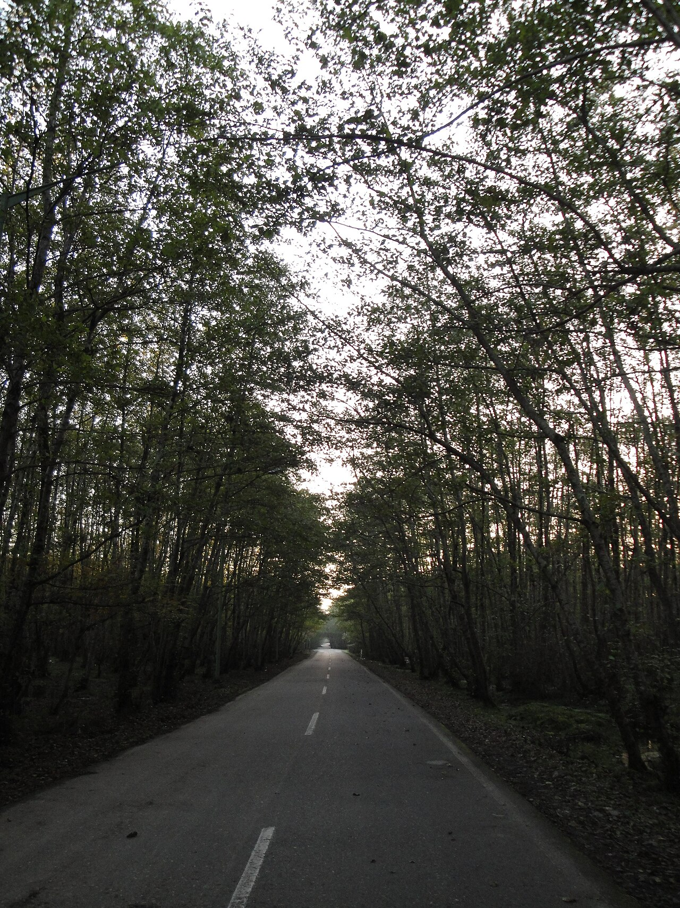

در ژرفای مه گرفته جنگل‌های باستانی هیرکانی، آنجا که شاخسار درختان ممرز و توسکا در هم تنیده و نجوای باران هرگز خاموش نمی‌شود، نامی کهن بر زبان چوپانان و دامداران تالش و گیلان جاری است: «سیاه گالش». در باور دیرین مردم بومی، او چوپانی نامرئی، قدسی و پاسدار بی‌همتای حیات وحش است؛ نگهبان گله‌های گوزن مارال، شوکاهای چالاک، کل و بزهای سرکش و تمامی دام‌های جنگلی که در مهستان‌های کوهپایه می‌چرند. کهنسالان گیلک روایت می‌کنند که سیاه گالش پیکری کشیده و اندامی چابک دارد، جامه‌ای سراسر سیاه از پشم فشرده نمدمالی بر تن می‌کند، پای‌افزاری از چرم گاو (چروک) به پا دارد و عصایی بلند از چوب خرمندی در دست می‌گیرد.

سیاه گالش هرگز به چشم شکارچیان آزمند و بدطینت نمی‌آید؛ اما آنان که با دلی پاک و حرمت به طبیعت گام در جنگل می‌نهند، گاه در سپیده‌دمان یا گرگ‌ومیش غروب، هیبت مه‌آلود او را می‌بینند که پیشاپیش گله‌ای از گوزنان شاخدار گام برمی‌دارد و با نوای سوت سحرانگیزش حیوانات را از پرتگاه‌ها و گزند گرگان دور می‌سازد. گالشان معتقدند گله‌های گوزن و شوکا در حقیقت رمه‌های شخصی سیاه گالش هستند؛ او آنان را همچون گوسفندان خویش می‌دوشد و از شیر معجزه‌آسای آنان پنیری پاکیزه فراهم می‌آورد. هر چوپانی که در نگهداری رمه خویش انصاف به خرج دهد، گوساله‌ای ناتوان را نجات بخشد یا دامی گم‌شده را پناه دهد، شب‌هنگام با نوازش دستی گرم و نادیده روبه‌رو می‌شود و بامدادان کاسه‌های شیرش سرشار از کره‌ای زرین و برکتی بی‌پایان خواهد بود.

> پیران تالش همواره به جوانان پند می‌دهند: «به شاخ گوزن تیر نیندازید و ماده‌شوکا را هراسان نسازید؛ جنگل بی‌صاحب نیست و قهرِ سیاه گالش تیر شکارچی را به سوی سینه خودش بازمی‌گرداند.»

افسانه‌ها حکایت از شکارچی سنگدلی دارند که در ییلاقات اسالم سوگند یاد کرده بود بزرگ‌ترین مرال کوهستان را از پای درآورد. او در شبی بارانی، رد گوزنی سپیدپیکر را پی گرفت و تیر در کمان نهاد. ناگهان صاعقه‌ای در میان درختان درخشید، مه غلیظی زمین را پوشاند و قامت مهیب سیاه گالش در برابرش پدیدار گشت. چوپان قدسی چشمانش چون زغال گداخته می‌سوخت و تازیانه‌ای از ریشه‌های رونده درختان در هوا چرخاند. شکارچی با دیدن آن هیبت از وحشت بر زمین افتاد؛ تپانچه‌اش در دستانش تبدیل به چوبی پوسیده شد و زبانش بند آمد. او روزها سرگردان در بیشه‌ها گریست تا سرانجام چوپانان محلی او را در حالی که جز تکرار نام سیاه گالش سخنی بر زبان نمی‌آورد، نجات دادند. از آن پس، هیچ شکارچی جرئت نکرد بدون نذر کردن برای بینوایان یا درود فرستادن بر ارواح پاکبان جنگل، تفنگ بر دوش اندازد. سیاه گالش تا به امروز نیز در عمق خاموش بیشه‌ها بیدار است و هر نسیمی که در دل بلوطستان‌های شمال می‌پیچد، طنین گام‌های اوست که زمین خسته را پاسداری می‌کند.

### منبع روایت و تصویر
- **خاستگاه افسانه:** فولکلور شفاهی تالش و گیلان، اقتباس از باورهای دامداران گالش البرز شمالی و متون مردم‌شناسی پژوهشکده گیلان‌شناسی.
- **عکاس / پدیدآورنده تصویر:** Pesare amol
- **منبع تصویر:** [صفحه تصویر در ویکی‌انبار](https://commons.wikimedia.org/wiki/File:Gisoum-forest-2.JPG)
- **نوع مجوز:** CC BY-SA 3.0
