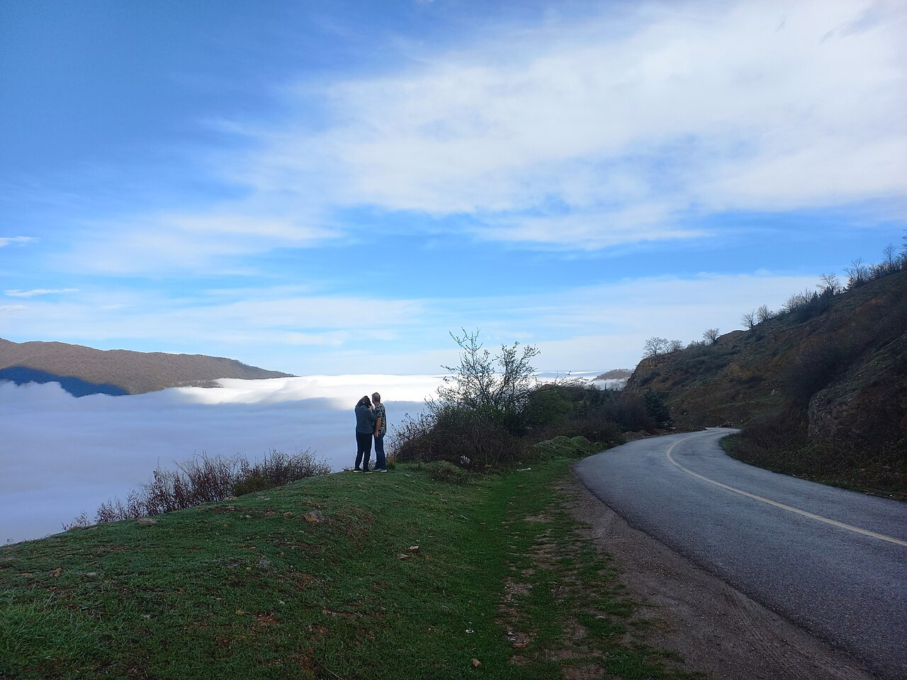

بر فراز قله‌های مهین و مه‌اندود شهرستان رامیان در استان گلستان، دیواره‌ای صخره‌ای و تخت به رنگ خاکستر و سرخ سر به آسمان ساییده است که آن را «قلعه ماران» (یا قلعه میران) می‌خوانند. این کوهستان با قله مسطح سه کیلومتری‌اش، بیشتر اوقات در دریایی مواج از ابرهای سپید غوطه‌ور است، گویی جزیره‌ای اسرارآمیز در آسمان معلق مانده است. در افسانه‌های کهن استرآباد و ایل قزلباش رامیان، این دژ مرتفع نه جایگاهی عادی، بلکه زادگاه مارهای بالدار، آشیانه اژدهای کوهستان و قلمرو طلسم‌شده پادشاه مارها به شمار می‌رود که از گنجینه‌های پیشدادیان در اعماق غارهای صخره حراست می‌کند. این کوهستان صخره‌ای چنان شیب‌های تندی دارد که در باور عامه تنها شاهین‌ها و مارهای بالدار توان رسیدن به ستیغ آن را دارند.

نام «ماران» در حافظه تاریخی مردمان رامیان تنها یک نام جغرافیایی نیست، بلکه بازتابنده باوری ریشه‌دار است؛ می‌گویند در شکاف سنگ‌ها و چاه‌های تاریک بالای کوهستان، مارهایی سیاه با خال‌های زرین لانه دارند که به هیچ انسانی گزند نمی‌رسانند مگر آنکه بیگانه‌ای به قصد غارت خاک پاک قلعه بدان پای نهد. کهنسالان روستای «پاقلعه» نقل می‌کنند که در زمستان‌های سخت، اژدهایی خفته در تالارهای زیرزمینی قلعه با دمیدن نفس آتشین خویش برف‌ها را آب می‌کند و چشمه‌های جوشان پیرامون دژ را گرم نگه می‌دارد. این اژدها، روزگاری هم‌پیمان سرداران بومی بود و هرگاه سپاهیان متجاوز آهنگ صعود به قله می‌کردند، دیواری انبوه از مه و بادهای گزنده پیرامون صخره‌ها برمی‌انگیخت تا راهپیمایان در دره‌های پرشیب سرنگون شوند.

> رامیانی‌ها به مسافرانی که قصد شب‌مانی در قله را دارند هشدار می‌دهند: «اگر در دل شب نوای زنگوله شنیدید، سر از چادر بیرون نیاورید؛ این کاروان مارهای نگهبان است که طلاهای نذر شده را به قعر چاه اژدها می‌برد.»

روایتی مشهور در میان چوپانان محلی از جوانی جویای نام بازگو می‌شود که برای ربودن «مهره مار زرین» از کوه بالا رفت. او پس از پیمودن پرتگاه‌های مرگبار، در میانه دشت مسطح بالای قلعه به چشمه‌ای زلال رسید که تخته‌سنگی مدور در میان آن قرار داشت. بر روی سنگ، ماری تنومند با تاجی از خزه زمردین چنبره زده بود. همین که جوان دست به سوی سنگ برد، زمین لرزید و مارهای بی‌شماری از لابه‌لای صخره‌ها سر برآوردند، بی آنکه نیش زنند، حلقه‌ای نفوذناپذیر بر دور او بستند و او را سه شبانه‌روز در سرمای مه حبس کردند تا توبه کند و پیمان بندد که هرگز سودای غارت کوهستان را در سر نپروراند. قلعه ماران با دیواره‌های عمودی و مه باشکوه‌اش، هنوز هم راز سر به مهر مارهای افسانه‌ای خویش را در دل البرز خاوری زنده نگاه داشته است.

### منبع روایت و تصویر
- **خاستگاه افسانه:** روایت‌های بومی مردم رامیان و روستای پاقلعه گلستان، فولکلور مارهای نگهبان در متون اسطوره‌شناسی گرگان و استرآباد.
- **عکاس / پدیدآورنده تصویر:** Diamoldco
- **منبع تصویر:** [صفحه تصویر در ویکی‌انبار](https://commons.wikimedia.org/wiki/File:Ramian_Golestan_Iran_01.jpg)
- **نوع مجوز:** CC0 (Public Domain)
